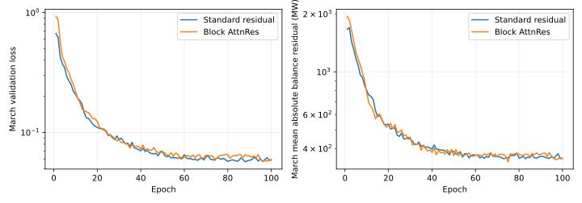

# Attention Residuals transformer clearing trial

The linked [Kimi Attention Residuals paper](https://arxiv.org/abs/2603.15031) replaces fixed residual accumulation with token-dependent softmax attention over earlier depth representations. We implemented its **Block AttnRes mechanism** for the 48-zone screen: each of four blocks has zone self-attention and an MLP, and a learned pseudo-query selects among the embedding and completed preceding blocks before each sublayer. The standard comparison has four conventional transformer blocks with the same width (64), four heads, input features, output heads, optimizer and training budget. This is an adaptation of one Kimi mechanism, **not** a reproduction of Kimi K3's large MoE, KDA or language-model training system. The provided social-media article was cross-checked against the primary paper's block pseudocode.

The trial also corrects a material defect in the previous 12-epoch screen: the aggregate generation cap had included emergency-offer capacity. Both candidates now use **non-emergency** zonal offer availability, source technology features and an aggregate feature from the retained **fitted hourly offer costs**. Generation and independent-corridor outputs are bounded by sigmoid heads. Neither candidate runs a projection, LP or Newton solve at inference. Neither enforces joint PTDF rows, generator-technology bounds or storage chronology. The accepted LP's fixed-hydro-adjusted load is used, not raw ENTSO-E demand.

## Protocol and result

Both candidates use [AURORA](https://github.com/tilde-research/aurora-release) for matrix weights and AdamW for other parameters, the same random seed, 100 epochs, batch size 128 and loss weights. Training uses 1 January–15 March 2025 (1,776 hourly examples); 16–31 March (384 hours) selects the lowest validation-loss checkpoint; all 720 April hours are held out from **network training and checkpoint selection**. The accepted 2025 bids and LP teacher were fitted retrospectively, so this is a teacher-transfer test, not a held-out market forecast. The loss penalizes LP zonal generation, LP zonal prices and modeled zonal imbalance. The target physical LP itself uses a different, joint PTDF network and 799 offer columns; its exact interconnector flows cannot be interpreted as independent-corridor labels.

| 100-epoch result | Standard residual | Block AttnRes |
| --- | ---: | ---: |
| Best March validation epoch / loss | 88 / 0.05694 | 96 / 0.05776 |
| CPU training time | 302.5 s | 850.0 s |
| April 720-hour one-pass inference | 0.189 s | 0.591 s |
| April zonal generation MAE versus LP | 0.978 GW | 0.974 GW |
| April zonal price MAE versus LP | 15.58 €/MWh | 16.04 €/MWh |
| April mean absolute zonal-balance residual | 510 MW | 548 MW |
| April maximum zonal-balance residual | 9,645 MW | 8,428 MW |
| Aggregate generation / independent-corridor bound violation | 0 / 0 MW | 0 / 0 MW |

The 12-epoch pilot was too short: both longer runs continued improving far beyond it. Because the emergency-capacity and bid features changed, its errors are **not a matched 12-versus-100 learning-curve comparison**. On the matched 100-epoch test, Block AttnRes did not improve March validation loss, April price error or mean balance error; its small generation gain and lower maximum imbalance are insufficient for a clearing claim. AURORA was held fixed, so these results isolate the architecture more than the optimizer. One seed and one width remain a limitation.

Both networks can output within individual bounds in substantially less than a second for April, but **neither gives feasible zonal balance**, let alone the accepted joint physical constraints. The April price number compares to the LP teacher, not directly to observed ENTSO-E prices. No changed-asset, storage or investor-value result was run. Keep this as a research diagnostic, not an accepted baseline or public scenario estimator.

## Reproduction and next step

The [script](../baselines/compact/transformer_screen_trial.py) was run in the CPU PyTorch 2.15 environment with `OPENBLAS_NUM_THREADS=1` and `--epochs 100 --architectures standard attnres --optimizers aurora`. The [per-epoch CSV](data/attnres-transformer-learning-2025.csv) has all 100 validation points for each model. The [receipt](data/attnres-transformer-trial-2025.json) contains output metrics and SHA-256 identities for the ignored training log, retained LP witness and fitted costs. The original large arrays remain ignored. Source [AURORA](https://github.com/tilde-research/aurora-release) is separately MIT-licensed and vendored with its license.

The next architecture experiment should enforce zonal balance **by its output parameterization**, without a post-hoc solver, then test whether it can also preserve generation and corridor bounds under changed assets. If it cannot, report the infeasible-hour distribution and retain the LP for results that require a physical certificate. A 100-epoch training curve alone cannot establish scenario-response validity.
