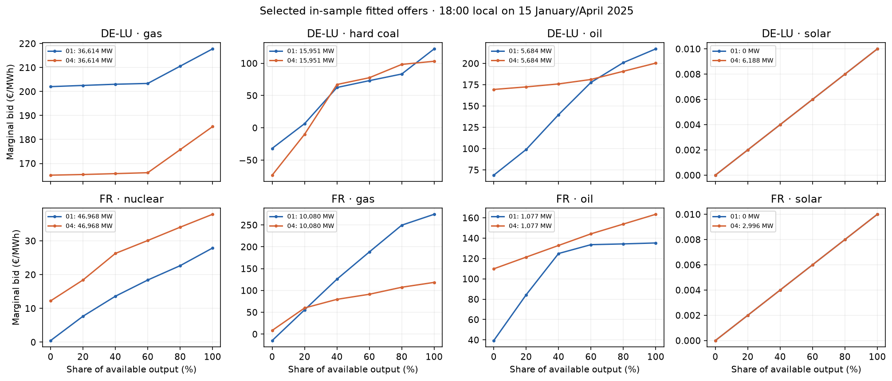

# Ten-update bid and price multistart pilot

This **January/April numerical pilot** combines four predeclared monotone
starting supply curves with a model-only price-root fallback in the LP-free
48-zone batched transport model. Each case fits ten Adam0.5 updates on its
own month's corrected hourly ENTSO-E prices and Ember monthly generation.
All actual hours, fixed demand, original renewable availability, source fuel
anchors, fixed hydro and independent-corridor bounds remain. This is
**in-sample reconstruction**, not a next-month forecast, physical-network
validation, or annual baseline.

The starting curves are neutral, 0.75× slope, 1.5× slope and +10 EUR/MWh
midpoint. Normally the solver starts from the previous modeled hourly price.
When a full batch stalls, it partitions the hours and tries eight fixed,
observation-independent price starts only for remaining hard hours. Every
candidate must meet the original 1e-9 GW balance gate and generator/corridor
bounds. It chooses the certified root nearest the previous modeled price,
or the model-only cold guess at update zero. No observed price chooses a root.

| Month | Supply-curve start | Price MAE (EUR/MWh) | Monthly mix MAE (TWh) | Joint data loss | Hard-hour fallbacks | Largest valid-root spread (EUR/MWh) |
|---|---|---:|---:|---:|---:|---:|
| January | Neutral | 22.737 | 0.316 | 0.717738 | 6 | 2.58 |
| January | **Flatter** | **22.633** | 0.324 | **0.714306** | 9 | 5.81 |
| January | Steeper | 22.981 | **0.293** | 0.717913 | 4 | <0.01 |
| January | Higher midpoint | 22.881 | 0.314 | 0.719541 | 4 | 4.80 |
| April | **Neutral** | **19.479** | 0.268 | **0.649289** | 16 | 31.14 |
| April | Flatter | 19.561 | 0.265 | 0.654536 | 26 | 54.54 |
| April | Steeper | 19.746 | **0.265** | 0.652511 | 12 | 28.14 |
| April | Higher midpoint | 19.576 | 0.267 | 0.650699 | 51 | **78.18** |

**All eight fits reached ten updates**, versus zero of eight without the
price fallback. Independent replay verified all final state hashes, 744 or
720 actual-hour prices, monthly generation metrics and endpoint fast-market
balance/no-emergency certificates. The wrapper's extra *case-level* completion
receipt hit a duplicate-`month` field after successful fit completion; its
failure receipts remain visible. The independent audit uses the intact
per-month `complete.json` and final state witnesses rather than treating that
wrapper error as a failed numerical fit. Original source hashes remained
unchanged during fitting.

The bold rows minimize the **declared in-sample price-plus-generation data
loss** among completed starts. Selection is for diagnosis only. A lower price
MAE can accompany a worse monthly mix error, as in January. Each case used
about 130–252 seconds of cumulative fitting work, including hard-hour
fallbacks; parallelism reduced wall time but did not make the work a
seconds-scale twelve-month fit.

The figure shows fitted marginal offer nodes for 18:00 local on the 15th of
each selected month. Its x axis is **share of that hour's available MW**;
available MW is shown in each panel legend. January solar has zero available
MW at 18:00 local, so its near-zero economic offer is not dispatchable then.
The plotted nodes are the fast model's technology-zone offers, not actual
exchange orders or all-country monthly generation curves.

The fallback resolves these saved numerical stalls, but it does **not**
identify a unique price in flat response regions: valid roots differed by
up to 78.18 EUR/MWh in one case. A complete annual fit should retain
root-spread sensitivity, test transfer to unseen months, and undergo the
separate original physical LP evaluation before any baseline promotion.
Full fit and independent-audit receipts remain ignored locally under
`data/bidding-zone-network-2025/curve-price-multistart-10-v1/`.
