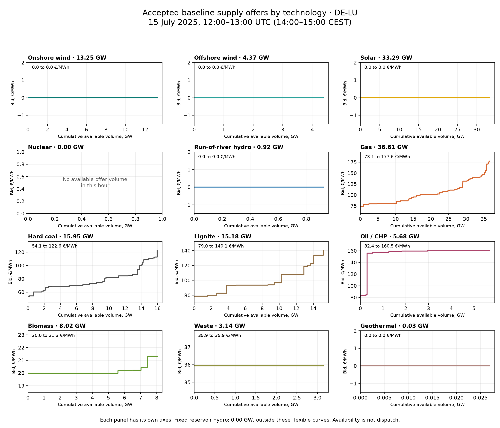
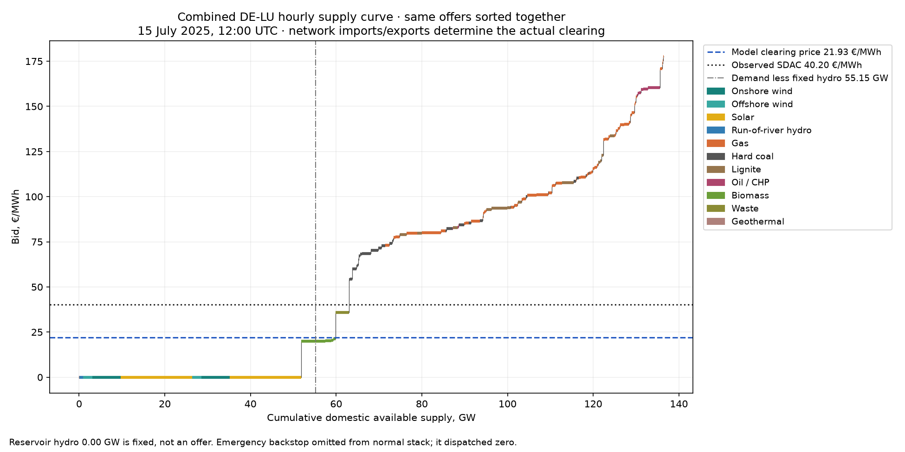

# What the baseline supply curves look like

**DE-LU, 15 July 2025 at 12:00–13:00 UTC (14:00–15:00 CEST).** Exact accepted `resource_full` bid prices and available MW, extracted without a new solve or fit. Curves change each hour as availability and bid inputs change.

Native demand is **55.15 GW**, fixed reservoir output **0.00 GW**, leaving **55.15 GW** after that fixed injection. Network-constrained modeled price is **21.93 €/MWh**, versus **40.20 €/MWh** observed ENTSO-E SDAC. These prices come from the full European clearing, not an isolated intersection of this domestic curve and demand.

Each horizontal segment is an available volume offered at one price: width is GW, height is €/MWh. Segments are sorted within each technology. These are independently divisible hourly supply tranches; they are not all-or-nothing block orders. Multiple source groups can give more than three steps in the combined gas or coal curve. Panel axes differ to keep low-price and small-volume resources readable.

| Technology | Available GW | Lowest bid €/MWh | Highest bid €/MWh |
|---|---:|---:|---:|
| Onshore wind | 13.246 | 0.00 | 0.00 |
| Offshore wind | 4.371 | 0.00 | 0.00 |
| Solar | 33.292 | 0.00 | 0.00 |
| Nuclear | 0 | — | — |
| Run-of-river hydro | 0.922 | 0.00 | 0.00 |
| Gas | 36.614 | 73.11 | 177.57 |
| Hard coal | 15.951 | 54.10 | 122.58 |
| Lignite | 15.178 | 78.98 | 140.11 |
| Oil / CHP | 5.684 | 82.44 | 160.50 |
| Biomass | 8.023 | 19.98 | 21.32 |
| Waste | 3.143 | 35.93 | 35.93 |
| Geothermal | 0.027 | 0.00 | 0.00 |

The combined curve sorts the same offers across all technologies. The demand marker excludes fixed reservoir hydro. Imports, exports, link losses and physical constraints participate in the European solve; an isolated supply-demand intersection would be a different calculation. Capacity is offered availability, not accepted dispatch or annual nameplate. The CSV retains source offer IDs, prices, capacities and tranche ranks.

3 source offers in this zone contain multiple technologies at identical bid prices. Their volumes are split for this display using current corrected PV components and remaining original member-availability shares, preserving each compiled offer’s total MW to within 4.55e-13 MW. This does not infer unique generator dispatch or distinct bidding behavior inside those pools. The plotted pieces remain fungible parts of the same original offer. Equal-price visual ordering is arbitrary.

Reservoir hydro has no flexible price curve in this baseline. Batteries/PHS are not modeled as flexible offers. Nuclear has no offered volume in DE-LU in this example. Emergency backstop offers are separate artificial feasibility supply (2000.00 GW at 10000 €/MWh); they are excluded from the normal curve scale and dispatch zero.

[Download the exact offer segments](de-lu-baseline-supply-curves-2025.csv). Source identity, hashes, plot exports and summary are retained in the local ignored `data/bidding-zone-network-2025/baseline-supply-curve-example-v1/` receipt. Baseline and public explorer unchanged.
