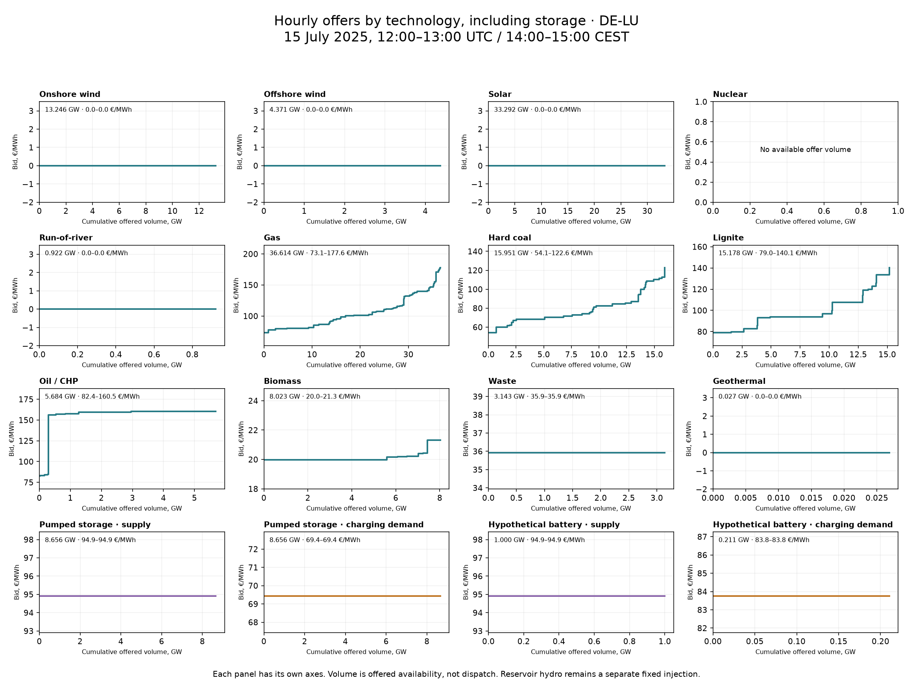

# How hourly technology curves are generated

**DE-LU, 15 July 2025, 12:00–13:00 UTC (14:00–15:00 CEST).** Exact generator offers from the accepted baseline, plus exact stock-limited offers from the audited storage candidate. No new clearing or calibration.

## Shared rules, changing hourly inputs

The model evaluates resource- and zone-specific rules every hour. It does not fit 8,760 independent hourly models. Wind/solar weather and capacity determine offered MW; their current offer price is zero. Thermal bids combine technology-specific cost assumptions, fuel/carbon inputs and calibrated zonal seasonal/local-clock adjustments. Gas uses monthly fuel prices; oil uses daily Brent inputs. Nuclear has its own bounded adjustment; other technologies retain their cost offers. These are synthetic bids, not recovered exchange order books. Calendar coefficients were calibrated on the same 2025 observations used for evaluation.

The solver sorts all available offers and clears them together across the European network. A domestic curve alone does not determine the zonal price: imports, exports and network constraints matter.

## Why the steps?

Each horizontal segment represents a finite MW tranche offered at one price. Moving right reaches another tranche/source group at a different price. Gas and coal/lignite source groups use 50%/35%/15% capacity tranches; combining many groups creates many steps. The solver can accept any fraction of each segment: these are divisible hourly offers, not binary block bids. Equal-price tranches appear as a single flat line. Technology labels inside mixed source pools are an availability-preserving display allocation, not separately inferred plant bids.

## Storage: two sides of the market

The own-baseline future-48-hour median reference is **93.91 €/MWh**. Discharge asks `P + 1`; charging willingness-to-pay is `round_trip_efficiency × P − 1`. Both prices are recomputed each hour; offered volumes also depend on actual carried stock, power limits, efficiency and remaining energy capacity. Charging is demand, so it is plotted separately from supply. Charging-demand segments are sorted from highest willingness-to-pay downward.

| Technology | Charge bid €/MWh | Discharge bid €/MWh | Charge offer GW | Discharge offer GW | Actual charge GW | Actual discharge GW |
|---|---:|---:|---:|---:|---:|---:|
| Pumped storage | 69.43 | 94.91 | 8.656 | 8.656 | 8.656 | 0.000 |
| Hypothetical battery | 83.75 | 94.91 | 0.211 | 1.000 | 0.211 | 0.000 |

The battery starts this hour at **3.80 of 4.00 GWh**. Its remaining 0.20 GWh needs 0.211 GWh of grid energy at 95% charging efficiency: hence only **0.211 GW** of charging for this one-hour interval, despite a 1 GW charger. It finishes full. Storage-candidate clearing is **56.19 €/MWh**: below both charging bids and the discharge ask. Both technologies charge and do not discharge.

The inventory update uses accepted charging/discharging, not all offered MW. Stock carries into the next hour and across days. Source pumped storage and the demo battery share a sell threshold here but have different charging thresholds because round-trip efficiencies are 75% and 90.25%. Their stock/power limits can also differ.

## Scope

Reservoir hydro remains a fixed hourly injection, not a flexible storage bid; it is zero in this DE-LU hour. PHS source energy capacities are not verified 2025 inventories. The battery is a hypothetical 1 GW/4 GWh demonstration asset. This candidate worsened annual observed-price fit and has not replaced the accepted baseline. The storage rule is a rolling heuristic, not an annual optimal schedule or a simultaneous daily auction.

[Exact storage offers, stocks and dispatch](de-lu-storage-supply-curves-2025.csv) · [Exact generator segments](de-lu-baseline-supply-curves-2025.csv) · [Annual storage evaluation](hourly-storage-bids-2025.md).
