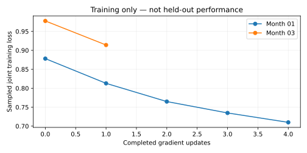
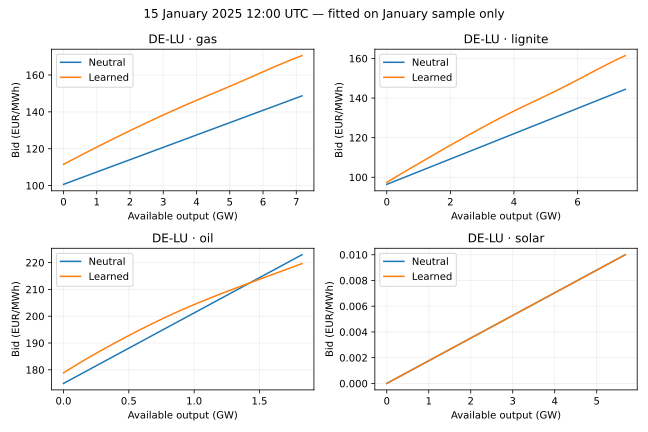

# Differentiable spline supply bids — research prototype

Snapshot: 2026-10-23 14:19 UTC.

**Implemented:** smooth monotone technology bids and gradient descent through constrained European clearing, fitting both prices and generation. **Month-pair fitting/evaluation is still in progress; no completed validation score is available.** The accepted model, country explorer and disabled recurring reviews are unchanged.

## Model and data

The physical inputs are the sealed, unfitted month-pair experiment: 48 bidding zones, 474 technology/source-cost groups, original hourly demand and renewable availability, interconnector bounds and model-derived physical grid constraints. Reservoir output stays fixed. No battery/pumped-storage fleet or new water scheduling is introduced. Artificial emergency generation is fixed absent; infeasible cases must fail rather than invent supply.

Wind, solar and run-of-river offer at zero economic price, with curtailment allowed. Other groups use their hourly source-cost anchor plus a learned local-clock midpoint and six positive cubic I-spline coefficients. Positive weights enforce a nondecreasing marginal bid. Integrating this bid gives the exact convex offer-cost objective; the experiment does not clear an LP approximation of the spline.

Parameters are shared across country/resource families (216 sets, 11 coefficients each); source technology and efficiency cost differences remain separate. They are not independent parameters for 8760 hours. The midpoint uses the first two daily sine/cosine harmonics and a bounded shift; availability and source costs also change hourly. Country generation targets do not identify unique zonal or plant bids.

Prices are negative zonal balance multipliers in EUR/MWh. Supply and network variables use GW and objective values use kEUR/hour. The solver retains balance, branch and link constraints. A technical generation regularizer changes marginal costs by at most €0.01/MWh inside capacities; a 1e-6 quadratic tie-break applies to network variables. These provide curvature, including for economically zero-bid resources; they are not observed bid costs.

Price observations are corrected hourly ENTSO-E SDAC prices. Generation is evaluated against original Ember monthly national technology totals; hourly ENTSO-E generation remains available but is not silently substituted for monthly targets. Capacity/availability and source-cost provenance is inherited unchanged from the [sealed source experiment](sigmoid-month-pairs-2025.md). Full-year-fitted bid offsets and empirical country PV factors stay removed. Historical grid, fixed-hydro and perfect-input assumptions still make this conditional retrospective research.

## Actual gradient fitting

Each clearing solves the smooth convex dispatch problem. An implicit adjoint of its primal-dual KKT system differentiates **both generator dispatch and cleared price multipliers** with respect to spline parameters. Adam follows those gradients on a joint loss: smooth price MAE divided by €40/MWh, normalized monthly generation error and a small parameter ridge. This differs from the earlier inverse least-squares/heuristic sigmoid fit.

Each odd month initializes independently. A fixed uniformly sampled 16 hours from that month supplies four gradient updates; monthly dispatch is estimated by expanding the sampled hours, while fixed reservoir generation uses its exact monthly total. This is a deliberately small, approximate training budget, not a claim of parameter convergence. Missing generation remains unknown. Even-month observations do not enter the fit or clearing. Proposals freeze before scoring February, April, June, August, October and December at **all 4344 hours**, with identical-input neutral-spline controls.

The even months have already been inspected in prior research, so this is not untouched prospective forecast validation. A completed six-month score would also not be an 8760-hour out-of-fold annual score. The zero-renewable-bid assumption changes alongside curve family relative to the earlier sigmoid experiment; only the neutral-versus-learned spline comparison isolates fitting in this design.

[Training data](differentiable-spline-2025-training.csv). Loss is sample-based and smoothed; it must not be reported as ordinary all-hour price or generation MAE. Current checkpoint stage: `fit`. No test result is inferred from this plot.

## Example supply curves

Each panel shows the largest available German source group in that resource family, not the entire national stack. Solar’s zero economic curve includes the disclosed numerical tie-break of at most €0.01/MWh. [Curve data](differentiable-spline-2025-curves.csv).

## Complete-month evaluation

No complete even-month comparison is available in this snapshot.

## Numerical verification

Six focused tests pass: monotonicity, integrated-cost derivatives, congested toy dispatch, joint price/dispatch finite differences, zero-bid parameter isolation, and training-loss/target-slice derivatives and isolation. Three European January hours satisfy balance/network feasibility and nonlinear KKT checks. One European joint adjoint agrees with finite differences to absolute error 9.38e-9.

Three additional full-European directional checks (midpoints, shapes and joint) pass, with maximum absolute directional-derivative discrepancy 4.5e-05. Reducing the generation regularizer from €0.01 to €0.001/MWh changes prices by at most €0.009720/MWh and individual source-group output by at most 1.260 MW over the three pilot hours. This is a small sample, not annual robustness evidence.

Initial exact European smooth solves take 1.51–3.40 seconds/hour, 18–40 Newton iterations. These are measured pilot timings, not annual runtime. Saved primal/dual witnesses support an independent replay with physical residual≤1e-4 MW, stationarity≤2e-7 EUR/MWh and complementarity≤€0.05. Complementarity is a nonlinear KKT statistic, not the earlier LP objective-gap measure. Full replay remains a separate acceptance step.

Smooth spline bids do not make hard capacity/network active-set changes universally differentiable. The adjoint uses the converged, very small perturbed KKT system; gradient checks are local. Numerical conditioning, parameter non-identification and broader smoothing sensitivity require continued checks.

## Conclusion and next check

The differentiable constrained prototype works on toy and European pilot cases. It has **not yet established better held-out accuracy or fast annual inference**. Complete all six month pairs, independently replay the saved certificates, then compare ordinary price MAE and actual monthly generation errors against neutral controls before considering larger fitting budgets or model adoption.

Reproduce with the scientific environment and `PYTHONPATH=tools OPENBLAS_NUM_THREADS=1 OMP_NUM_THREADS=1`: `run_differentiable_spline_2025.py`, then `audit_differentiable_spline_2025.py`, then `report_differentiable_spline_2025.py`. The runner checks sealed dependency hashes on resume; inspect live jobs/failure checkpoints first and never start a duplicate. Large witnesses remain ignored local data, not Git.
