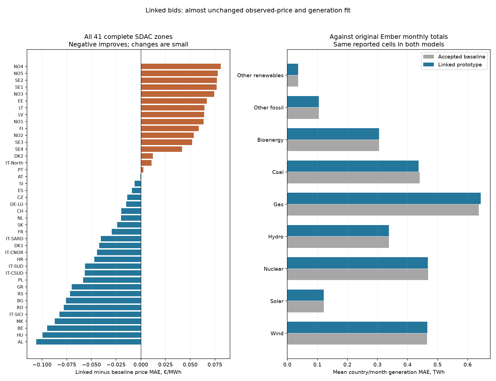
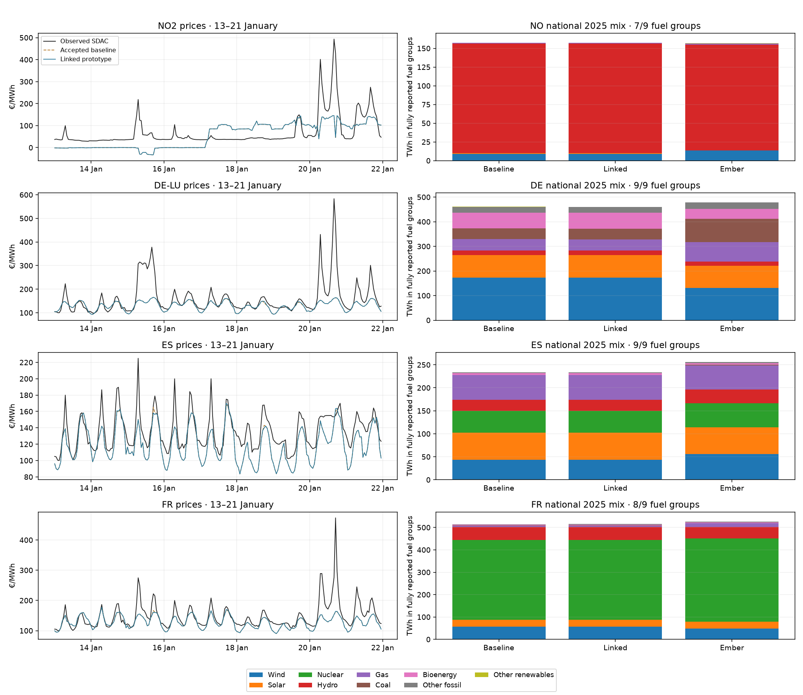

# Linked bids: observed 2025 prices and generation

**Result:** the saved 365-day linked-order prototype changes European price MAE **26.795 → 26.786 €/MWh (0.034% lower)**. Generation is almost unchanged: gas fit worsens slightly, coal/hydro improve slightly, wind/solar are essentially unchanged. **The measured accuracy benefit does not justify replacing the accepted ~52-second continuous baseline with this ~37-minute prototype.** This evaluates the specified synthetic packages, not the value of all possible block/linked bidding strategies.

## Saved results and comparison scope

All daily dispatch, coupled primal/dual prices, acceptance ratios and storage flows remain in the ignored local cloud cache `data/bidding-zone-network-2025/europe-linked-clearing-robust-v1/`, with six seed witnesses referenced in `europe-linked-clearing-priced-v1/`. The parent audit independently replayed all 365 days/8,760 physical hours and linked-price/storage certificates. No market solve was repeated for this report. A derived `observed-comparison-v1/hourly-comparison.npz` contains both annual price/generation arrays and the observations; source hashes and metric audit remain beside it. These full hourly witnesses are local cache files, not Git-backed remote backups. Only this report, compact summary CSVs, figures and reproducible code are committed.

Baseline means the user-accepted `solar-anchor-bids-v1/resource_full`, not the older model in the public country explorer. Linked means the same inputs/grid/fixed hydro plus ~44.45 GW of synthetic gas packages and three hypothetical 100 MW/400 MWh batteries. Six hours/day are newly coupled and 18 exact unchanged hours reused. Comparison covers all 8,760 hours; it does not treat the six-hour subset as a full-year sample. Cached own-model storage forecasts are unchanged.

Prices use **corrected hourly ENTSO-E main SDAC day-ahead auction observations**, already interval-averaged into hourly targets. Equal-zone annual MAE uses the same 41 complete zones out of 48 modeled zones. Missing source observations remain unknown. No target refit, new fuel-price calibration, baseline adoption or public explorer replacement occurs. Generation uses original monthly Ember country/fuel totals and hourly ENTSO-E A75 generation where all required national/constituent areas report the technology/hour. IRENA supplies capacity inputs, not hourly generation observations.

## Price performance

| Metric | Accepted baseline | Linked prototype |
|---|---:|---:|
| Full-year equal-zone MAE, €/MWh | 26.7950 | 26.7860 |
| Mean zonal correlation | 0.6328 | 0.6333 |
| Daily-demeaned MAE, €/MWh | 18.7525 | 18.7493 |
| Pooled MAE when observed price >300 €/MWh | 234.83 | 234.13 |

25 complete zones improve and 16 worsen. Scarcity-spike error remains large; adding these packages does not recover the missing spikes. Price changes can reflect both allocation and the choice of supporting LP duals. Fixed-integer prices satisfy the retained family/KKT checks, but this is a heuristic supported-price incumbent rather than full EUPHEMIA certification or proof that observed commercial bids were recovered.

| Zone | Baseline MAE | Linked MAE | Baseline correlation | Linked correlation |
|---|---:|---:|---:|---:|
| DE-LU | 17.349 | 17.335 | 0.849 | 0.850 |
| ES | 19.605 | 19.596 | 0.853 | 0.853 |
| FR | 21.689 | 21.660 | 0.823 | 0.823 |
| NO1 | 37.142 | 37.205 | 0.208 | 0.209 |
| NO2 | 41.042 | 41.096 | 0.143 | 0.143 |
| NO3 | 34.098 | 34.172 | 0.242 | 0.242 |
| NO4 | 42.532 | 42.613 | 0.111 | 0.110 |
| NO5 | 32.295 | 32.373 | 0.287 | 0.286 |

## Generation mix

The table averages absolute monthly generation error across the **same known country/fuel/month cells**, including observed zero output. Each fuel has different source coverage. The CSV includes observed months and annual totals only when all 12 months report. These all-country metrics have broader coverage than the earlier solar score over 21 fitted countries and the earlier thermal score limited to modeled fleets; they should not be compared as identical scores.

| Ember fuel group | Complete countries | Baseline monthly MAE, TWh | Linked monthly MAE, TWh |
|---|---:|---:|---:|
| Wind | 33 | 0.4654 | 0.4655 |
| Solar | 31 | 0.1213 | 0.1213 |
| Nuclear | 16 | 0.4682 | 0.4681 |
| Hydro | 33 | 0.3385 | 0.3382 |
| Gas | 29 | 0.6378 | 0.6433 |
| Coal | 26 | 0.4408 | 0.4365 |
| Bioenergy | 28 | 0.3052 | 0.3052 |
| Other fossil | 28 | 0.1050 | 0.1050 |
| Other renewables | 19 | 0.0361 | 0.0361 |

Across the complete national source scopes, baseline wind generation is about 643.84 TWh versus 568.37 TWh observed; gas is 372.33 versus 528.83 TWh, and coal 207.67 versus 279.21 TWh. The prototype barely changes those fleet-wide gaps. These are sums over each fuel’s covered country set, not a harmonized EU total. Price and quantity source-boundary differences remain.

Technology allocations within pooled equal-price source offers are proportional to current member availability; 108 compiled offers contain multiple country/technology labels. Current corrected PV components are reconstructed separately; all capacities partition the sealed offer bounds. Thermal pure-country/fuel groups are identified, while renewable mix points can be nonunique. Hourly CSVs retain conditional allocation bounds, not confidence intervals; different bounds cannot generally be attained jointly. Fixed reservoir generation is reconstructed from sealed native demand, displacement offsets and zonal residual-load weights.

Hypothetical batteries consume **0.121400 TWh** and return **0.098334 TWh**. Their discharge is excluded from primary generation mix and reported separately. ENTSO-E pumped-storage production/consumption is not silently folded into reservoir generation. Gross/net output, Ember Other fossil versus oil/waste, geography and unreported types remain limitations; missing data are never zero-filled.

## Country examples

The left panels show hourly observed and model prices during 13–21 January; nearly overlapping model curves are an actual result. Norway uses NO2 as the price example and national NO for generation. The right panels compare annual primary generation for fuel groups with all 12 Ember months; omitted groups remain unknown, so bars are covered mix rather than certified total generation.

## Verification and conclusion

The source-bound producer checks all daily witness hashes, exact reuse of the 6,570 independent hours, current PV/source-capacity partition (maximum difference 1.46e-11 MW), primary-generation closure and source coverage. An independent metric replay checks 82 available zone/case price records, 7344 country/fuel/month results against original Ember CSV cells and 422 available hourly technology/country/case comparisons. Original physical/price-family/storage audit remains linked; this reporting audit does not claim a new native solve or unique generation allocation.

Keep the accepted continuous baseline. The next useful changes should target the much larger source/mix and scarcity-price discrepancies, then test block strategies with source-backed plant commitments or observed operator behavior. The current result gives no evidence that the extra discrete complexity materially improves the observed fit. Both models remain calibrated 2025 reconstructions, not independent forecasts or validated investment estimators.

[All 48 price-zone comparisons](europe-linked-clearing-2025-observed-prices.csv) · [All country/Ember fuel comparisons](europe-linked-clearing-2025-observed-generation.csv) · [Hourly ENTSO-E technology metrics and allocation bounds](europe-linked-clearing-2025-observed-hourly-generation.csv) · [Measured runtime and scope](europe-linked-clearing-2025-runtime.md).
