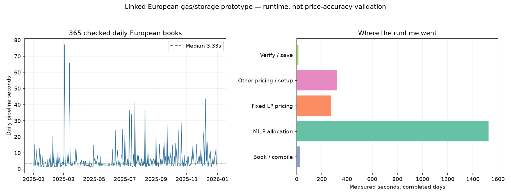

# European linked-order clearing: measured runtime

**Coverage: 365/365 days complete and independently replayed.** The full retained 48-zone network is present. The submitted book has 1,345 orders and 106 binary decisions per day. Completed daily pipelines total **2155.5 s (35.92 min)**; median **3.33 s/day**, 95th percentile **16.52 s**, maximum **77.16 s** (2025-03-03). This is measured work, not a multiplication of three sample-day timings.

Cumulative measured execution wall across the checkpointed final-method jobs is **2224.4 s (37.07 min)**, including 37.1 s of repeated source preparation and the retained 10-second allocation timeout. This is not one uninterrupted annual stopwatch. It excludes earlier compiler/certificate development experiments and the independent audit, which takes 153.5 s. The CSV/figure cover all 365 completed days. Failed-attempt receipts remain in the local provenance checkpoints.

## What was run

All 48 zones, 799 original compiled supply offers, 37 controllable links and the retained physical/PTDF/GSK network are included. Every positive gas member group is represented: **103 groups in 40 zones**. Each contributes at most 500 MW to a synthetic four-hour linked package, with a 20% minimum-output parent, 25 EUR/MW assumed startup charge and divisible hourly children for the remaining 80% across all three tranches. About **44.45 GW (19.69% of 225.77 GW eligible gas)** is packaged; the remaining fleet retains original hourly offers. These are synthetic packages from available source groups, not identified real plants or all-European unit commitment.

Three explicitly hypothetical 100 MW/400 MWh storage assets in DE-LU, FR and ES submit charging-parent/discharging-child cycles, with 90% charging and 90% discharging efficiency. Charging is offered at 06:00–07:00 UTC and discharge at 17:00–18:00 UTC; gas packages cover 16:00–19:00 UTC. Initial and terminal storage energy are both constrained to zero every day. That is an explicit restrictive daily-cycle strategy, not an unaccounted reset or a claim to represent actual European battery/PHS capacity. Hydro remains fixed.

The accepted resource_full inputs, country solar factors, weather, demand, original MW, oil/coal/nuclear bids and grid limits are preserved. Storage bid limits use the retained **own-model** baseline-price forecast, not observed ENTSO-E prices. Loading that precomputed forecast is included; producing a fresh forecast solve is excluded. Historical source reference clearing took 51.8 s, but that is a different workload and not a timing measured by this new run. No price-target fitting or baseline/public-site promotion occurs.

All 24 delivery hours are represented in each daily result. Six connected hours enter the coupled optimization; 18 unchanged independent hours reuse the exact checked reference witness. Storage profiles are zero between the retained hours and standing loss is zero, so energy remains constant during omitted periods. This exact time-component shortcut does not apply if new bid profiles or physical constraints connect those omitted hours. The benchmark therefore measures this specified hourly UTC book, not arbitrary 24-hour flexible schedules or a reproduction of 2025 quarter-hour/local-DST exchange rules.

## Implementation and timing breakdown

Precompute the unchanged sparse topology once per process; refresh every daily offer cost, renewable/source bound, demand and network-flow RHS. Cold-versus-cached sample books produce identical objectives. Two cache tests cover changed costs/demand/capacity, profile-triggered rebuilding and stale-reservation rejection.

Allocation is a bounded MILP. Fixed-integer LP duals are checked directly against stationarity, duality, complementarity and accepted-family surplus. If those prices fail, search alternatives. An infeasible price search triggers heuristic rejection of the offending root package followed by complete network re-clearing; numerical failures/timeouts never become rejection cuts. Preserve the original unrestricted allocation bound, since later heuristic-cut bounds are not globally valid price-clearing bounds.

113 of 365 checked days need more than one allocation/pricing pass; maximum **5 passes**. The retained cost interval is an offer-cost/welfare bound for this prototype; it is **not observed-price error**, investment value or full EUPHEMIA optimality. Maximum remaining interval width is 16141.35 EUR. Five cut-loop tests include exhaustive tiny-book comparison and a deliberately nonzero bound after rejecting a paradoxically accepted block; three direct-price tests preserve both rejection and profitable-child rescue.

| Phase, completed days | Measured seconds |
|---|---:|
| Book / compile | 24.76 |
| MILP allocation | 1525.32 |
| Fixed LP pricing | 273.94 |
| Other pricing / setup | 318.47 |
| Verify / save | 12.98 |

Other pricing/setup is the measured re-clearing wall residual after allocation and fixed-pricing solver times. It includes alternative-price searches (including infeasible attempts), certificate work and solver/loop setup; it is not a separately instrumented pure-price-solver total. Verification/save is the daily-wall residual. Source preparation is separate. Tested with one solver/BLAS thread and a 5 GiB address-space cap; sampled process RSS was roughly 0.7 GiB. No annual monolithic matrix is allocated.

## Verification, failures and limits

Independent replay checks 8,760 original-network/bound hours, every stored coupled primal/dual and family-surplus certificate, source-gas reservation reconstruction and full 24-hour storage energy/power/direction/terminal limits. Maximum physical residual **3.63e-07 MW**, duality gap **0.00228 EUR**, storage terminal error **0 MWh**. Emergency output remains within the unchanged 1e-6 MWh daily numerical gate (total roundoff 6.76e-08 MWh). This is matrix/temporal/price-certificate verification, not a fresh native PyPSA component solve or full EUPHEMIA certification.

Preserved development failures: the initial preflight used exact emergency-zero equality and was corrected to the existing tolerance; a strict auxiliary price search stopped on 4 January despite already valid conditional prices (minimum family surplus about −5.9e-7 EUR). The final certificate-first implementation accepts only directly checked prices at the unchanged 0.05 EUR economic tolerance. On 7 January a 10-second allocation limit was reached before optimality proof; the final execution budget permits 60 seconds per solve/300 seconds per day without relaxing optimality or physics gates. The six already checked days are reused with parent-record/source/witness hashes, not inferred from stale progress. Earlier failures remain local and are not counted as completed annual days.

The existing accepted baseline remains resource_full. New price accuracy, generation mix, realistic operator startup assumptions, actual storage coverage and investment-response validity have not been accepted by this timing test. Re-clearing is a bounded heuristic subset of EUPHEMIA; MIC, full product/tick/tie rules and commercial network-domain reconstruction remain outside it. A future investment study must recompute its model forecasts and operator proposals consistently.

[All 365 completed days and runtime/certificate metrics](europe-linked-clearing-2025-runtime.csv). Active prototype runner: tools/run_robust_priced_europe_2025.py annual; input budget: config/europe-linked-clearing-robust-2025.json; book: config/europe-linked-clearing-2025.json; pricing core: tools/priced_linked_orders.py. Source hashes, all checkpoints, cost bounds, seed provenance and independent audit remain in ignored data/bidding-zone-network-2025/europe-linked-clearing-robust-v1/. Earlier cold/strict-price stages are retained for reproducibility, not competing accepted models.

The prototype completes the specified year with checked physical and price certificates, but does not meet a seconds-scale annual runtime target. Discrete allocation dominates the runtime. Before considering adoption, evaluate whether these linked-bid assumptions improve observed-price and generation performance enough to justify that cost.
