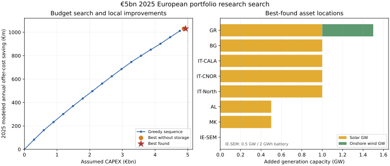
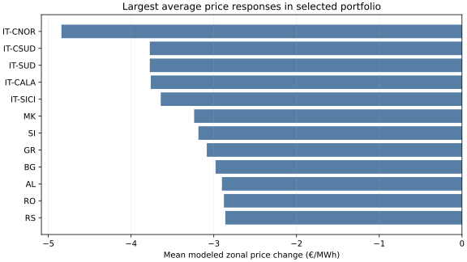

# A €5 billion European portfolio search on the retained 2025 dispatch model

## Summary

A source-hashed, finite research search found a **budget-feasible portfolio of 6 GW utility solar, 500 MW Greek onshore wind and a 500 MW / 2 GWh battery in IE-SEM**. Assumed 2025 capital cost is **€4.932 billion**, leaving €67.58 million unallocated in the declared block grid. Reclearing the 2025 European physical joint LP gives **€1,030.76 million less annual modeled generation-offer cost** than the unchanged baseline. This is the best portfolio *found in the declared search*, not a global optimum or an investment return.

The selected 500 MW blocks are:

| Asset | Bidding zone | Added capacity | Assumed CAPEX (M€) |
| --- | --- | ---: | ---: |
| Solar | AL | 500 MW | 297.43 |
| Solar | BG, GR, IT-CALA, IT-CNOR, IT-North | 1,000 MW each | 2,974.32 total |
| Solar | MK | 500 MW | 297.43 |
| Onshore wind | GR | 500 MW | 719.44 |
| Battery | IE-SEM | 500 MW / 2,000 MWh | 643.79 |
| **Total** | | **6 GW solar + 0.5 GW wind + 0.5 GW / 2 GWh storage** | **4,932.42** |

## What was optimized

The model keeps the retained `mixed_curve_fitting` 2025 hourly technology bids, fixed ENTSO-E demand, renewable availability, fixed hydro schedule, zonal links and 311-row linear physical network approximation. A new solar or wind offer has a zero bid and follows its zone/technology 2025 hourly **availability** profile scaled to the added nameplate. Dispatch is decided by the LP; archived dispatch is never copied into an availability profile. Added battery stock, charge and discharge are endogenous. The annual objective is

`B(S) = C(baseline) − C(portfolio S)`, with `sum(CAPEX(S)) ≤ €5 billion`,

where `C` is executed 2025 generation-offer cost plus battery throughput cost. The selected battery uses 95% charge and 95% discharge efficiency, €0.01/MWh throughput cost, half-full initial stock and a half-full terminal target. Each 48-hour perfect-model-input LP executes its first 24 hours, then carries stock into the next day; the last day uses a 24-hour LP. This is a rolling dispatch policy, **not** a single full-year storage optimum or a forecast of real operator bids.

The cached 2025 PyPSA-Eur technology-cost source has utility solar **€594.8646/kW**, onshore wind **€1,438.8845/kW**, battery inverter **€287.4657/kW**, and battery energy **€250.0283/kWh**. These are technology assumptions, not local project quotes. Source hash and exact candidate declarations are in the ignored `data/bidding-zone-network-2025/budget-portfolio-search-v1/manifest.json`; the pinned replay code is `baselines/compact/budget_portfolio_search.py`, `budget_portfolio_improve.py`, `budget_portfolio_pair_scan.py`, `budget_portfolio_complements.py`, and `budget_portfolio_final.py`.

## Search and diminishing returns

The broad screen considered **115 first blocks** in 48 model zones: 35 solar, 32 onshore wind and 48 batteries. Solar and wind blocks were 500 MW; battery blocks were 500 MW / 2 GWh. Renewable first blocks required at least 500 MW original source peak availability, and second blocks required 1,000 MW; at most two blocks per zone and technology were tested. These are model-scale guards, **not** site buildability checks. The exact greedy search shortlisted ten first blocks per family, added feasible second blocks (57 blocks total), and recleared up to two leading affordable proposals per family at every step. It evaluated 89 new full-year portfolios, selecting by measured marginal annual saving per assumed CAPEX. Earlier full-year DE-LU battery size tests showed declining block value, but this search does not assume global submodularity.

Greedy selection ended with 8 GW solar. A 46-portfolio local search then tested wind and battery substitutions and five solar sites outside the original shortlist. All 51 valid two-solar-for-Greek-wind swaps of the greedy portfolio were checked, followed by 40 mixed battery/second-wind proposals. Every new scored portfolio was recleared for all 8,760 hours; cached results were reused only by exact asset IDs and source manifest hash.

| Best found at stage | Assumed CAPEX (M€) | 2025 modeled cost saving (M€) | Difference from greedy (M€) |
| --- | ---: | ---: | ---: |
| Greedy, 8 GW solar | 4,758.92 | 1,012.09 | — |
| Pair swaps, 7 GW solar + 0.5 GW Greek wind | 4,883.49 | 1,029.57 | +17.48 |
| Complements, **selected** 6 GW solar + 0.5 GW Greek wind + Irish battery | **4,932.42** | **1,030.76** | **+18.67** |

The selected battery adds **€108.83 million/year** to the same 6 GW solar plus wind portfolio, whose no-battery benefit is €921.93 million/year. It replaces two 500 MW solar blocks to respect the budget. The *net* gain over the best no-storage portfolio is only **€1.19 million/year**, so the precise solar-versus-storage ordering is not robust to modest cost or model error. The best of 20 tested two-wind complement cases reached €985.01 million/year.

The selected portfolio has only €67.58 million of budget headroom. Holding other costs fixed, a **1.89%** increase in assumed solar unit CAPEX alone would exceed €5 billion. The same thresholds are 9.39% for wind and 10.50% for the battery. These are feasibility thresholds, not a reoptimized cost-sensitivity analysis; they show why the exact asset list is fragile to project pricing.

## Independent annual witness

`budget_portfolio_final.py` separately rebuilt the selected assets and replayed all 365 chronological battery days, saving hourly generation, zonal prices and stock to ignored `data/bidding-zone-network-2025/budget-portfolio-search-v1/selected-final-v1/annual.npz`. The replay matched the selected search receipt's annual cost and saving. The original zero-change LP also reproduced the retained witness to within €0.0001 over the whole year. The selected replay passed all original physical gates:

| Check | Result |
| --- | ---: |
| Cleared hours | 8,760 / 8,760 |
| Baseline offer cost | €26,486.18 million |
| Selected portfolio offer cost | €25,455.41 million |
| Maximum primal residual | 9.58 × 10⁻⁷ MW or MWh |
| Emergency generation | 0 MWh |
| Maximum battery stock replay error | 8.91 × 10⁻¹¹ MWh |
| Battery charge / discharge | 1.485 / 1.341 TWh |
| New solar / wind dispatch | 10.682 / 1.141 TWh |
| Mean absolute modeled zonal price change | €1.876/MWh |

The battery stock ranges from numerical zero to 2,000 MWh and ends at its declared terminal level. Total new generator dispatch is **11.823 TWh**; under fixed demand, it displaces other modeled generation. The largest mean modeled price changes are reductions in IT-CNOR (−€4.84/MWh), IT-CSUD and IT-SUD (both −€3.77/MWh), IT-CALA (−€3.76/MWh), and IT-SICI (−€3.64/MWh). Of 48 zones, 47 have a lower mean modeled price and ES rises slightly (+€0.009/MWh). These are changes between two *model* clears, not improvements in observed-price MAE.

## Interpretation and limits

This is a **retrospective system-cost sensitivity**, not an optimal investment plan. The accepted bids were fitted within 2025 using observed ENTSO-E prices and generation. Even on that same year, the retained baseline's ENTSO-E price MAE is **€25.051/MWh**, so it is not a high-fidelity price forecast; there is no independent year or weather transfer validation for this portfolio. IT-North has a known local baseline price-fit regression; its strong ranking here may partly reflect that model error. Fixed hydro cannot adjust reservoir release to the new portfolio. The battery policy has 48-hour perfect model inputs and half-stock look-ahead targets; different terminal or forecast rules could change its rank.

The candidate grid omits physical transmission builds because the retained commercial link-envelope releases lack a costable route and verified mapping to new physical network capacity. It also omits offshore wind, hydro additions, other storage durations, solar and wind site limits, connection costs, land/permitting constraints, and country-specific CAPEX. The 500 MW block grid and top-ten initial shortlist cannot certify a Europe-wide optimum. No line or generator is inferred to be buildable solely because its source profile and LP are feasible.

A wider source-hashed single-block relocation challenge was started after this result. Six of its 106 planned Europe-wide wind, battery and solar alternatives completed within the five-hour work window; none beat the selected portfolio (the strongest, moving Greek wind to Estonia, scored €1,030.22 million/year). The job was stopped without an unattended process, and its ignored receipts can be resumed with `baselines/portfolio_challenge.py`. **Do not interpret the six-case subset as a complete geographic optimum check.**

The €1,030.76 million is reduced **modeled offer cost**, not generator or battery owner revenue, ENTSO-E congestion rent, net welfare including all externalities, NPV, or a guaranteed annual return. A credible allocation needs site and line-build evidence, O&M and finance costs, adverse weather/fuel/CAPEX and storage-policy sensitivities, independent price/generation transfer checks, and a stronger search or valid upper bound. The active research baseline and public app estimator are unchanged.

## Reproduction and provenance

On the Linux host retaining ignored `data/`, use the pinned scientific interpreter at `data/pypsa-eur/upstream/.pixi/envs/default/bin/python` and run the five `baselines.compact.budget_portfolio_*` modules named above in this order: `budget_portfolio_search`, `budget_portfolio_improve`, `budget_portfolio_pair_scan`, `budget_portfolio_complements`, `budget_portfolio_final`. Each run checks source identity and refuses a changed manifest. Inspect live processes before starting a long run; each stage stores ignored receipts for readback or resume. Baseline annual witness SHA-256: `5fbc4d1d1c6dace91299c9a2638fb1d092827a5d2914211bf0f5486a06771648`; 2025-cost source SHA-256: `9e1b0c105f28713499718afa49e1bbaf191197a2ba945558814617d8e7106cda`; selected hourly witness SHA-256: `92e725d146d396cb716023d5b5aa62769d2fa90e763c5907afc4e0b24ac0d9e5`.

The separate `baselines.compact.verify` command currently stops at its 20-file import-count gate: the folder had 32 counted Python files before this search and now has 38. That maintenance gate was not changed. Its numerical checks were run directly and passed: all 6,999,240 transferred cost cells equal the retained costs, and seven sampled LP hours satisfy the original objective, zonal-price, total-generation and primal tolerances. The full-year zero-delta and selected-portfolio replays above provide the annual checks.
