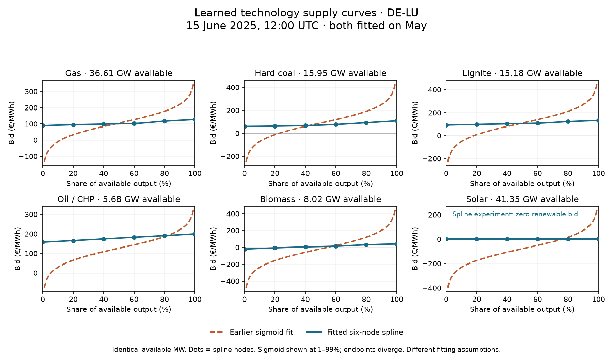

# Fitted splines compared with the earlier sigmoids

**DE-LU, 15 June 2025, 12:00–13:00 UTC / 14:00–15:00 CEST.** Both use their saved May-fitted parameters and exactly the same hourly available MW. This matches the [earlier sigmoid example](learned-supply-curve-example-2025.md). No fitting or clearing was rerun.

Blue lines show the fitted monotone cubic splines; dots mark the six supply nodes at 0, 20, 40, 60, 80 and 100% of available output. Dashed orange lines show the earlier fitted sigmoids, aggregated across the original source groups of each technology. These are economic offer curves, not realized dispatch, observed bids or independently cleared prices. Each panel has its own price scale.

The orange curve expresses the price needed to offer a given volume: it is the inverse of a sigmoid quantity-versus-price function. It becomes unbounded at zero and full output, so only its 1–99% interior is drawn. The actual sigmoid LP uses eight finite midpoint-priced tranches per source group; the spline LP uses twenty finite interval-average tranches per technology/zone. The smooth lines here show their underlying curves, not the LP staircases.

The spline can change its slope independently between supply nodes, while remaining nondecreasing. For example, the fitted gas bids at the six nodes are **€89.16, €94.81, €98.73, €102.58, €117.06 and €126.92/MWh**. The steeper 60–80% section is a learned bend. Oil is close to linear in this example. Extra flexibility permits curvature; it does not force wiggles. The broad sigmoid tails also make the narrower spline curves look flatter on a shared price axis.

| Technology | Available GW | Earlier sigmoid bid at 50% | Spline bid at 50% |
|---|---:|---:|---:|
| Gas | 36.61 | €105.03/MWh | €100.38/MWh |
| Hard coal | 15.95 | €89.71/MWh | €71.64/MWh |
| Lignite | 15.18 | €109.83/MWh | €105.41/MWh |
| Oil / CHP | 5.68 | €126.15/MWh | €178.30/MWh |
| Biomass | 8.02 | −€17.83/MWh | €9.66/MWh |
| Solar | 41.35 | −€79.11/MWh | €0.00/MWh |

These midpoint bids are not predictions of the zone's market price. European imports, exports, fixed injections and physical constraints participate in clearing. Fixed reservoir hydro has no fitted curve in either experiment; neither fitted experiment includes the separate flexible-storage fleet candidate. Germany has no nuclear output in the retained fleet.

**This compares two actual fitted experiments, not an isolated test of curve shape.** The earlier model shares country/resource parameters and retains distinct source-cost anchors. Its aggregate gas curve here sums 31 source-group sigmoids. The spline model shares parameters by technology/zone and uses an availability-weighted source-cost anchor. It uses gradient fitting on sixteen sampled training hours per month, with eight updates after its own-month spline initialization; the earlier sigmoid fit uses full odd-month targets with a different fitting procedure. Solar, wind and run-of-river are fixed at zero economic bid in the spline experiment, rather than fitted as in the sigmoid experiment. The flat solar line is this explicit assumption, not a learned result.

Across the same 4,344 even-month evaluation hours, the earlier sigmoid experiment remains better: price MAE **€26.36/MWh**, versus **€28.39/MWh** for these splines; monthly generation MAE **0.193 TWh**, versus **0.298 TWh**. These results do not establish that sigmoids are intrinsically better: pooling, parameter sharing, renewable offers and fitting coverage changed together. Neither experiment replaces the accepted baseline automatically.

[Download SVG](fitted-spline-sigmoid-comparison-2025.svg) · [Curve points CSV](fitted-spline-sigmoid-comparison-2025.csv) · [Extraction receipt and exact node values](fitted-spline-sigmoid-comparison-2025-receipt.json) · [Spline LP evaluation](supply-knots-lp-2025.md) · [Sigmoid evaluation](sigmoid-month-pairs-2025.md).

Reproduce with `PYTHONPATH=tools OPENBLAS_NUM_THREADS=1 OMP_NUM_THREADS=1 data/pypsa-eur/upstream/.pixi/envs/default/bin/python tools/compare_fitted_supply_curves_2025.py`. Extraction checks saved input/proposal/provenance hashes, MW conservation by original membership, sigmoid aggregate inversion and agreement of plotted splines with independent SciPy PCHIP interpolation. Full numerical inputs remain ignored local files; only the compact comparison is tracked.
