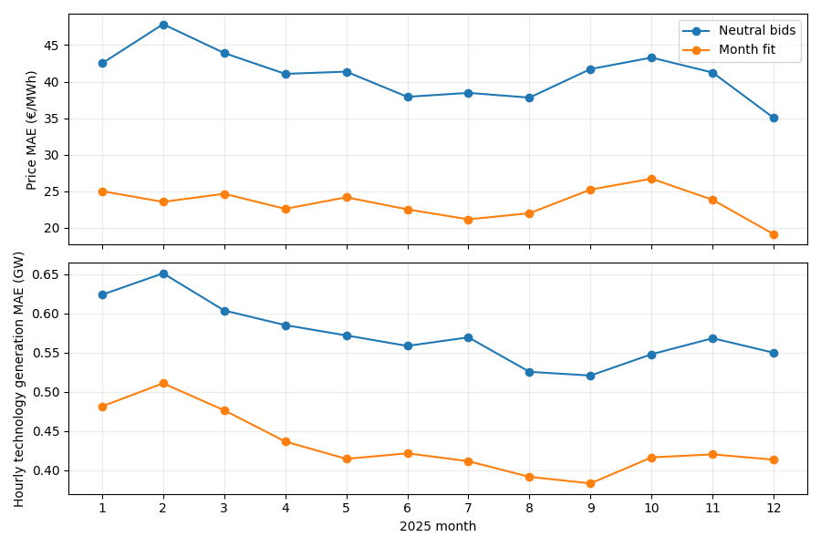
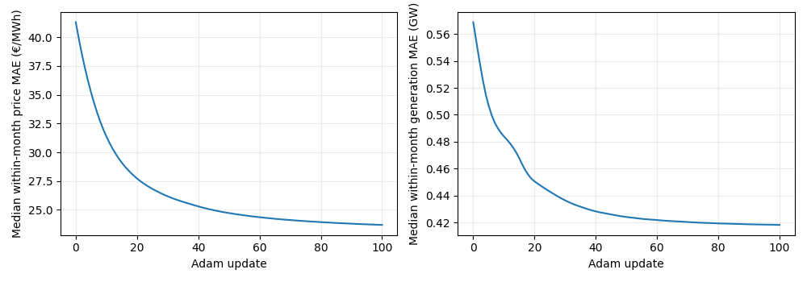
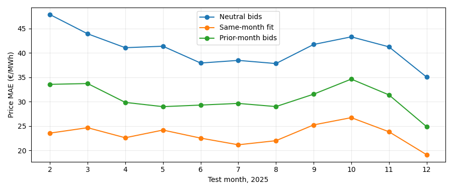
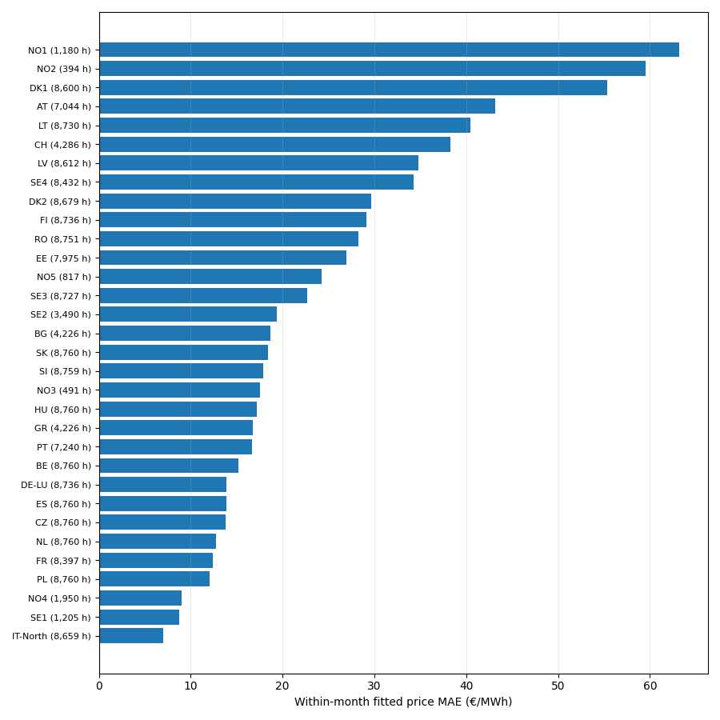
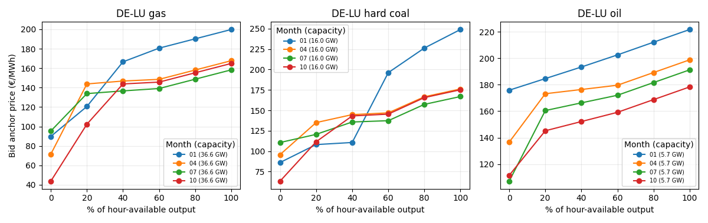

# Monthly technology bid fitting with observed 2025 exchanges

## Summary

We scaled the attached three-zone supply-curve notebook's central idea to the
retained **48 bidding zones and every hour of 2025**: fit a monotone six-anchor
technology supply curve for each **month, zone and local hour of day**, using
gradients through the cleared price. This is a retrospective conditional fit,
with observed ENTSO-E day-ahead commercial exchanges fixed. It does not yet
simulate how flows change after an investment.

All twelve 100-update monthly fits completed and their saved curves passed an
independent price/generation/balance replay. On the **same 209,662 eligible
zone-hour price cells**, MAE went from **€40.87 to €23.37/MWh**. Hourly
technology-generation MAE went from **0.571 to 0.429 GW** over 1,407,942
source-covered country/technology/hour cells. These are *within-month* scores;
there is no year-wide all-zone score here. Applying each month's bids **without
refitting** to the following month yields **€30.53/MWh** on February–December's
193,080 eligible price cells, versus €40.73 for neutral bids and €23.23 for
same-month fits on those exact cells. This tests bid-parameter transfer while
still supplying the next month's observed flows, demand and source availability;
it is **not** an operational price forecast. Fitting all twelve
months took **1,393 seconds (23.2 minutes)** on this workspace. The compiled
independent price root is faster than the earlier joint Newton fitting loop,
but the 100-update full-year fit is still far from seconds scale.

## Model and data

For zone *z* and hour *t*, the target for local bids is model residual demand
minus observed net imports:

`Σ_g q_g(p_zt; θ_g,local-hour,month,t) = D_residual,zt − I_observed,zt`.

`I_observed` is incoming minus outgoing ENTSO-E **A09/A01 day-ahead commercial
exchange**, averaged from four covered quarter-hours. Every incident corridor
must have both directions present. The `D_residual` input retains the model's
existing fixed reservoir production; it is already subtracted from source
demand. Installed and weather-dependent available output, daily source fuel
costs, zones and technologies come from the retained 2025 physical source
snapshot. The price target is the corrected hourly ENTSO-E SDAC series. The
generation target is source-covered hourly ENTSO-E technology generation,
reported by country; it contributes to training only when every modeled zone
of that country has a feasible, flow-covered local balance. No missing flow,
price or generation was set to zero.

Each nonzero-bid technology has six increasing price anchors at 0%, 20%,
40%, 60%, 80% and 100% of **that hour's available output**. Wind, solar and
run-of-river retain their zero-price offer rule; reservoir production remains
fixed. Source fuel cost and hourly capacity still move even when a learned
local-hour/month parameter repeats. The six anchors use the pre-existing
monotone softplus parameterization. We jointly minimize smoothed absolute
cleared-price error (scaled by €40/MWh) and source-covered hourly technology
generation error (scaled by 3 GW), with a small penalty on movement from
neutral bids. Each independent month receives 100 Adam updates at rate 0.1.
The separate forward check applies month *m* curves to month *m+1* without
another update.

The fast root evaluates each zone's smoothed aggregate bid curve at its
flow-adjusted demand. Its implicit gradient is

`∂p/∂θ = −(∂Q/∂θ)/(∂Q/∂p)`.

A unit test checks this gradient against finite differences, and the compiled
root was compared against the original vectorized bisection. Every replayed
cleared cell has an absolute zonal balance residual below 0.0001 MW. The
original 95-corridor joint network is **not** solved at each parameter update;
observed exchanges are conditioning data. The notebook's synthetic generator
and estimator shared the same model family and known capacities. Here real
forecasts, capacities, hydro scheduling, bid behavior and exchange definitions
can disagree, so synthetic recovery is not evidence that these real bid
anchors are uniquely identified.

## Geographic results and limits

| Zone | Eligible price hours | Neutral MAE | Fitted MAE (€/MWh) |
| --- | ---: | ---: | ---: |
| DE-LU | 8,736 | 26.74 | 13.87 |
| FR | 8,397 | 27.23 | 12.42 |
| ES | 8,760 | 28.07 | 13.86 |
| NO1 | 1,180 | 63.17 | 63.17 |
| NO2 | 394 | 59.54 | 59.54 |
| NO4 | 1,950 | 40.13 | 9.01 |
| SE2 | 3,490 | 22.57 | 19.38 |

Only **32/48 zones** have any eligible price hours. The full-year matched set
is 209,662 out of 420,480 possible zone-hours. The other cells fail complete
incident-flow coverage or the requirement that flow-adjusted residual demand
fit between zero and available local supply. In NO2, 4,277 covered hours have
a negative target and 4,089 exceed modeled local supply. Its 394 eligible
hours are not a representative annual sample.

NO1, NO2 and NO3 have only fixed-price wind/solar/run-of-river offers plus the
precomputed reservoir schedule in this source snapshot: there is **no flexible
technology bid in those zones to learn**. NO4 and NO5 have gas offers and can
change their fitted price. The unchanged NO1/NO2 score is thus a model-scope
result, not evidence that their prices are intrinsically unpredictable. The
model's fixed reservoir production, zonal demand accounting and commercial
exchange basis need reconciliation before extending this fit in the Nordics.

The plotted curves are for the 15th at 18:00 UTC in January, April, July and
October. The x-axis is a fraction of that hour's available output; the legend
reports capacity. Their shape is monotone by construction, but individual
technology anchors may be weakly identified when that technology is little
dispatched or several technologies substitute for one another.

## What follows

The next comparison should clear the **joint constrained network** once with
these fitted offers and report price, generation and exchange errors on the
same hours. The forward-month check above still conditions on observed next
month inputs and exchanges; an independent-input or held-out-year test is
required before a predictive claim. For an investment scenario, the observed
exchanges must be replaced by flows recalculated under the changed constraints.
First reconcile
the Nordic residual-demand/fixed-hydro/A09 balance and source geography; do
not train around infeasible observations. No accepted baseline, scenario
estimator or public app input was changed by this experiment.

Producer: `tools/fit_flow_adjusted_monthly_bids_2025.py`; independent replay:
`tools/audit_flow_adjusted_monthly_bids_2025.py`; forward transfer:
`tools/evaluate_flow_adjusted_forward_2025.py`. Ignored local source and
curve receipts are under `data/eu-market/flow-adjusted-clearing-2025/`.
The exchange provenance and strict coverage rule are in the
[2025 flow audit](entsoe-flow-refresh-2025.md).
