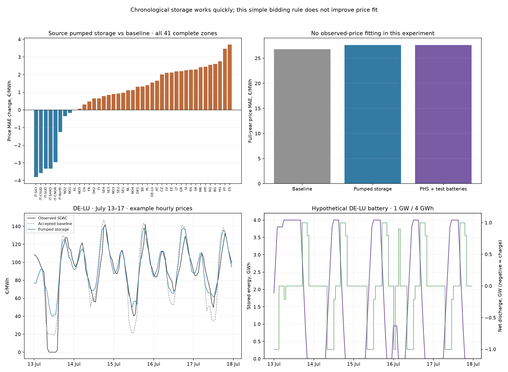

# Hourly storage bids on the accepted European baseline

**Implemented:** batteries and pumped storage can submit hourly charging-demand and discharging-supply offers, with state of charge updated from actual dispatch and carried across days. Two full-year European cases pass independent network, stock and LP-price checks. **Neither improves price fit; keep the accepted baseline.**

## Fleet and scope

The first case restores only the retained source model’s **67 pumped-storage units: 58.15 GW**, split conservatively into 68 bidding-zone entries. It preserves original pump/turbine power, energy limits, efficiencies and zero natural inflow; it does not add the fixed reservoir schedule a second time. Source round-trip efficiency is 75%. Mixed-zone parents use dated located pumped-storage plant capacities; pure parents map directly. No parent needed the modeled-bus-count fallback, but the source location/grouping remains a proxy.

The inherited energy capacity is **9,088 GWh**, with durations from roughly 0.008 to 2,404 hours. This is a conspicuous source-model uncertainty, not a verified 2025 pumped-storage inventory. It was disclosed and preserved rather than silently capped or replaced. Power, pumping limits, shared-reservoir roles and energy capacity need external reconciliation before an empirical fleet or investment claim.

The cache contains no verified battery fleet. The second case adds exactly three **hypothetical 1 GW / 4 GWh batteries** in DE-LU, FR and ES, each with 95% charge and 95% discharge efficiency. This tests the battery interface; it is not a claim that Europe has only these batteries or that these assets existed in 2025.

Accepted resource_full supply bids, hourly renewable availability, fixed demand/reservoir hydro, grid/GSK/link limits and all price targets remain unchanged. Storage changes consumption and generation endogenously. Its injection follows the same zonal GSK treatment as baseline supply; this does not validate the actual connection of individual plants.

## Simple bidding and chronology

For every hour and zone, take the median of the **next 48 own-baseline modeled hourly prices**, clipped at zero. Call that reference P. Charging willingness-to-pay is `eta_charge × eta_discharge × P − 1 €/MWh`; discharging ask is `P + 1 €/MWh`. No observed SDAC price enters this rule, and no new storage forecast LP is solved. The cached baseline was itself calibrated using 2025 prices, so this is still retrospective reconstruction.

Both directions are divisible offers in the full network LP. A strictly positive buy/sell spread prevents simultaneous cycling without binaries. Available charge is bounded by pump power and remaining space; discharge is bounded by turbine power and current energy. After clearing, `E_next = (1 − standing_loss) × E + eta_charge × charge − discharge / eta_discharge`. Future hours use that actual E, with no day-boundary reset. This hourly screen has no minimum run time, block acceptance, intrahour switching or simultaneous 24-hour day-ahead auction.

Initial energy is explicitly zero, since observed initial inventories are not supplied. Final inventory is reported rather than forced cyclic or credited in profit. Both evaluated cases happen to finish empty. Forecast windows shrink at year end; they never wrap into January or look up future observations. Reservoir hydro remains fixed and separate. This is a rolling opportunity-cost heuristic, not globally optimal storage operation or a validated operator equilibrium.

## Full-year results

| Case | Price MAE €/MWh | Mean correlation | Case runtime | Charge TWh | Discharge TWh | Closing stock TWh |
|---|---:|---:|---:|---:|---:|---:|
| Accepted baseline | 26.795 | 0.6328 | 51.8 s historical | — | — | — |
| Source pumped storage | 27.643 | 0.6277 | 76.4 s | 65.954 | 49.465 | 0.000000 |
| PHS + hypothetical batteries | 27.661 | 0.6274 | 58.1 s | 68.966 | 52.420 | 0.000000 |

All cases cover all 8,760 hours and the same 41 complete SDAC target zones of 48 modeled zones. New case runtimes include stock/bid updates, hourly clearing, certificates and witness saving. Total execution for both candidates plus source/forecast preparation is **153.8 s**; source preparation is **18.9 s**. Independent audit takes **23.7 s**. A fresh own-baseline forecast solve is excluded; the pinned historical baseline solve took 51.8 s. The two candidate runtimes are sequential measurements, not a claim that adding batteries inherently speeds the solver. One solver/BLAS thread, 5 GiB address-space cap.

The new bids and stock constraints materially alter dispatch, but push prices away from the observations on average. A storage implementation is not automatically a better market reconstruction: fleet inputs, bidding thresholds, forecasting, calibrated pre-storage bids and market design all matter. The baseline bid calibration may already absorb some observed storage effects; adding explicit storage without refitting can expose that mismatch. Price deviations cannot be causally assigned to any one of those from these two cases.

## Generation effects

| Case | Wind/solar offer dispatch TWh | Gas monthly MAE TWh | Coal monthly MAE TWh | Nuclear monthly MAE TWh |
|---|---:|---:|---:|---:|
| Accepted baseline | 1038.611 | 0.6604 | 0.5207 | 0.5351 |
| Source pumped storage | 1044.885 | 0.6936 | 0.5341 | 0.5192 |
| PHS + hypothetical batteries | 1044.919 | 0.6945 | 0.5343 | 0.5190 |

Wind/solar is the exact jointly grouped renewable-offer volume, avoiding a false unique wind-versus-solar allocation. Thermal errors compare original monthly Ember cells for the same modeled country/resource groups across cases; they exclude countries lacking that modeled resource. These are not the broader all-country scores in the preceding comparison report. Generation from storage discharge is reported separately rather than counted as new primary renewable or hydro energy. Charging losses require additional net generation. No carbon savings or storage profit is claimed.

## Verification and next step

Six focused tests cover empty/full stocks, efficiency, loss and carry beyond a day, forecast boundaries, invalid states/cycling, positive bid spreads and a small independent LP dispatch/dual certificate. Before the annual run, 26 zero-storage control hours reproduced the accepted objective within 2.24e-8 EUR. The annual independent replay reconstructs each forecast, bid bound and storage balance, checks every cross-day carry, original network constraints and hourly primal/dual optimality.

- **Source pumped storage:** maximum physical residual 1.78e-07 MW, stock balance residual 9.09e-13 MWh, duality gap 1e-06 EUR, annual energy-ledger residual 0 MWh. Zero emergency dispatch and simultaneous cycling. Maximum recorded numerical stock clip 9.09e-13 MWh.
- **PHS + hypothetical batteries:** maximum physical residual 2.97e-06 MW, stock balance residual 9.09e-13 MWh, duality gap 2.96e-06 EUR, annual energy-ledger residual 7.45e-09 MWh. Zero emergency dispatch and simultaneous cycling. Maximum recorded numerical stock clip 9.09e-13 MWh.

Retain this candidate as a working storage interface, not a replacement baseline. Before promotion, reconcile real battery/PHS MW/MWh and initial inventories, then evaluate a declared alternative bidding rule on unchanged common inputs. The current 48-hour median rule demonstrably fails the observed-price improvement goal. Do not restart reservoir searches, change source availability to dispatch, or relax feasibility gates. Public explorer/browser integration and recurring reviews remain unchanged.

[All-zone prices](hourly-storage-bids-2025-prices.csv) · [Source-model zonal PHS fleet](hourly-storage-bids-2025-fleet.csv) · [Country/resource thermal generation](hourly-storage-bids-2025-thermal-generation.csv). Full hourly dispatch, prices, charge/discharge and state trajectories stay in the ignored local `data/bidding-zone-network-2025/hourly-storage-bids-v1/`, with inputs, source hashes and audit. No large hourly witnesses are committed.

Reproduce in a fresh output directory with pinned scientific Python and one BLAS/OMP thread: run `tools/run_hourly_storage_2025.py`, then `tools/audit_hourly_storage_2025.py`, then `tools/report_hourly_storage_2025.py`. Design: `config/hourly-storage-bids-2025.json`. The generic interface supports both technologies with explicit power, energy, efficiency and standing-loss inputs.
