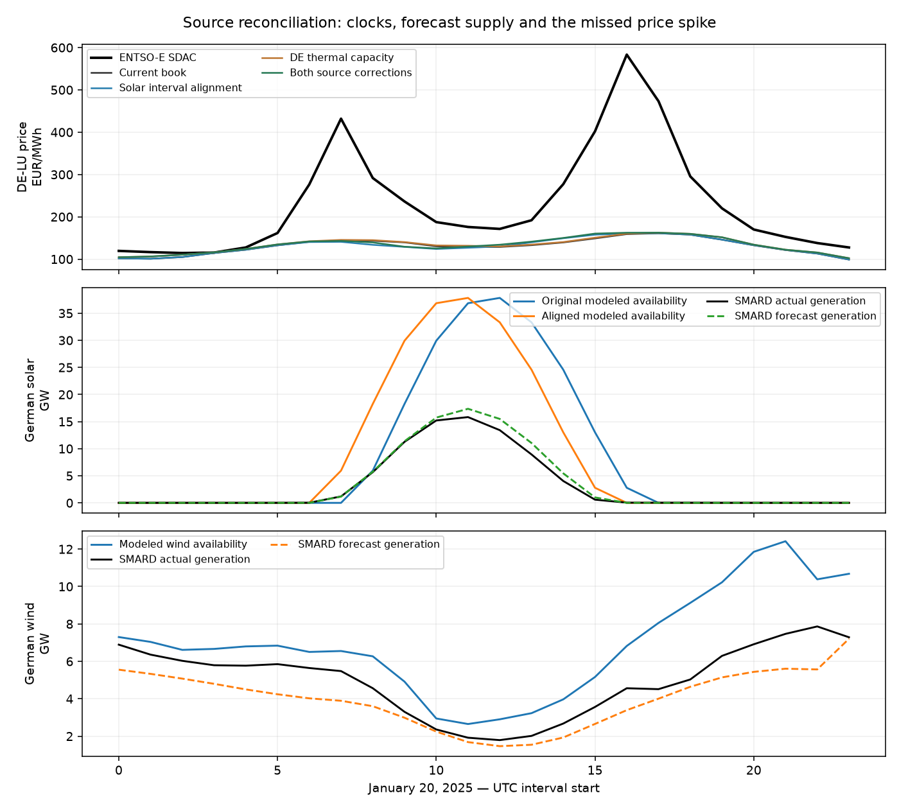
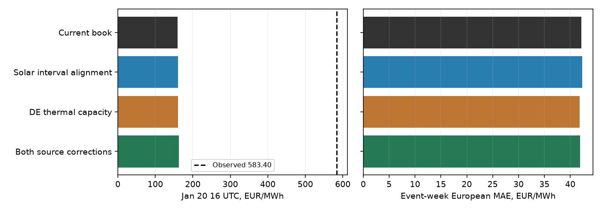

# January 2025 price-spike investigation

Source follow-up, 22 October 2026. Research evidence; current public model and accepted baseline remain unchanged.

## Findings

**Two input problems are substantiated:** ERA5 solar intervals were carried into hour-start market snapshots one hour late, and the inherited German coal fleet exceeds reported 2025 net installed capacity. Correcting these inputs still leaves the January 20 price spike largely unexplained.

The combined case gives **€162.40/MWh** at January 20, 16:00 UTC, versus **€583.40 observed**. Reported-capacity reconciliation alone improves German event-week MAE **€42.67→€40.39/MWh**. Solar timing alignment alone slightly worsens price MAE: retain that adverse outcome. No price-selected shift, bid fit, model selection or promotion was performed.

## Forecast supply balance

SMARD is the Bundesnetzagentur public source, with TSO/ENTSO-E data and explicit series IDs. Forecast generation, actual generation, modeled available supply and demand have different meanings. Values below refer to Germany; price comparisons use DE-LU. All prices remain corrected original ENTSO-E A44 SDAC targets.

| January 20, 16 UTC | Original model MW | Aligned model MW | SMARD forecast MW | SMARD actual MW |
|---|---:|---:|---:|---:|
| Solar | 2783.65 | 0.00 | 3.50 | 38.75 |
| Onshore wind | 4403.17 | unchanged | 2485.00 | 2763.00 |
| Offshore wind | 2419.14 | unchanged | 907.00 | 1800.25 |
| Grid load | 70641.63 | unchanged | 69690.75 | 70641.75 |

Residual load here means **grid load minus wind and solar**. It is 61.04 GW in the original inputs and 63.82 GW after solar alignment, versus 66.30 GW in the forecast archive. This is a tightness diagnostic, not a newly fitted bid feature. Realized demand is higher than forecast at this hour; an underestimated German demand input is not the apparent problem.

**Forecast-vintage limit:** these are current archived forecast series, not verified pre-auction snapshots. SMARD distinguishes day-ahead and intraday forecasts; its guidance describes renewable forecast publication by 18:00 for the following day, after the midday auction. File creation metadata does not establish the original forecast issue time. We therefore use these forecasts only as retrospective diagnostics, not recovered auction offers or physical resource bounds. Actual generation is never substituted for availability.

## Solar timing correction

ECMWF defines ERA5 accumulated radiation as covering the preceding hour. The installed atlite adapter explicitly says 13:01–14:00 is labeled 14:00 and computes solar position at the interval midpoint. Our compact converter retains the source clock; the renewable loader copies profiles directly to market snapshots. Every original solar/PV-tracker generator profile matches the network coefficient exactly in the source replay. The market demand/price clock labels interval starts.

The correction uses **PV coefficient at t+1 for market interval [t,t+1)**. Wind coefficients are unchanged. Destination-hour IRENA commissioning, source-country membership, plant geography and tranche shares are preserved. Original files remain intact; corrected coefficients are separate arrays. No circular roll, correlation-selected lag, weather rescaling or generation replacement is used.

This fixes interval semantics, not the size of the midday solar resource estimate. A full-year corrected profile still needs the right-edge 2026-01-01 00:00 coefficient; this study neither wraps nor fills that endpoint. No annual corrected-profile or price-accuracy claim follows from this ten-day test.

## German thermal-capacity reconciliation

SMARD reports net installed capacity in MW, with an annual reporting calendar. The 2025 label is resolved in Europe/Berlin, including a UTC timestamp on December 31, 2024. These are revised annual stock figures, **not dated hourly outages, market-eligible offered capacity, or proof of January 20 availability**.

| Technology | Inherited model MW | SMARD reported 2025 MW | Applied factor |
|---|---:|---:|---:|
| hard_coal | 20351.94 | 15951.00 | 0.7838 |
| lignite | 19457.03 | 15178.00 | 0.7801 |
| gas | 36895.87 | 36614.00 | 0.9924 |

The capacity case proportionally reconciles only existing German coal/lignite/gas offer upper bounds, keeping spatial membership, relative offer tranches and bids unchanged. German/Luxembourg membership is checked against original source-country labels; no Luxembourg thermal fleet is folded into the German totals. Gas nameplate is already close to the reported stock. Hourly outages and commercial availability remain unresolved, so this is a reported-stock sensitivity, not a reconstructed available fleet.

## Clearing results

| Case | Jan 20 German price | European MAE | German MAE | Emergency MWh | Solver seconds |
|---|---:|---:|---:|---:|---:|
| Current book | 159.10 | 42.15 | 42.67 | 0.000000 | 0.000 |
| Solar interval alignment | 160.68 | 42.27 | 42.88 | 0.000000 | 0.859 |
| DE thermal capacity | 160.22 | 41.82 | 40.39 | 0.000000 | 0.837 |
| Both source corrections | 162.40 | 41.89 | 40.62 | 0.000000 | 0.803 |

Prices/MAE are EUR/MWh. Evaluate every hour January 15–21 (168 hours), with equal weight across all 41 complete observed-price zones; German MAE is separate. All cases retain the entire European network, fixed hydro, original demand, calibrated bids, GSK, links and ratings/flow offsets. There is no startup/commitment optimization in these fast source tests. All four cases use zero emergency supply over all 240 checked hours.

The control reuses the saved annual witness and has no new solve time. The three new cases each make 240 chronological hourly solves; recorded solver time excludes collection, source reconstruction and verification. These timings are not an 8,760-hour benchmark. Existing non-oil bids retain calibration to earlier incorrectly selected auction targets; no corrected-target refit was performed.

## Verification and prior evidence

Independent replay covers the original raw source responses, configuration units, all four **960 hourly LP witnesses** (240 reused control,720 new), every native network equation, bounds, unchanged costs and full primal/dual optimality. Maximum native residual is 3.52e-08 MW and duality gap €2.31e-07. Quarter-hour energy sums match hourly energy; forecast components match their combined series. Four source-contract tests cover interval alignment across midnight, missing year endpoints and source-year selection.

Authoritative ignored receipts: `data/bidding-zone-network-2025/january-supply-balance-v1/reconciliation-inputs.json`, `clearing-v1/summary.json`, `clearing-v1/audit.json` and `report-receipt.json`. URLs, original response bytes, retrieval timestamps and SHA256 hashes are retained. Source/case producers are `january_supply_sources_2025.py`, `january_supply_balance_2025.py` and `audit_january_supply_2025.py`.

The [prior ramp/startup investigation](https://github.com/autological-eu/grid-conductor/blob/3516be8/research/january-scarcity-2025.md) remains archived with all original witnesses: running-unit ramps left the event price at159.10; continuous startup states raised it to165.04. Its stronger stress failed the emergency-supply gate and peaked two hours late. The prior report/figures are also copied into this source checkpoint with their original hashes; no old numerical helper or receipt is rewritten.

## Conclusion and next checks

These input corrections improve physical consistency and modestly improve the German price comparison, but they do not recover the scarcity event. Solar alignment alone slightly worsens price errors, consistent with inherited bid parameters already compensating for imperfect inputs; that possibility is not proof of its cause. Keep the source correction distinct from refitting bids.

The remaining forecast gap is chiefly wind. Gas installed capacity broadly agrees with the public stock, so the next decisive evidence is **hourly available/offered thermal capacity and bids**, along with the true regional import constraints and neighboring hydro opportunity costs. We have not identified which of these caused the observed spike.

A usable ENTSO-E API credential is not configured in this runtime, so authenticated outage queries are unavailable. Dated plant outages remain unverified; other public sources may provide evidence. This does not prevent the public SMARD audit or network solves. Obtain dated source evidence before asserting that a particular plant was unavailable; do not infer outages from low generation or from this price gap. The public model, accepted annual baseline and disabled recurring reviews remain unchanged.

## Sources

- [ECMWF ERA5 time/accumulation convention](https://confluence.ecmwf.int/pages/viewpage.action?pageId=85415489).
- [Atlite solar-interval discussion](https://github.com/PyPSA/atlite/issues/158); the locally installed adapter and exact loader/converter source bytes are hash-bound.
- [SMARD forecasts](https://www.smard.de/page/en/wiki-article/5884/206318) and [net installed capacity](https://www.smard.de/page/en/wiki-article/5884/6038/installed-generation-capacity).
- [SMARD API chart configuration](https://www.smard.de/app/chart_configuration/market_data_configuration.json): forecasts125/123/3791/5097/411; actual4068/4067/1225/410; installed4075/4072/198. Public SMARD data attribution: Bundesnetzagentur/SMARD, CC BY4.0.
