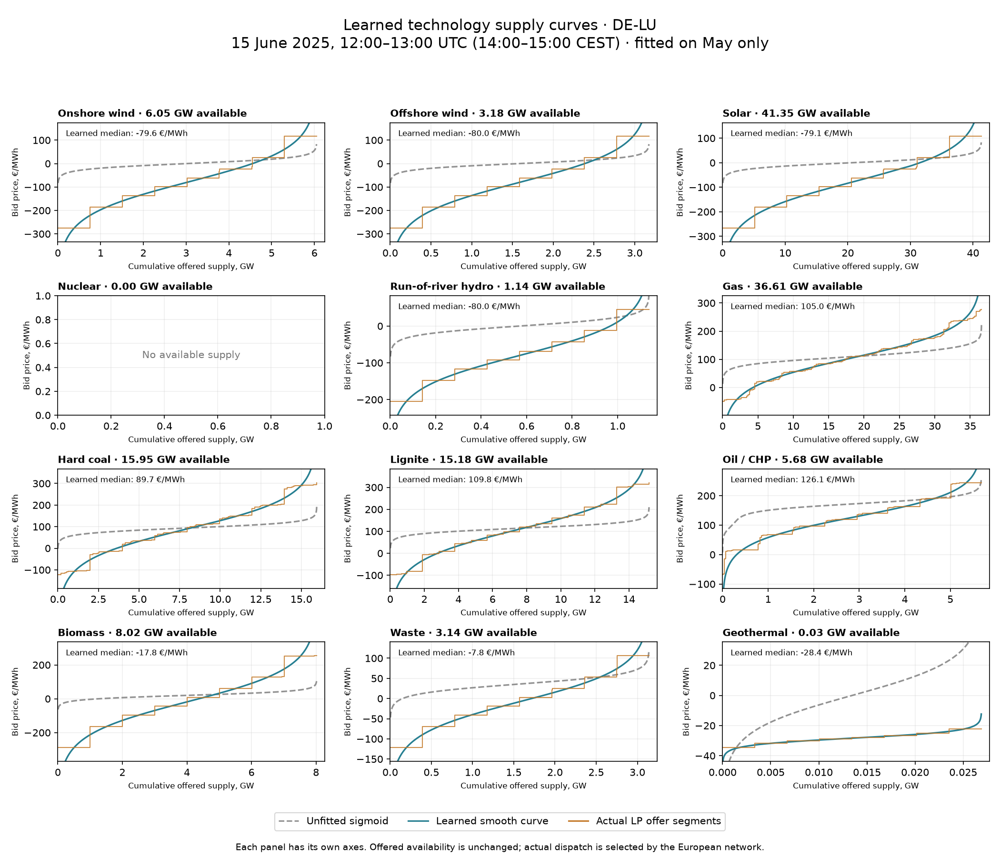

# An example of learned technology supply curves

**DE-LU, 15 June 2025, 12:00–13:00 UTC / 14:00–15:00 CEST.** Curves were fitted on May only, then used unchanged for June. This is an extraction of the completed held-out run: no new fitting or clearing.

Grey dashed: the unfitted sigmoid control. Blue: the learned continuous supply function. Orange: the finite divisible offers actually used by the LP. Both versions have identical source availability; learning changes their bid prices and distribution across price levels. Each panel has its own axes.

The underlying rule is `quantity = available_MW × sigmoid((price − source_cost − hourly_shift)/spread)`. The shift uses learned intercept and local-clock daily harmonics; spread controls steepness. Both are shared country/resource-family parameters, while original technology/efficiency costs and source groups remain distinct. A technology curve adds up the curves of its source groups, so it need not be one perfect sigmoid.

A shift upward means that the same volume requires a higher price; a wider price range spreads offered volumes across more prices. The sigmoid expresses **volume as a function of price**. These charts put price on the vertical axis and volume on the horizontal axis, so they show its **inverse**. Here eight equal-volume segments per source group approximate the smooth curve. Their prices are sampled at inverse-sigmoid quantile midpoints. The orange steps are independently divisible, not block bids.

| Technology | Available GW | Unfitted median bid €/MWh | Learned median bid €/MWh | Learned 10–90% bid range €/MWh | Actual dispatch GW |
|---|---:|---:|---:|---:|---:|
| Onshore wind | 6.054 | 0.00 | -79.63 | -238.84 to 78.84 | 4.545 |
| Offshore wind | 3.176 | 0.00 | -80.00 | -239.04 to 79.04 | 2.382 |
| Solar | 41.353 | 0.00 | -79.11 | -231.52 to 71.52 | 31.081 |
| Nuclear | 0 | — | — | — | 0 |
| Run-of-river hydro | 1.139 | 0.00 | -80.00 | -181.36 to 21.36 | 0.996 |
| Gas | 36.614 | 109.35 | 105.03 | -9.46 to 219.84 | 4.332 |
| Hard coal | 15.951 | 93.70 | 89.71 | -71.56 to 250.97 | 3.982 |
| Lignite | 15.178 | 113.73 | 109.83 | -51.51 to 271.16 | 1.897 |
| Oil / CHP | 5.684 | 171.99 | 126.15 | 29.01 to 219.88 | 0.074 |
| Biomass | 8.023 | 20.14 | -17.83 | -237.49 to 201.88 | 4.012 |
| Waste | 3.143 | 35.93 | -7.79 | -100.12 to 84.45 | 1.569 |
| Geothermal | 0.027 | 0.00 | -28.37 | -33.47 to -23.27 | 0.027 |

European network clearing gives DE-LU **-6.98 €/MWh** with learned curves, versus **17.65 €/MWh** with the unfitted control and **-5.00 €/MWh** observed ENTSO-E SDAC. These prices are not an isolated intersection of the displayed domestic curves: imports, exports, fixed injections and physical network constraints participate.

The median and 10–90% range describe prices along the smooth offered-volume curve, not confidence intervals or predicted market-price ranges. Prices beyond those quantiles still exist; graph tails are clipped for readability. Available MW is not dispatched MW, and negative offers are permitted. Germany has no nuclear supply in the retained fleet. Reservoir hydro remains a separate fixed hourly injection. Flexible battery/PHS curves were not part of this fitted experiment; their separate earlier candidate must not be spliced into this witness.

The gas median changes only from 109.35 to 105.03 €/MWh, but its 10–90% range widens from 80.30–143.22 to −9.46–219.84 €/MWh. The fit is learning a much wider distribution of willingness to supply, not simply shifting every gas offer downward. German wind/solar reach the declared −80 €/MWh effective hourly-shift bound in this example, and a biomass spread reaches the 100 €/MWh upper bound. These binding limits are important calibration diagnostics, not established physical properties.

These are learned effective offers, not observed order books or recovered operating costs. The broad negative/positive tails can compensate for excessive modeled availability, missing constraints or missing market mechanisms. They do not establish actual renewable or thermal bidding behaviour. The six-pair experiment improved aggregate prices/generation but worsened solar generation and seven Nordic price zones; the accepted baseline remains unchanged.

[Technology summary and parameters](learned-supply-curve-example-2025.csv) · [Exact LP offer segments](learned-supply-curve-example-2025-offers.csv) · [Six-pair validation report](sigmoid-month-pairs-2025.md). The local receipt pins the proposal, witnesses, original inputs and exports.
