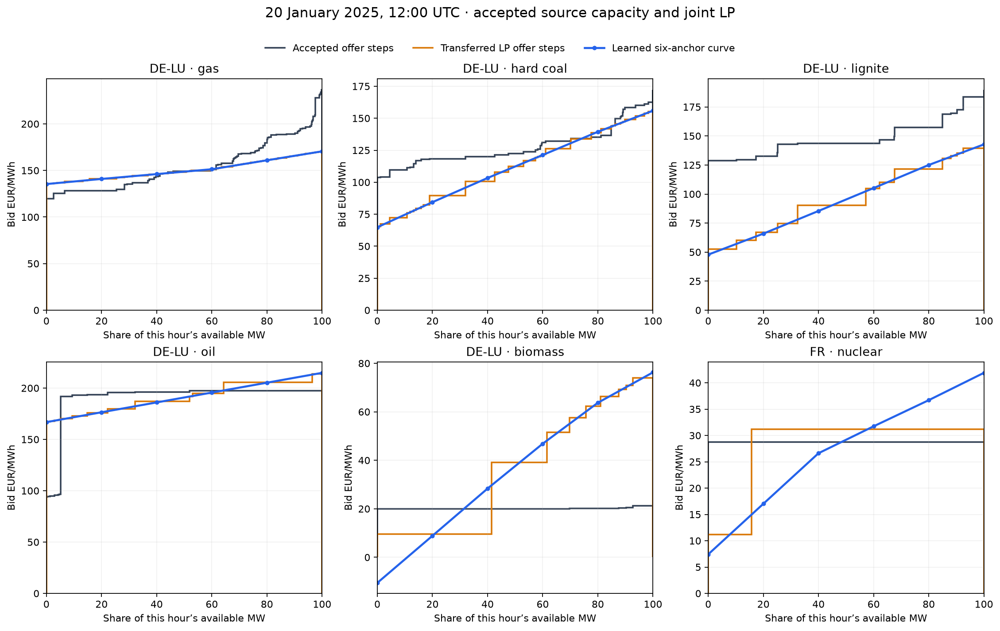

# Monthly fitted bids in the 2025 joint physical LP

## What changed in the bids?

The accepted baseline assigns each original LP offer column a discrete price.
Those prices start from technology/resource inputs (including fuel, efficiency,
carbon and existing CHP/offer adjustments); its accepted gas, coal/lignite and
nuclear case adds bounded zone/resource calendar corrections. Sorting a
technology's available offer columns by price gives the **grey step stack**
below. The monthly fit instead learns **six increasing marginal-price anchors**
at 0, 20, 40, 60, 80 and 100% of each technology's *hourly available MW* in
each zone and local hour. The blue line joins these anchors. In the original LP
test, each existing column receives the curve price at the midpoint of its
available capacity tranche, producing the orange steps. Capacities and network
constraints do not change in this comparison.

This is **20 January 2025, 12:00 UTC**, not an annual average. Each panel has
its own price scale and each horizontal axis refers to that technology's
available output, not total zonal supply. Exact plotted values and capacity
are in [the six-row example table](monthly-bids-vs-baseline-2025.csv).

| Technology and zone | Available GW | Baseline column prices, EUR/MWh | Learned anchor range, EUR/MWh |
| --- | ---: | ---: | ---: |
| DE-LU gas | 36.61 | 119.57–236.78 | 135.42–170.54 |
| DE-LU hard coal | 15.95 | 103.87–172.35 | 64.83–155.89 |
| DE-LU lignite | 15.18 | 128.75–189.88 | 47.84–142.73 |
| DE-LU oil | 5.68 | 93.93–197.21 | 166.82–214.83 |
| DE-LU biomass | 8.02 | 19.98–21.32 | −10.54–76.27 |
| FR nuclear | 46.97 | 28.74–28.74 | 7.42–41.89 |

The baseline coal/gas steps reflect multiple physical source offers and earlier
bid corrections; the learned shape is an effective curve fitted to prices and
generation, **not** a reconstruction of operator bids or fuel costs. The
negative biomass anchor is permitted by the experimental fit and is a reason
to check economic plausibility before using it for scenarios. Wind, solar and
run-of-river retain low/zero-price renewable bids in this experiment; their
hourly *available volume* changes with source profiles. The original LP also
pools some renewable technologies in mixed offer columns, so it has no uniquely
observable separate wind or solar step stack for this hour. Reservoir hydro is
a fixed hourly schedule here, and batteries have no offer curve in this LP.

## Result

The twelve saved, same-month technology bid fits **can** be used in the fast joint
physical LP. The original 799-offer model cleared all 8,760 hours of 2025 in
**30.85 seconds** of solver time, with no emergency generation. Preparation,
including cost transfer and a 24-hour pilot, took another **23.74 seconds**;
this is a roughly 55-second preparation-plus-clearing test, excluding Python
startup and the separate independent audit. All prices below are cleared LP
duals compared with corrected hourly ENTSO-E SDAC prices in the same 41
complete-coverage zones.

| Full-year matched metric | Accepted `solar-anchor-bids-v1/resource_full` | Monthly bids in original joint LP |
| --- | ---: | ---: |
| Equal-zone hourly price MAE, EUR/MWh | **26.795** | 26.863 |
| Hourly country/technology generation MAE, GW | 0.633 | **0.567** |
| Hourly source-covered technology-share MAE | 0.0777 | **0.0677** |
| Monthly Ember generation MAE, TWh/cell | 0.326 | **0.313** |
| Monthly Ember normalized generation MAE | 0.2769 | **0.2724** |

Price MAE rises by **0.068 EUR/MWh** (0.25%) relative to the accepted baseline;
19 of the 41 price zones improve. The hourly generation and share scores improve,
but are **illustrative**: the original LP has mixed renewable offer columns whose
technology split is not uniquely identified by their cleared output. These columns
dispatch 1,117.39 TWh over the year. Allocation uses source-member availability
shares where defined. For 0.271 TWh of the candidate's mixed-offer output
(0.271 TWh in the baseline), every member profile is zero despite positive LP
output; the audit instead uses the available zone/technology shares. This
fallback is 0.024% of mixed-offer output, but the much larger mixed-offer total
still makes technology attribution conditional rather than exact. Both cases use
the same allocation rule.

| Month | Joint LP MAE | Accepted MAE | Month | Joint LP MAE | Accepted MAE |
| --- | ---: | ---: | --- | ---: | ---: |
| Jan | 28.20 | 29.59 | Jul | 22.93 | 22.80 |
| Feb | 35.97 | 36.25 | Aug | 24.72 | 25.27 |
| Mar | 30.42 | 30.53 | Sep | 27.27 | 26.52 |
| Apr | 25.86 | 25.88 | Oct | 28.16 | 26.84 |
| May | 25.27 | 25.24 | Nov | 27.35 | 27.14 |
| Jun | 25.53 | 24.60 | Dec | 21.52 | 21.69 |

Among the largest price-MAE improvements are NO4 (42.53→39.13), SE1
(40.57→37.35), SE2 (41.27→38.11) and ES (19.61→16.48) EUR/MWh.
CZ worsens from 19.22 to 24.71; GR from 21.31 to 25.59. The full 41-zone
and twelve-month rows are in the ignored independent `audit.json` below.

## Transfer and verification

The fit was made with the [mixed-flow monthly transport model](mixed-flow-monthly-bid-fit-2025.md):
20 Adam updates at rate 0.05 per month, one six-anchor monotone curve per
technology, zone and local hour. Its **24.577 EUR/MWh** same-month price MAE
comes from an independent-corridor smooth clearing model, not this LP. The LP
test froze each month's curves and sampled their marginal prices at the
existing, availability-weighted offer-column midpoints. It retained the original
LP's 799 columns, demand, fixed hydro, link limits, PTDF constraints, emergency
costs and corrected solar availability. Zero-bid renewable and geothermal
offers, and 104 mixed renewable columns, kept their accepted LP bids; 647
single-technology columns were mapped. No hourly fit or reclearing of observed
exchanges occurred during transfer. The LP determines its own flows.

The fitting source has **37.116 TWh more 2025 solar available energy** than the
later accepted LP input, with a maximum 22.319 GW Europe-wide hourly
difference. All non-solar group availability, source costs, load and fixed
generation matched in the preflight. The LP evaluation retained the accepted
lower solar input, so the compared LP cases share physical inputs, while the
fitted curves were learned under a materially different renewable envelope.
They should be refitted on the accepted inputs before a baseline selection.

The independent saved-witness replay checked every hour and the original LP
cost/availability transfer. Maximum primal violation was
**2.01×10⁻⁵ MW**, objective replay difference **3.73×10⁻⁸ EUR**, duality gap
**2.98×10⁻⁴ EUR**, and complementarity **9.93×10⁻⁴ EUR**, within the unchanged
gates. Emergency dispatch was zero. The pilot had zero emergency output and
maximum primal residual **3.40×10⁻¹⁰ MW**. Source hashes, curves, transferred
costs, accepted reference and annual witness are checked by
`tools/run_mixed_flow_fast_joint_lp_2025.py` and
`tools/audit_mixed_flow_fast_joint_lp_2025.py`; large arrays stay ignored at
`data/bidding-zone-network-2025/mixed-flow-fast-joint-lp-v1/`.

## Baseline decision and next step

**Keep the accepted baseline pointer unchanged.** The LP transfer is fast and
feasible, and generation agreement improves, but the all-zone price target is
slightly worse. This is an in-sample 20-update pilot rather than the requested
100-update protocol. August needed projected pseudogradients, and no independent
month or investment-response validation has been done. The source solar
difference further limits interpretation of fitted coefficients. Next, align
the fit with accepted solar availability, resolve the August price-root
ambiguity, complete the full update protocol, and repeat the same LP and
generation audit. A reconstructed historical price fit alone does not validate
new-asset scenario values.
