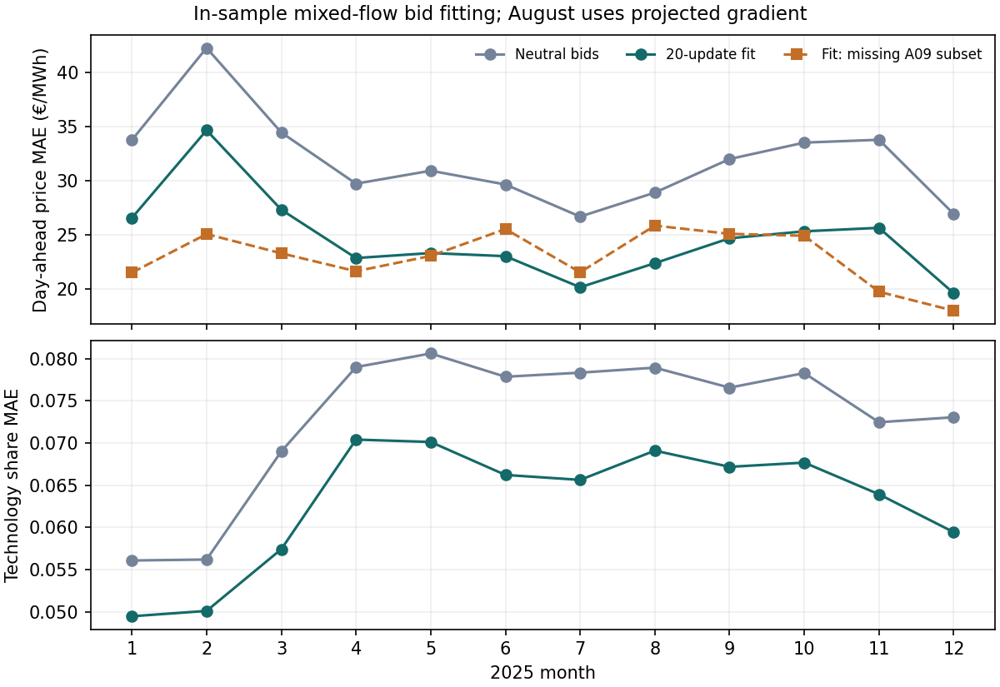

# Monthly bid fitting with inferred transport on missing-exchange hours

## Question and scope

Can the 2025 technology bid-curve fit include hours lacking complete ENTSO-E
day-ahead commercial exchange observations? This research control clears all
48 retained bidding zones jointly in each hour, inferring corridor flows under
the model's independent physical bounds. Unlike the earlier local
flow-adjusted fit, it does not require observed flows to define residual demand.
It uses the attached toy notebook's key safeguard: both a cleared-price error
and an observed generation-mix error contribute gradients through the market
clearing. The result is a retrospective fit, not a validated forward forecast,
market-domain reconstruction, physical LP benchmark, or investment simulator.

## Data and model

Demand, generator capacity, original hourly renewable availability, fixed
reservoir schedule, fuel-price source terms, 48 bidding zones and 2025 UTC
chronology come from the retained European source snapshot. Corrected hourly
ENTSO-E day-ahead prices supply targets in source-covered zones. Source-covered
hourly ENTSO-E A75 technology generation supplies **country by technology**
targets, not a complete bidding-zone technology census. Observed ENTSO-E
A09/A01 commercial exchanges are parsed separately in both directions and
averaged over complete quarter-hours; missing intervals remain missing.

For each month, bidding zone, technology and local hour of day, six monotonically
increasing price anchors describe a supply curve at 0, 20, 40, 60, 80 and 100%
of that actual hour's available output. Renewable zero-price offers and the
fixed reservoir schedule retain their existing roles. This does not replace
availability with observed dispatch. The joint market balances each zone with
bounded corridor flows. Positive saved flow runs from its recorded `from_zone`
to `to_zone`; positive zonal net import is incoming minus outgoing. The
independent-corridor bounds are model-derived physical proxies and are not
certified JAO commercial domains or native PyPSA-Eur PTDF constraints.

The differentiable objective sums four smoothed absolute terms, each averaged
over its own observed cells: (1) day-ahead price difference divided by
€40/MWh, (2) hourly country/technology generation difference divided by 3 GW,
(3) source-covered technology **share** difference within each country/hour,
and (4) a 0.2-weighted flow difference on corridors where both A09 directions
are present **and** the observed commercial exchange fits the model's physical
bound. The fourth term never fabricates an exchange on an unobserved corridor.
The technology-volume and share terms both backpropagate to bids; prices alone
cannot define the loss. A small neutral-bid parameter penalty stabilizes
updates. Each month starts from the same neutral bids and receives 20 Adam
updates at rate 0.05 in this bounded pilot. Numerical root recovery may use
only previous **modeled** prices or independently cleared neighboring modeled
hours, never observed price labels to choose a root. The unchanged balance,
generation-bound, corridor-bound and no-emergency checks remain mandatory.
The default strict gradient gate stops when the price Jacobian has an
unidentified loss direction. In an explicitly flagged research continuation,
the Moore–Penrose adjoint projects only that unidentified direction out of the
parameter update; its price error remains in every reported score. The
affected hours, zones and projected residual must be disclosed, and this
continuation does **not** pass an exact-gradient acceptance gate.

## Result and verification

All twelve 20-update fits completed. The independent replay of saved curves
reproduced every monthly price, generation-volume, mix-share and compatible
observed-flow metric; all 8,760 hours passed the unchanged zonal balance,
generation-capacity, corridor-bound and zero-emergency checks. Its maximum
balance residual was **0.000001 MW**. The 12 monthly fit loops took **783 seconds**
in total, excluding repeated source preparation, interrupted attempts and the
independent audit.

| Same-month observed-cell metric | Neutral bids | Fitted bids | Cells |
| --- | ---: | ---: | ---: |
| Day-ahead price MAE, €/MWh | 31.82 | **24.58** | 359,160 zone-hours |
| Price MAE where incident A09 is incomplete, €/MWh | 34.53 | **22.98** | 88,220 zone-hours |
| Hourly country/technology generation MAE, GW | 0.612 | **0.550** | 1,835,997 cells |
| Country/hour source-covered technology-share MAE | 0.0731 | **0.0631** | 1,832,369 cells |
| Compatible observed corridor-flow MAE, GW | 0.991 | **0.957** | 647,826 corridor-hours |

The missing-A09 row is a **subset** of the all-zone price row. It is scored on
observed prices even though no complete incident commercial-exchange vector
exists for those zone-hours. Its flows come solely from the joint model.

| Month | Neutral price MAE | Fitted price MAE | Fitted missing-A09 MAE | Projected-gradient updates |
| --- | ---: | ---: | ---: | ---: |
| Jan | 33.77 | 26.58 | 21.54 | 0 |
| Feb | 42.28 | 34.68 | 25.10 | 0 |
| Mar | 34.47 | 27.34 | 23.32 | 0 |
| Apr | 29.75 | 22.88 | 21.66 | 0 |
| May | 30.94 | 23.34 | 23.08 | 0 |
| Jun | 29.67 | 23.05 | 25.56 | 0 |
| Jul | 26.71 | 20.19 | 21.57 | 0 |
| Aug | 28.92 | 22.41 | 25.88 | **19** |
| Sep | 32.02 | 24.70 | 25.12 | 0 |
| Oct | 33.54 | 25.35 | 24.94 | 0 |
| Nov | 33.80 | 25.67 | 19.77 | 0 |
| Dec | 26.95 | 19.64 | 18.02 | 0 |

August's first projected update includes **15 August 23:00 UTC** in EE, LV and
LT: their common price direction is flat in the clearing Jacobian. The
unidentified component of the normalized loss gradient reached 1.42×10⁻⁶;
subsequent August updates continued to require projection. Scores still
include those observed prices. A projected update is **not** an exact gradient
and cannot certify unique historical bids or a price root. A direct two-start
check on the final August curve for that hour found equally balanced solutions
whose EE/LV/LT prices differ by **€6.43/MWh**; inferred corridor flows and
generation differ by less than **10⁻⁸ GW**. Thus the ambiguity is a price
reference within an isolated flat direction, not an observed flow change.
The other eleven months did not invoke this exception.

Saved `curves.npz` files hold the fitted monthly bids. The independent audit
also saved one `inferred-flows.npz` per month for all 8,760 UTC hours and 95
directed corridors (10.12 MiB total), plus `flow-metadata.json` mapping columns
to zone pairs and recording model/constraint hashes. Each array contains
inferred corridor flow and zonal net import in GW, model lower/upper bounds,
observed A09 exchange where available, and a compatibility mask. Positive
flow runs from `from_zone` to `to_zone`. Positive net import enters a zone.
These are ignored local research artifacts; no inferred value is labelled as
an ENTSO-E observation. The independent audit records SHA-256 hashes for each
month's fitted curves and flow file in `audit.json`.

### Limitations and next gate

Training and scoring use the same 2025 months and observed prices. A lower
within-month price MAE is therefore not evidence of forward price recovery or
unique historical bids. The generation target is incomplete and aggregated to
country; its mix penalty limits but cannot resolve all inverse ambiguity.
Commercial A09 exchanges disagree with model physical bounds in **47,768**
corridor-hours; those cells are reported rather than silently forced into the
loss. Compatible observed-flow error remains **0.957 GW**, so inferred flows
are not verified reconstructions of the commercial schedule. Any asset
scenario must reclear flows, and the accepted physical LP, hydro chronology,
source reconciliation and independent-period evaluation gates remain open.
