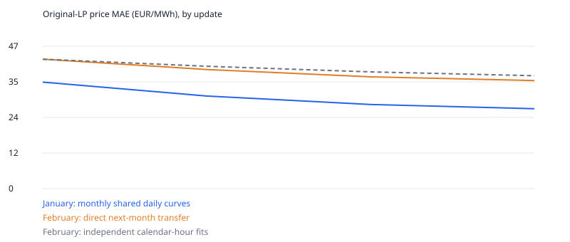

# Monthly daily-pattern bids and compiled dispatch —2025

One monthly model shares24 local-hour supply curves across all days, for every
technology and bidding zone. January therefore has **46,944**
raw coefficients rather than **1,455,264** independent
calendar-hour coefficients:31 times fewer. **25,200**
coefficients are active; zero renewable bids and unavailable resources stay frozen.

Every actual hour still uses its own demand, source/fuel costs, renewable MW and
network bounds. Monthly generation remains an actual sum, not a sampled estimate.
The model fits all744 January hours and applies its local-hour curves directly
to all672 February hours. No February target enters gradients or transfer.

| Update | January price MAE | February forward MAE | February mix MAE TWh | Phase seconds |
|---|---:|---:|---:|---:|
|0|35.266|42.860|0.3504|38.0|
|1|30.668|39.446|0.3449|143.5|
|2|27.860|37.022|0.3431|162.3|
|3|26.462|35.782|0.3395|155.8|

The selected update is **3**, chosen by February price
MAE. This is a bounded three-update model-selection test, not convergence or an
untouched forecast test. At equal three-update budgets the earlier independent
hourly model scores37.389 EUR/MWh in February
and0.3348 TWh monthly mix MAE. Its
January fit scores22.916 EUR/MWh. Sharing and
regularization change together here; do not attribute all differences to solver
choice. These neutral-source candidates are not promoted accepted baselines.

## Parameterisation and identifiability

For each technology/zone/local hour, six raw parameters control a bounded
midpoint shift80·tanh(raw/4) and five positive increments0.001+20·softplus(raw).
Monotone cubic interpolation joins nodes at0/20/40/60/80/100% available output.
Adam uses gradients through physical clearing against observed ENTSO-E prices
and known monthly country/technology Ember generation. Shrinkage and cyclic
adjacent-hour penalties both use weight0.01. The latter joins23:00 to00:00;
there is no artificial calendar-month wrap or backwards forecast.

Every local09:00 observation contributes to the same09:00 economic curve.
Availability and fuel anchors still make its MW volumes and total price vary
from day to day. February uses these January patterns without averaging away
independently fitted hourly noise. Weekday/weekend effects are not added.
Fewer coefficients and repeated observations improve statistical support but
do not uniquely identify real bids: monthly generation is mainly national,
many supply segments never set the price, and network/resource tradeoffs remain.

## Faster differentiable dispatch trial

Clarabel **0.11.1** solves compiled convex quadratic
subproblems of the unchanged cubic objective. Feasible objective line search
and original nonlinear Newton polishing retain true cubic optimality. Uncertified
QP solutions never become accepted dispatch. Failed compiled steps use original
Newton recovery and are counted in the iteration CSV. Gradients are implicit
adjoints of the converged cubic KKT system, not of the last QP approximation.

Six matched January/February nonlinear pilot hours took1.407s with the
previous condensed solver and1.325s with the compiled hybrid
(1.06×). The three relevant price/generation directional checks
pass the unchanged0.001 scaled-error gate at both smaller perturbations. An
earlier arbitrary **internal-flow** output failed that gate, worsening as the
step shrank; its receipts remain retained. No general internal-flow sensitivity
accuracy is claimed. Monthly-sharing gradient aggregation and cyclic penalties
also pass independent directional tests.

Fewer parameters alone do not remove the744 hourly clearings. Timings separate
dispatch, adjoints and the two original20-tranche LP evaluations in the CSV.
The initial step revalidates cached neutral KKT states; it is not a fresh-solve
benchmark. Full-pipeline comparisons also change sharing, regularization and
the number of LP passes, so only matched pilot timings isolate backend speed.
Input loading, some checkpoint writes and independent auditing are separate.

## Verification and scope

Independent SciPy cubics and original physical/dual certificates replay
**2,832 witness hours** from initial/selected/last proposals.
LP gates stay1e-4 MW feasibility,0.05 EUR objective/complementarity and1e-5 EUR/MWh
free reduced cost, with no artificial emergency dispatch. Smooth training uses
the stricter original2e-10 GW/2e-9 EUR/MWh/1e-8 kEUR precision gates. Original
availability, network physics and fixed hydro remain unchanged; no duplicate-LP
compression or new pricing/allocation convention is used for these scores.

This is retrospective perfect-input validation. Actual future demand, weather,
fuel prices and fixed reservoir schedules are exogenous. February errors select
the update. Missing generation observations remain unknown; renewable allocation
can be nonunique. The twelve-month study stays separate and paused. Sources,
versions, failure receipts, optimizer states and full witnesses remain in local
ignored `monthly-diurnal-splines-v1`; compact data only are tracked.

[Iterations/timings](assets/monthly-diurnal-splines-iterations.csv) ·
[Per-zone February errors](assets/monthly-diurnal-splines-zones.csv) ·
[Monthly generation](assets/monthly-diurnal-splines-generation.csv)

## Comparison and next step

| Three-update model | January price MAE | February price MAE | February monthly mix MAE |
|---|---:|---:|---:|
| Independent calendar-hour fits, averaged for transfer |22.916 EUR/MWh|37.389 EUR/MWh|0.33481 TWh|
| Monthly shared local-hour curves |26.462 EUR/MWh|35.782 EUR/MWh|0.33954 TWh|

The monthly model fits January less closely but improves February price MAE by
**4.3%** relative to independent hourly fits. February generation MAE is **1.4%
worse**; sharing is not a uniform empirical improvement. Both comparisons use
the same source inputs and exactly reproduce the same neutral initial control.
Both saved result sets passed their independent audits; the comparison source
hashes are recorded locally in `comparison-provenance.json`.

Updated phase totals are **144–162 seconds**, versus202–221 for the earlier
independent-hour study. This changes model sharing and removes its redundant
averaged-within-month scoring pass, as well as changing the solver. The matched
backend pilot's1.06× gain is small and is not evidence of a major solver speedup.
All744 hours in each updated iteration still needed original nonlinear polishing
after the compiled QP steps. The initial38-second pass reuses neutral checkpoints.

A more promising *model reformulation* for speed is a **native convex QP**:
replace cubic marginal bids with monotone piecewise-linear marginal bids at the
same supply nodes. Their integrated costs are piecewise quadratic, which can be
represented as a QP with divisible supply bands. This would remove the nonlinear
polishing stage rather than merely initialize it. It is a different bid family,
not yet benchmarked here. It would require fresh provenance, generation/price
finite-difference checks, explicit regularization and active-set/dual-degeneracy
handling, and the same complete-month LP/observed-data comparison before adoption.
No runtime or accuracy gain is promised for that future test.
