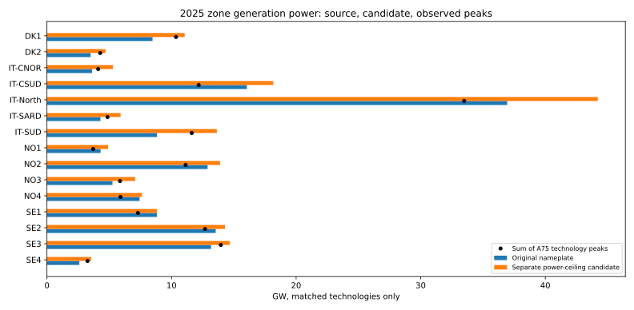
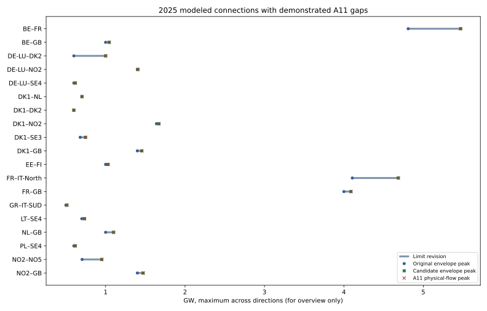

# 2025 network inventory: before and after candidate corrections

**Scope:** 48 bidding zones, 13 generation categories and 95 modeled cross-zone connections. The original research baseline is unchanged. The generation power-ceiling candidate and the A11 physical-network candidate are **separate experiments**; the annual €24.831/MWh LP sensitivity uses only the latter, with original generation inputs and frozen bids.

**Later correction:** The generation candidate column is the originally inferred physical power ceiling from observed A75 peaks. Its v2 hourly renewable-availability scaling was subsequently found to double count some capacity corrections already present in the LP. It is **not** the generation input used in the corrected LP sensitivity. See [the corrected LP power input](generation-power-lp-2025.md). The connection table is unaffected.

Download all [624 zone–technology rows](data/network-before-after-generation-2025.csv) and [95 directional connection rows](data/network-before-after-connections-2025.csv). Blank observed values mean no exactly scoped observation; they do not mean zero generation or flow.

## Generation capacity beside observed output

The full fleet column sums original PyPSA-derived zone–technology nameplates. The paired columns use only technologies with **bidding-zone-matched** ENTSO-E A75 generation: original fleet power, the separate dated observed-power-ceiling candidate, and the sum of each technology’s observed 2025 hourly peak. Those technology peaks can occur in different hours, so their sum is **not** a simultaneous zonal maximum. National or proxy generation is excluded from the paired comparison but shown in a separate column where present; it must not be compared directly to one zone’s fleet, especially when repeated across zones of a country. The candidate ceiling is a power diagnostic, not available renewable energy or reservoir water.

| Zone | Full fleet GW | Matched tech | Matched original GW | Candidate ceiling GW | Matched observed peaks GW | Unallocated national/proxy peaks GW |
| --- | ---: | ---: | ---: | ---: | ---: | ---: |
| AL | 2.58 | 0/13 | 0.00 | 0.00 | — | — |
| AT | 17.37 | 0/13 | 0.00 | 0.00 | — | 19.18 |
| BA | 4.56 | 0/13 | 0.00 | 0.00 | — | — |
| BE | 16.78 | 0/13 | 0.00 | 0.00 | — | 23.41 |
| BG | 16.35 | 0/13 | 0.00 | 0.00 | — | 11.26 |
| CH | 17.18 | 0/13 | 0.00 | 0.00 | — | 14.21 |
| CZ | 19.23 | 0/13 | 0.00 | 0.00 | — | 16.05 |
| DE-LU | 231.50 | 0/13 | 0.00 | 0.00 | — | 159.70 |
| DK1 | 8.47 | 9/13 | 8.47 | 11.06 | 10.36 | — |
| DK2 | 3.50 | 8/13 | 3.50 | 4.70 | 4.28 | — |
| EE | 2.38 | 0/13 | 0.00 | 0.00 | — | 1.68 |
| ES | 120.43 | 0/13 | 0.00 | 0.00 | — | 77.86 |
| FI | 24.25 | 0/13 | 0.00 | 0.00 | — | 18.57 |
| FR | 134.95 | 0/13 | 0.00 | 0.00 | — | 119.51 |
| FR-COR | 0.57 | 0/13 | 0.00 | 0.00 | — | — |
| GB | 101.43 | 0/13 | 0.00 | 0.00 | — | — |
| GR | 31.04 | 0/13 | 0.00 | 0.00 | — | 19.08 |
| HR | 5.09 | 0/13 | 0.00 | 0.00 | — | 3.86 |
| HU | 10.95 | 0/13 | 0.00 | 0.00 | — | 9.88 |
| IE-SEM | 15.26 | 0/13 | 0.00 | 0.00 | — | — |
| IT-CALA | 5.91 | 0/13 | 0.00 | 0.00 | — | — |
| IT-CNOR | 3.62 | 10/13 | 3.62 | 5.30 | 4.11 | — |
| IT-CSUD | 16.05 | 10/13 | 16.05 | 18.17 | 12.18 | — |
| IT-North | 36.94 | 10/13 | 36.94 | 44.22 | 33.49 | — |
| IT-SARD | 4.29 | 10/13 | 4.29 | 5.91 | 4.86 | — |
| IT-SICI | 6.11 | 0/13 | 0.00 | 0.00 | — | — |
| IT-SUD | 8.83 | 11/13 | 8.83 | 13.64 | 11.62 | — |
| LT | 3.76 | 0/13 | 0.00 | 0.00 | — | 4.05 |
| LV | 3.56 | 0/13 | 0.00 | 0.00 | — | 2.71 |
| ME | 0.72 | 0/13 | 0.00 | 0.00 | — | — |
| MK | 2.93 | 0/13 | 0.00 | 0.00 | — | 1.22 |
| NL | 39.56 | 0/13 | 0.00 | 0.00 | — | 24.11 |
| NO1 | 4.30 | 7/13 | 4.30 | 4.91 | 3.71 | — |
| NO2 | 12.91 | 6/13 | 12.89 | 13.90 | 11.13 | — |
| NO3 | 5.28 | 6/13 | 5.26 | 7.08 | 5.87 | — |
| NO4 | 7.43 | 4/13 | 7.43 | 7.63 | 5.91 | — |
| NO5 | 9.20 | 0/13 | 0.00 | 0.00 | — | — |
| PL | 47.61 | 0/13 | 0.00 | 0.00 | — | 47.24 |
| PT | 18.44 | 0/13 | 0.00 | 0.00 | — | 15.98 |
| RO | 27.13 | 0/13 | 0.00 | 0.00 | — | 13.17 |
| RS | 8.15 | 0/13 | 0.00 | 0.00 | — | 6.85 |
| SE1 | 9.16 | 3/13 | 8.83 | 8.84 | 7.31 | — |
| SE2 | 15.93 | 4/13 | 13.54 | 14.29 | 12.69 | — |
| SE3 | 18.14 | 5/13 | 13.17 | 14.68 | 13.96 | — |
| SE4 | 4.15 | 4/13 | 2.60 | 3.55 | 3.25 | — |
| SI | 3.56 | 0/13 | 0.00 | 0.00 | — | 3.65 |
| SK | 6.57 | 0/13 | 0.00 | 0.00 | — | 5.15 |
| XK | 1.70 | 0/13 | 0.00 | 0.00 | — | — |

The downloadable detail keeps each technology, its original fleet nameplate, its peak model hourly availability, the proposed demonstrated power ceiling, observed peak output, coverage, geographic scope and treatment. These distinctions matter especially for hydro, wind and solar. No generation ceiling candidate has yet passed a combined full-year LP audit.

## Modeled connections beside observed physical flow

All figures below are **GW**. Export means from the first named zone to the second; import is the reverse direction. Original and revised limits are the **peak independent N-0 directional edge envelopes** across 2025, not simultaneously feasible transfers under the joint PTDF model and not JAO market capacities. The revised envelope corresponds to the separate dated A11 component candidate. ENTSO-E A11 physical-flow peaks use only complete hourly observations in both directions; A09 commercial schedules are not substituted. A single complete hour is sufficient for a diagnostic. Fifteen edges have zero such hours.

| Connection | Original export | Revised export | A11 peak export | Original import | Revised import | A11 peak import | A11 hours | Status |
| --- | ---: | ---: | ---: | ---: | ---: | ---: | ---: | --- |
| AL–GR | 1.251234 | 1.251234 | 0.681 | 1.251234 | 1.251234 | 0.86466 | 8,760 | unchanged |
| AL–ME | 1.595323 | 1.595323 | — | 1.595323 | 1.595323 | — | 0 | no A11 |
| AL–XK | 1.595323 | 1.595323 | — | 1.595323 | 1.595323 | — | 0 | no A11 |
| AT–CH | 3.065522 | 3.065522 | 2.24379 | 3.065522 | 3.065522 | 1.75563 | 8,760 | unchanged |
| AT–CZ | 3.190645 | 3.190645 | 1.3026 | 3.190645 | 3.190645 | 2.7096 | 8,760 | unchanged |
| AT–DE-LU | 7.006908 | 7.006908 | 2.88332 | 7.006908 | 7.006908 | 4.022027 | 8,760 | unchanged |
| AT–HU | 3.190645 | 3.190645 | 1.935611 | 3.190645 | 3.190645 | 1.59035 | 8,760 | unchanged |
| AT–IT-North | 0.688178 | 0.688178 | 0.444 | 0.688178 | 0.688178 | 0.16525 | 8,760 | unchanged |
| AT–SI | 2.721433 | 2.721433 | 1.801 | 2.721433 | 2.721433 | 1.4223 | 8,760 | unchanged |
| BA–HR | 4.911092 | 4.911092 | — | 4.911092 | 4.911092 | — | 0 | no A11 |
| BA–ME | 2.846556 | 2.846556 | — | 2.846556 | 2.846556 | — | 0 | no A11 |
| BA–RS | 1.595323 | 1.595323 | — | 1.595323 | 1.595323 | — | 0 | no A11 |
| BE–DE-LU | 1.688178 | 1.688178 | 1.267251 | 1.688178 | 1.688178 | 1.107229 | 8,760 | unchanged |
| BE–FR | 4.809429 | 4.809429 | 3.40063 | 4.809429 | 5.469728 | 5.469728 | 8,760 | AC revised |
| BE–NL | 4.754687 | 4.754687 | 2.813038 | 4.754687 | 4.754687 | 4.126331 | 8,760 | unchanged |
| BE–GB | 1.000000 | 1.045532 | 1.045532 | 1.000000 | 1.003033 | 1.003033 | 8,760 | HVDC effective revised |
| BG–GR | 2.502467 | 2.502467 | 0.881 | 2.502467 | 2.502467 | 0.821 | 8,760 | unchanged |
| BG–MK | 1.251234 | 1.251234 | 0.61096 | 1.251234 | 1.251234 | 0.33876 | 8,760 | unchanged |
| BG–RO | 5.004934 | 5.004934 | 1.76848 | 5.004934 | 5.004934 | 1.91088 | 8,760 | unchanged |
| BG–RS | 1.251234 | 1.251234 | 0.917738 | 1.251234 | 1.251234 | 0.459056 | 8,760 | unchanged |
| CH–DE-LU | 13.951254 | 13.951254 | 3.721773 | 13.951254 | 13.951254 | 3.940351 | 8,760 | unchanged |
| CH–FR | 7.945333 | 7.945333 | 2.45825 | 7.945333 | 7.945333 | 4.76207 | 8,760 | unchanged |
| CH–IT-North | 7.319716 | 7.319716 | 5.081 | 7.319716 | 7.319716 | 3.06 | 8,760 | unchanged |
| CZ–DE-LU | 4.754687 | 4.754687 | 3.508852 | 4.754687 | 4.754687 | 2.785347 | 8,760 | unchanged |
| CZ–PL | 3.190645 | 3.190645 | 1.709936 | 3.190645 | 3.190645 | 2.290829 | 8,760 | unchanged |
| CZ–SK | 4.097790 | 4.097790 | 2.653225 | 4.097790 | 4.097790 | 1.7761 | 8,760 | unchanged |
| DE-LU–DK1 | 5.004934 | 5.004934 | 2.54816 | 5.004934 | 5.004934 | 2.68856 | 8,760 | unchanged |
| DE-LU–FR | 4.731227 | 4.731227 | 4.212996 | 4.731227 | 4.731227 | 4.595219 | 8,759 | unchanged |
| DE-LU–NL | 9.509375 | 9.509375 | 5.41951 | 9.509375 | 9.509375 | 6.23081 | 8,760 | unchanged |
| DE-LU–PL | 4.879811 | 4.879811 | 2.710347 | 4.879811 | 4.879811 | 2.229328 | 8,760 | unchanged |
| DE-LU–DK2 | 0.600000 | 1.001035 | 1.001035 | 0.600000 | 0.981535 | 0.981535 | 8,760 | HVDC effective revised |
| DE-LU–NO2 | 1.400000 | 1.401770 | 1.40177 | 1.400000 | 1.406520 | 1.40652 | 8,760 | HVDC effective revised |
| DE-LU–SE4 | 0.600000 | 0.600170 | 0.60017 | 0.600000 | 0.618020 | 0.61802 | 8,760 | HVDC effective revised |
| DK1–NL | 0.700000 | 0.700510 | 0.70051 | 0.700000 | 0.703310 | 0.70331 | 8,760 | HVDC effective revised |
| DK1–DK2 | 0.600000 | 0.600000 | 0.59114 | 0.600000 | 0.600030 | 0.60003 | 8,740 | HVDC effective revised |
| DK1–NO2 | 1.640000 | 1.640000 | 1.609739 | 1.640000 | 1.671195 | 1.671195 | 8,760 | HVDC effective revised |
| DK1–SE3 | 0.680000 | 0.712673 | 0.712673 | 0.680000 | 0.747230 | 0.74723 | 8,760 | HVDC effective revised |
| DK1–GB | 1.400000 | 1.456000 | 1.456 | 1.400000 | 1.455320 | 1.45532 | 8,740 | HVDC effective revised |
| EE–LV | 2.322602 | 2.322602 | 0.817 | 2.322602 | 2.322602 | 0.74805 | 8,756 | unchanged |
| EE–FI | 1.000000 | 1.000000 | 0.593875 | 1.000000 | 1.031350 | 1.03135 | 8,760 | HVDC effective revised |
| ES–FR | 5.206286 | 5.206286 | 3.65603 | 5.206286 | 5.206286 | 3.5194 | 8,724 | unchanged |
| ES–PT | 8.539669 | 8.539669 | 4.66058 | 8.539669 | 8.539669 | 3.39564 | 8,760 | unchanged |
| FR–IT-North | 4.105610 | 4.685625 | 4.685625 | 4.105610 | 4.105610 | 1.0455 | 8,760 | AC revised |
| FR–GB | 4.000000 | 4.089000 | 4.089 | 4.000000 | 4.000000 | 3.5815 | 8,759 | HVDC effective revised |
| GR–IT-SUD | 0.500000 | 0.513000 | 0.513 | 0.500000 | 0.504000 | 0.504 | 8,760 | HVDC effective revised |
| GR–MK | 2.502467 | 2.502467 | 1.098 | 2.502467 | 2.502467 | 0.965 | 8,760 | unchanged |
| HR–HU | 5.004934 | 5.004934 | 0.75 | 5.004934 | 5.004934 | 1.90675 | 8,760 | unchanged |
| HR–RS | 1.251234 | 1.251234 | 0.78 | 1.251234 | 1.251234 | 0.62 | 8,760 | unchanged |
| HR–SI | 4.441879 | 4.441879 | 1.668 | 4.441879 | 4.441879 | 2.3 | 8,760 | unchanged |
| HU–RO | 2.502467 | 2.502467 | 1.37241 | 2.502467 | 2.502467 | 0.649657 | 8,760 | unchanged |
| HU–RS | 1.251234 | 1.251234 | 0.823725 | 1.251234 | 1.251234 | 0.60071 | 8,760 | unchanged |
| HU–SI | 2.502467 | 2.502467 | 0.84811 | 2.502467 | 2.502467 | 0.531365 | 8,760 | unchanged |
| HU–SK | 6.256168 | 6.256168 | 2.049405 | 6.256168 | 6.256168 | 3.81157 | 8,760 | unchanged |
| IT-CALA–IT-SICI | 3.566015 | 3.566015 | — | 3.566015 | 3.566015 | — | 0 | no A11 |
| IT-CALA–IT-SUD | 5.098777 | 5.098777 | — | 5.098777 | 5.098777 | — | 0 | no A11 |
| IT-CNOR–IT-CSUD | 5.442866 | 5.442866 | 4.07859 | 5.442866 | 5.442866 | 3.886137 | 8,737 | unchanged |
| IT-CNOR–IT-North | 7.663805 | 7.663805 | 3.481008 | 7.663805 | 7.663805 | 4.73772 | 8,737 | unchanged |
| IT-CNOR–FR-COR | 0.300000 | 0.300000 | — | 0.300000 | 0.300000 | — | 0 | no A11 |
| IT-CSUD–IT-SUD | 7.476120 | 7.476120 | 2.512315 | 7.476120 | 7.476120 | 5.261755 | 8,737 | unchanged |
| IT-CSUD–ME | 1.200000 | 1.200000 | — | 1.200000 | 1.200000 | — | 0 | no A11 |
| IT-CSUD–IT-SARD | 1.000000 | 1.000000 | 0.907115 | 1.000000 | 1.000000 | 0.988467 | 8,737 | unchanged |
| IT-North–SI | 1.595323 | 1.595323 | 0.97149 | 1.595323 | 1.595323 | 1.57368 | 8,760 | unchanged |
| LT–LV | 3.096803 | 3.096803 | 0.98175 | 3.096803 | 3.096803 | 1.034 | 8,758 | unchanged |
| LT–PL | 2.502467 | 2.502467 | 0.382625 | 2.502467 | 2.502467 | 0.508625 | 8,760 | unchanged |
| LT–SE4 | 0.700000 | 0.700000 | 0.69998 | 0.700000 | 0.734552 | 0.734552 | 8,760 | HVDC effective revised |
| ME–RS | 0.688178 | 0.688178 | — | 0.688178 | 0.688178 | — | 0 | no A11 |
| ME–XK | 1.251234 | 1.251234 | — | 1.251234 | 1.251234 | — | 0 | no A11 |
| MK–RS | 1.251234 | 1.251234 | 0.524363 | 1.251234 | 1.251234 | 0.63643 | 8,760 | unchanged |
| MK–XK | 1.939412 | 1.939412 | — | 1.939412 | 1.939412 | — | 0 | no A11 |
| NL–NO2 | 0.700000 | 0.700000 | 0.64982 | 0.700000 | 0.700000 | 0.62333 | 8,760 | unchanged |
| NL–GB | 1.000000 | 1.101060 | 1.10106 | 1.000000 | 1.070063 | 1.070063 | 8,760 | HVDC effective revised |
| PL–SK | 2.502467 | 2.502467 | 1.597722 | 2.502467 | 2.502467 | 0.831719 | 8,760 | unchanged |
| PL–SE4 | 0.600000 | 0.617825 | 0.617825 | 0.600000 | 0.601075 | 0.601075 | 8,760 | HVDC effective revised |
| RO–RS | 5.004934 | 5.004934 | 0.920721 | 5.004934 | 5.004934 | 0.985384 | 8,760 | unchanged |
| RS–XK | 1.595323 | 1.595323 | — | 1.595323 | 1.595323 | — | 0 | no A11 |
| DK2–SE4 | 2.502467 | 2.502467 | 1.27394 | 2.502467 | 2.502467 | 1.38961 | 8,760 | unchanged |
| FI–NO4 | 0.344089 | 0.344089 | 0.07706 | 0.344089 | 0.344089 | 0.11526 | 8,760 | unchanged |
| FI–SE1 | 5.004934 | 5.004934 | 1.730886 | 5.004934 | 5.004934 | 1.99955 | 8,760 | unchanged |
| FI–SE3 | 1.300000 | 1.300000 | 1.17363 | 1.300000 | 1.300000 | 1.1961 | 8,760 | unchanged |
| NO1–NO2 | 7.366637 | 7.366637 | 2.345326 | 7.366637 | 7.366637 | 3.13623 | 8,760 | unchanged |
| NO1–NO3 | 0.703819 | 0.703819 | 0.24803 | 0.703819 | 0.703819 | 0.658023 | 8,760 | unchanged |
| NO1–NO5 | 5.349023 | 5.349023 | 0.567953 | 5.349023 | 5.349023 | 3.923926 | 8,760 | unchanged |
| NO1–SE3 | 2.627590 | 2.627590 | 2.13973 | 2.627590 | 2.627590 | 2.28281 | 8,760 | unchanged |
| NO2–NO5 | 0.703819 | 0.703819 | 0.38368 | 0.703819 | 0.952397 | 0.952397 | 8,760 | AC revised |
| NO2–GB | 1.400000 | 1.472870 | 1.47287 | 1.400000 | 1.400000 | 1.39755 | 8,760 | HVDC effective revised |
| NO3–NO4 | 2.017614 | 2.017614 | 0.417042 | 2.017614 | 2.017614 | 1.432882 | 8,760 | unchanged |
| NO3–NO5 | 1.313795 | 1.313795 | 0.917433 | 1.313795 | 1.313795 | 0.583052 | 8,760 | unchanged |
| NO3–SE2 | 1.313795 | 1.313795 | 0.82693 | 1.313795 | 1.313795 | 1.15066 | 8,760 | unchanged |
| NO4–SE1 | 1.251234 | 1.251234 | 0.779398 | 1.251234 | 1.251234 | 0.76991 | 8,760 | unchanged |
| NO4–SE2 | 0.344089 | 0.344089 | 0.31153 | 0.344089 | 0.344089 | 0.251535 | 8,760 | unchanged |
| SE1–SE2 | 5.004934 | 5.004934 | 3.33088 | 5.004934 | 5.004934 | 1.788668 | 8,760 | unchanged |
| SE2–SE3 | 11.042136 | 11.042136 | 8.03666 | 11.042136 | 11.042136 | 0.06839 | 8,760 | unchanged |
| SE3–SE4 | 7.456168 | 7.456168 | 5.85731 | 7.456168 | 7.456168 | 1.90209 | 8,760 | unchanged |
| FR-COR–IT-SARD | 0.300000 | 0.300000 | — | 0.300000 | 0.300000 | — | 0 | no A11 |
| GB–IE-SEM | 1.000000 | 1.000000 | — | 1.000000 | 1.000000 | — | 0 | no A11 |

## Interpretation and provenance

Three AC edges have revised mapped PTDF branch ratings within original line nameplate. Sixteen HVDC edges have effective aggregate bounds that may stand for missing parallel equipment; a larger limit is not proof that any particular cable was uprated. The remaining 61 observed edges have no demonstrated gap, and 15 have no usable A11 hour. The [annual network sensitivity](a11-component-network-2025.md) cleared all 8,760 hours with zero emergency, but did not apply the generation power-ceiling candidate. A lower in-sample price error alone does not validate either candidate for asset scenarios.

Generation inputs and A75 coverage: [adequacy inventory](zone-network-adequacy-2025.md) and [dated power-envelope study](zone-tech-power-envelope-2025.md). Physical-flow and network provenance: [A11 source audit](cross-zone-capacity-evidence-2025.md) and [component LP audit](a11-component-network-2025.md). The tracked source tables and their SHA-256 receipts are retained in `research/data`; large hourly arrays remain ignored.
