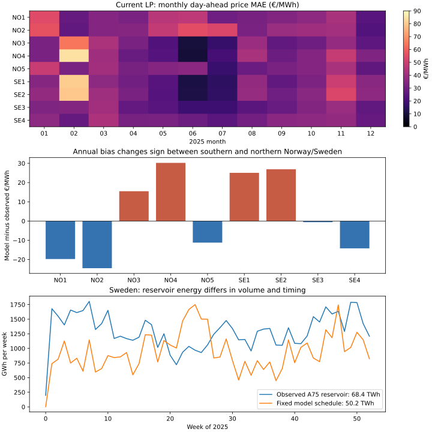
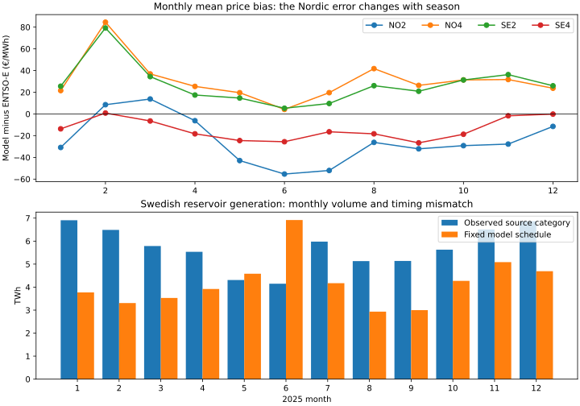

# Nordic storage and price errors: 2025 diagnostic

**Status:** research sensitivity, not an adopted baseline or investment simulator. The retained `mixed_curve_fitting` LP remains the control. This study used its saved 8,760-hour prices, dispatch, fitted offer costs and original network; no fitted bid was changed. All figures below are retrospective 2025 comparisons against corrected hourly ENTSO-E day-ahead prices.

## What the error looks like

| Zone | Retained price MAE €/MWh | Model minus observed mean €/MWh |
| --- | ---: | ---: |
| NO1 | 36.61 | -19.8 |
| NO2 | 40.42 | -24.5 |
| NO3 | 31.48 | +15.5 |
| NO4 | 35.11 | +30.2 |
| NO5 | 33.63 | -11.2 |
| SE1 | 34.08 | +25.0 |
| SE2 | 35.63 | +26.9 |
| SE3 | 28.91 | -0.6 |
| SE4 | 32.61 | -14.2 |

The opposite signs across zones are more revealing than a Nordic average. The **NO4 minus NO2** annual mean price difference is **-56.7 €/MWh observed** but only **-2.0 €/MWh modelled**. The model puts the two within 5 €/MWh for **68.4%** of hours; observations do so for **4.4%**. Its hourly spread correlation is **0.02**. For **SE2 minus SE4**, the observed mean is **-43.9 €/MWh** and the model mean **-2.8 €/MWh**; the model puts them within 5 €/MWh for **82.2%** of hours versus **27.2%** observed. This points to missing spatial separation in the combined supply/network model; reservoir timing alone cannot be assumed to fix it.

The retained generation target has **no hourly Norwegian reservoir observations** in its `reservoir` category. The NVE witness instead supplies hourly model inflow and weekly reported stock anchors. In Sweden, the source-covered reservoir category has all 8,760 hours: **68.42 TWh observed** versus **50.18 TWh** in the fixed model schedule, an **18.25 TWh** gap. That is an annual volume and potentially a reporting-scope issue, not only a scheduling issue. The source category and geographic allocation need reconciliation before adding water or fitting Swedish hydro bids.

### Are broad seasonal patterns captured?

Only partly. The **monthly mean price bias** (model minus ENTSO-E) is large and changes with the season. In February, NO4 is **+85 €/MWh** and SE2 is **+79 €/MWh**; in June, NO2 is **−55 €/MWh** and NO1 is **−46 €/MWh**. NO4's monthly bias ranges from **+4 to +85 €/MWh** through 2025. These are persistent level errors over hundreds of hours, not only missed individual price spikes. Subtracting each zone's *in-sample* monthly mean bias would reduce NO4 hourly MAE from **35.1 to 25.3 €/MWh** and NO2 from **40.4 to 32.5 €/MWh**. This is a decomposition of the error, **not a legitimate forecast correction or a validated model improvement**: it uses the same observed prices being scored.

The geographic pattern also persists across the whole year. The observed monthly **NO4 minus NO2** mean ranges from **−79 to −43 €/MWh**; the model ranges from **−22 to +10 €/MWh**. The observed **SE2 minus SE4** range is **−79 to −27 €/MWh**, while the model stays between **−6 and −1 €/MWh**. Thus a Europe-wide price level adjustment or a common yearly fuel-price curve cannot by itself recover the missing north–south separation. The supply location, water schedule/volume and feasible zonal transfers must be examined together.

Swedish reservoir production has a broad mismatch too. The observed/model source-category totals are **6.91/3.77 TWh in January**, **6.49/3.31 in February**, **4.15/6.92 in June**, and **6.87/4.69 in December**. The model is short in eleven months and high in June. This identifies a concrete seasonal supply problem, although different reporting scope or technology mapping could explain part of the discrepancy. There is no equivalent Norwegian hourly reservoir target in the retained grouped source data, so price residuals alone cannot identify an alternative Norway water schedule. The small Norwegian retiming trial below does not change any monthly energy and is therefore incapable of fixing these large volume and spatial patterns.

## Bounded Norwegian reservoir timing trial

The five retained NVE Norway reservoirs keep their original hourly inflow and spill, turbine limits, dispatch efficiency, inventory capacity, initial and terminal stock, and **each unit's daily generation total**. Within each UTC day a small LP moves generation toward higher *modelled baseline* prices, with a 2 €/MWh absolute-movement charge. The price signal is the retained model's own price, with no lookup of observed prices. The trial bounds each hour's movement to a declared fraction of that unit's turbine MW.

The reservoir injection is allocated to the same saved physical buses as the accepted model. For every changed hour the trial updates zonal demand net of hydro and the exact PTDF branch-flow offset. A daily scalar reduces the proposed changes where the existing physical LP would otherwise be infeasible or call its €10,000/MWh emergency offer. The scalar is uniform within each day, so daily water and stock anchors remain intact. The accepted LP's original 799 offers, demand, renewable availability, network rows, limits and fitted costs are unchanged.

| Trial | Norway equal-zone price MAE €/MWh | Europe equal-zone price MAE €/MWh | Source-covered hourly generation MAE GW | Physical result |
| --- | ---: | ---: | ---: | --- |
| Retained baseline | 35.45 | 25.051 | 0.552867 | 8,760 optimal, zero emergency |
| 1% turbine movement | **34.19** | **24.907** | 0.553011 | 8,760 feasible, zero emergency; no day clipped |
| 10% turbine movement | **170.45** | **41.797** | 0.553158 | 8,760 feasible, zero emergency; 61 days clipped |

The 1% case moves **1.076 TWh** out of some hours and the same amount into others (2.152 TWh absolute movement); it leaves every unit's daily and annual energy unchanged. Norwegian price MAE improves in **10 of 12 months**, but February and June worsen slightly. The improvement is small and does not close the spatial spread gap: NO4–NO2 still averages **-3.1 €/MWh modelled** versus **-56.7 €/MWh observed**.

The 10% case is rejected. Its initial unconstrained schedule failed physical feasibility at hour 8. After daily feasibility and no-emergency scaling, it still produces severe negative marginal prices near the feasible-generation boundary (for example, about **-2,855 €/MWh** in NO1 at hour 100) and sharply worsens the price score. Physical feasibility alone does not make an aggressive reservoir response economically credible. Neither case improves the source-covered generation MAE; the Norwegian reservoir volume has no hourly observed target in this input.

Independent replay of both saved candidates confirms daily water release, stock bounds and anchors, annual terminal stock, physical LP rows and columns, zero emergency, and objective equality. The 1% case's maximum primal residual is **3.37×10⁻⁷ MW** and maximum hourly objective discrepancy **2.61×10⁻⁸ EUR**. The corresponding 10% residual is **5.55×10⁻⁶ MW**. The LP marginal prices were produced by the solver; this candidate has not undergone the accepted baseline's full independent dual audit. The 1% value was inspected after the larger trial failed, so this is **not** a prespecified holdout comparison, even though the rule itself does not read observed prices.

## Interpretation and next test

Small water-feasible retiming can recover some Norwegian price variation, but the larger seasonal level errors, opposite-signed zonal biases and nearly absent modelled north–south price spread remain. A reservoir-only explanation is insufficient. The next data-driven experiment should first reconcile Sweden's reservoir reporting scope and monthly 18.25 TWh gap against the original hydro fleet and stock/inflow sources, then audit monthly zonal supply availability, generation, observed exchanges and constraint binding. It should jointly score **observed zonal price spreads, source-covered generation and commercial exchanges**, varying hydro volume/geographic allocation and internal transfer limits only with independent source justification. For Norway, obtain a trustworthy hourly reservoir-generation target or report price-only identification explicitly; NVE weekly stock is a stock constraint, not hourly generation. Keep a separate later period or year unseen when choosing the parameters.

The source PyPSA network includes pumped-hydro units, but the retained dataset has no verified 2025 battery fleet. An older pumped-hydro bidding trial was not adopted; its score is not a matched comparison to this newly retimed reservoir experiment. A battery scenario needs identified power, energy and commissioning dates before it can test whether *existing* batteries explain 2025 prices. Hypothetical new batteries belong in a separate investment-response case.

### Reproduction and provenance

`python -m baselines.compact.nordic_storage --alpha 0.01` and `--alpha 0.1` write separate ignored witnesses under `data/bidding-zone-network-2025/nordic-reservoir-timing-v1/`. `python -m baselines.compact.audit_nordic_storage --alpha ...` independently replays both. `python -m tools.plot_nordic_storage_diagnostic_2025` creates the figure. The candidate receipts hash the retained NVE water witness, original PyPSA grid, saved zonal hydro allocation and prepared native physical grid. Large arrays remain ignored. No baseline pointer, source-hashed producer, public app or `main` website was changed.
