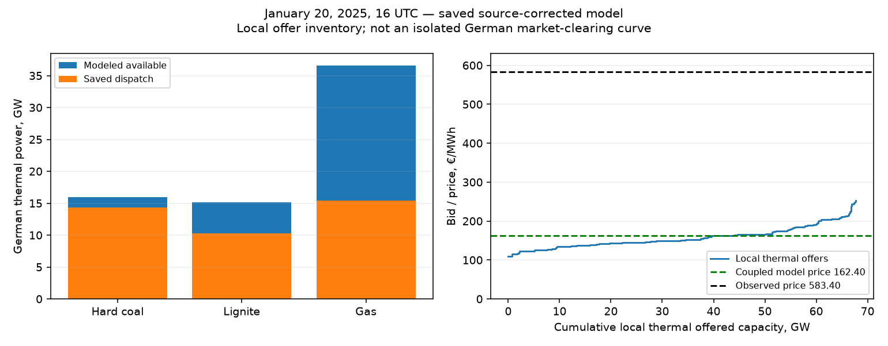
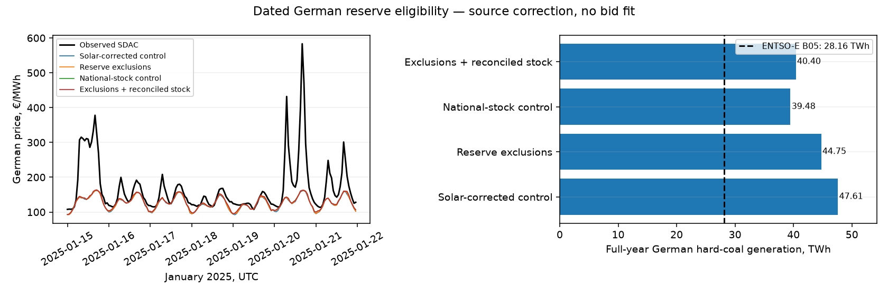

# Research: pricing scarce supply without inventing an emergency

22 October 2026. Literature review, saved-book diagnosis and an implemented,
independently verified annual reserve-eligibility test. The implementation/results
are at the end. No fitted scarcity bid, baseline promotion or website replacement.

## Recommendation

**Keep the fast network solver; improve the offer book in two connected ways:
market-eligible hourly volumes and resource-specific prices for scarce flexibility.**
A €500/MWh auction price does not establish that emergency generation was used.
Expensive ordinary offers can clear while all demand is served. Nor does a
fuel-plus-carbon calculation alone necessarily reproduce an auction offer.

The most decisive model finding is quantitative: at January 20, 16:00 UTC
(17:00 CET), the saved solar-plus-capacity case offers **36.61 GW of German gas**
but dispatches only **15.43 GW**. Its remaining **21.18 GW is all offered below
€253/MWh**. A small new €500 tranche would not clear ahead of those cheaper
offers. Availability/eligibility and pricing must be investigated together.

## What the evidence says

### High prices and supply emergencies are different

[SMARD](https://www.smard.de/page/en/topic-article/217400/219038) confirms the
€583.40/MWh January 20 maximum. A
[Bundesnetzagentur explanation](https://www.bundesnetzagentur.de/DE/Allgemeines/DieBundesnetzagentur/Insight/Texte/Energiewende/Dunkelflaute.html)
discusses that event and reports no near supply-security shortage in January.
This does not identify the marginal participant or reconstruct its offers.

The [BNetzA/Bundeskartellamt investigation](https://www.bundesnetzagentur.de/DE/Fachthemen/ElektrizitaetundGas/Aktuelles/Strompreis/Preisspitzen_Untersuchung_e.html?nn=666514)
examined **November/December 2024**, not January 2025. It found secure supply and
no evidence of unlawful withholding in those investigated events. It distinguished
installed, available and market-usable capacity, with only about 3.4–4.5 GW of
estimated unused market capacity in the two peak hours. Reserves, technical
restrictions and heat-led operation matter. This is analogous evidence, not a
January outage dataset or a transferable derating percentage.

The [Bronisch–Tiedemann–Hirth study commissioned by 50Hertz](https://www.50hertz.com/xspProxy/api/staticfiles/50hertz-client/dokumente/unternehmen/partnerschaften/scientific%20advisory%20project%20board/neon%20-%20preisspitzen%20am%20strommarkt%20bericht.pdf)
(December 2025; 2023–24 events, pp. 8–13, 19–26) compares prices with a conservative
gas-turbine cost benchmark, then examines unit availability and operating roles.
It finds reasons why much nameplate capacity was not usable and interprets the
events as scarce market supply. Its benchmark does not explain all prices through
fuel and startup costs. Its empirical production-based classification must not
become our renewable availability or an assumed 2025 outage schedule.

For a wider European perspective, [ACER's 2026 Southeast Europe study](https://www.acer.europa.eu/monitoring/MMR/crosszonal-electricity-trade-capacities-2026)
attributes the region's summer 2024 spikes to insufficient evening flexibility
combined with limited import capacity. This supports checking fleet response
and commercial constraints jointly; it is not evidence of January 20 German
line outages.

### There are useful simple bidding models

[ASSUME's documented thermal heuristic](https://assume.readthedocs.io/en/latest/bidding_strategies.html)
separates inflexible and flexible offers and accounts for startup, operating
history, ramping and heat production. Its block/linked-order variants represent
multi-hour acceptance conditions. The useful lesson is explicit operating states
and cost recovery, rather than adopting reinforcement learning or replacing our
solver. These are modeling rules, not measured German bids.

[Ghelasi and Ziel, *A data-driven merit order*](https://arxiv.org/html/2501.02963v3)
estimate bounded supply-stack parameters and examine must-run volumes, gas
technology splits and available capacity. Their Germany-only framework is a
useful model of interpretable offer calibration. It is not a validated replacement
for our coupled European network: their hydro/import extensions use forecast
quantities, which we should not copy as fixed observed imports for investment
counterfactuals. An estimated parameter need not identify a physical efficiency.

[Carmona, Coulon and Schwarz](https://arxiv.org/abs/1205.2299) demonstrate that a
structural, multi-fuel bid stack can produce price spikes through its supply–demand
relationship and varying generator efficiencies. This supports testing steep
offer curves within clearing. Their tractable price model is not itself our
network dispatch, unit-commitment or EUPHEMIA implementation.

### Actual auction pricing has additional rules

The [August 2024 EUPHEMIA description](https://www.ote-cr.cz/en/short-term-markets/market-coupling-day-ahead-market/euphemia-public-description_v2024.pdf)
was the applicable published version for January 2025, according to
[OTE's version history](https://www.ote-cr.cz/en/short-term-markets/market-coupling-day-ahead-market/pcr-price-coupling-of-regions).
Sections 7.5 and Annex C.2 describe pricing constraints for accepted complex/block
orders and resolution of price indeterminacy. Our ordinary LP dual is a price for
our convex synthetic book, not automatically that auction price. Adding startup
costs to a dispatch objective therefore does not guarantee a realistic auction
price. Full block-order implementation would be a distinct, more complex step.

## What our model currently allows

The existing thermal book already has three volume tranches (50/35/15%). Its
inherited seasonal/local-clock, inverse and weekly bid adjustments operate on
fuel/efficiency/carbon costs. Oil has a separately audited CHP tranche. None of
that establishes dated thermal outages, plant market eligibility or actual
auction supply curves. German gas/coal groups retain flat source capacity
envelopes; the latest annual stock sensitivity changes their levels, not their
hourly operating states. Prior continuous ramp/startup tests raised the event
price only from about €159 to €165; their stronger stress used emergency supply
and was rejected. Do not resume that search or present it as a solution.

Observed targets now use the corrected ENTSO-E main day-ahead auction. However,
the inherited non-oil bid calibration used the earlier incorrectly selected
targets. This is another reason not to treat today's offer levels as established
behavior. Any later calibration must start with the corrected source clock and
auction identity, preserve the earlier witnesses and explicitly label 2025
reconstruction as in-sample.

Read-only replay of the **annual `solar_capacity` witness**, January 20 at 16 UTC:

| German resource | Modeled available GW | Dispatch GW | Unused GW | Bid range €/MWh |
| --- | ---: | ---: | ---: | ---: |
| Hard coal | 15.95 | 14.32 | 1.63 | 108.91–177.38 |
| Lignite | 15.18 | 10.27 | 4.91 | 133.79–194.92 |
| Gas | 36.61 | 15.43 | 21.18 | 135.52–252.72 |

These are model quantities, not observed unused plant capacities. In total,
**33.12 GW of German non-emergency offers below €500 remain unused**, including
other technologies. The source-corrected model clears at €162.40 versus €583.40.

There is a stronger mathematical check than looking at a price plot. All the
German thermal offers have the same zonal injection column in this formulation.
We verified an explicit feasible witness serving **1 MW more local demand** from
an unused offer at **€162.5084/MWh**, leaving net injection and branch flows
unchanged. Its maximum primal residual is 1.82e-11 MW. This bounds the extra-hour
objective cost by €162.5084; it is not a newly optimized price or proof about real
plant availability. In the unchanged convex book, the existing optimal zonal
dual cannot rise to €583 while that marginal cheap headroom remains available.
Network restrictions elsewhere do not remove this specific local option.

Consequently, a low clearing price does not prove that we merely forgot an
expensive generator. It reveals a disagreement between the modeled cheap offer
book and whatever offers/constraints produced the real auction result. Some
combination of offerable volume, prices and operating/auction rules must differ.
We have not identified which combination caused January 20.

## Proposed fast formulation

This is a research recommendation, not an implemented or accepted model change.

1. **Build a dated market-eligible fleet.** Keep installed stock separate from
   technical availability, ordinary energy-market eligibility and quantity actually
   offered. Join plant IDs, operating/reserve status and outage messages to the
   existing source fleet before aggregating by zone and technology. Missing
   records remain uncertainty, not assumed availability or inferred outages.
   Prevent overlap between stock corrections, plant removal, outages and reserve
   commitments. Do not subtract an entire reserve unit when a product only
   reserves incremental headroom; verify its applicable rules and delivery date.
2. **Generate simple daily thermal offers.** Distinguish already-online output,
   flexible extra output and genuinely startable offline capacity. Use fuel,
   carbon, electrical efficiency and VOM as anchors. A startup charge spread over
   expected delivered MWh can inform an offline offer; that spread is an explicit
   heuristic, not a measured cost or proof the unit will clear. Preserve state
   across midnight. Avoid charging startup both in the bid and again in an
   operating-cost objective. Retain explicit volume, ramp and fuel constraints.
3. **Give the eligible stack a defensible expensive upper end.** Reprice existing
   tranches where possible, with nondecreasing bids and exactly conserved eligible
   MW. Normal output can remain near short-run cost; the last feasible flexibility
   may carry start/risk/opportunity costs. Calibrate a small number of bounded
   resource/role parameters if later authorized. Do not declare a generic markup
   observed, lawful for every operator, or a uniquely identified scarcity rent.
   No artificial January-specific €583 bid. This uses dispatched stack position
   inside clearing, not residual demand as a new fitted hourly predictor.
4. **Retain coupled hourly clearing.** Demand and network constraints decide which
   offers clear. Prices must emerge inside the optimization, so new transmission
   or generation can change them. A small number of piecewise-linear offer bands
   preserves the sparse LP architecture; actual runtime still needs measurement.
   There is no need to start with full unit commitment or an agent-learning system.
5. **Keep failure supply separate.** Genuine expensive market offers have finite,
   sourced capacity. The current €10,000/MWh emergency slack is a diagnostic
   feasibility device: any use still fails supply-model acceptance. Do not lower
   that penalty to €500 and rename it a market explanation. Similarly, a virtual
   demand-response generator is not physical supply: changing fixed observed
   demand would require an explicit flexible-load model and separate accounting.

An illustrative one-hour example makes the distinction clear: 69 GW offered at
€150 plus 2 GW at €500 can serve 70 GW entirely, with 1 GW from the expensive
tranche and a €500 marginal price. No emergency energy is needed. **This is a toy
example, not Germany's reconstructed auction.** Our real model currently has too
many cheaper alternative offers for this example to apply unchanged.

## Data priorities and access limits

| Evidence | What it can establish | Current next action |
| --- | --- | --- |
| BNetzA plant/status decisions and winter reserve records | Dated market eligibility, retirement and reserve roles | Match units and effective dates to the source fleet; do not apply today's status retrospectively |
| ENTSO-E Article 15 outage messages / EEX non-usability | Reported available MW and revisions | Reconcile overlapping events and original publication times; preserve ex-post versus pre-auction versions |
| Reserve procurement results | Contracted flexibility/headroom | Reconcile product-specific commitments; distinguish ancillary reserves from plants outside the energy market |
| Exchange aggregated curves and block outcomes | Price/quantity shape and market depth | Verify licensed historical access and curve construction before using as calibration evidence |
| JAO commercial domains and market net positions | Deliverable interzonal trading limits | Continue reconciliation with modeled physical constraints; do not invent hourly line deratings |
| Source fuel/FX/carbon and generation data | Bid anchors and independent quantity checks | Daily German fuel basis and resource efficiency remain audit targets; generation does not replace availability |

There is useful public evidence before purchasing anything. The
[BNetzA winter 2024/25 reserve announcement](https://www.bundesnetzagentur.de/SharedDocs/Pressemitteilungen/EN/2024/20240430_Netzreserve_Pb.html)
identifies 5,580 MW of German grid-reserve provision and explains that those
plants operate outside the market. This is not a gas-only deduction or proof
which units are still double counted in our scaled fleet. The
[dated plant decisions](https://www.bundesnetzagentur.de/DE/Fachthemen/ElektrizitaetundGas/Versorgungssicherheit/Erzeugungskapazitaeten/Systemrelevante_KW/start.html)
and [public reserve data center](https://www.regelleistung.net/apps/datacenter/)
are concrete follow-up sources. The implemented extension below matches three
whole plants; the remaining fleet and block-level mappings are unresolved.

[EEX's transparency service](https://www.eex.com/en/market-data/eex-group-datasource/eex-group-transparency-data)
documents unit non-usability coverage, while
[ENTSO-E's publication rules](https://eur-lex.europa.eu/legal-content/EN-DE/TXT/?from=EN&uri=CELEX%3A32013R0543)
specify outage information including available capacity and event periods. This
runtime has no configured authenticated ENTSO-E access or verified EEX entitlement;
2025 event-level thermal availability remains unverified. No purchase,
registration, credential change or bulk historical download was made.

[Nord Pool's curve service](https://www.nordpoolgroup.com/en/services/power-market-data-services/aggregatedbiddingcurves/)
includes German-Luxembourg and Nordic *clusters*, with block volumes and net
imports/exports included in published curves. Historical access is a paid feed.
[EPEX/EEX's historical German curve product](https://webshop.eex-group.com/data-type/de-day-ahead-auction-aggregated-curves-histo-y-1)
is also a subscription with access restrictions. Such curves can audit offer-book
shape, but directly adding their included imports to our already coupled network
would double count trading. Neither service was acquired or integrated here.

## How to evaluate a later implementation

First resolve the large cheap-headroom discrepancy; do not tune the expensive
tail against a false fleet. Then predeclare a small set of volume-only, bid-only
and combined controls against the source-corrected annual anchor. Evaluate all
8,760 hours and every covered price zone, retaining adverse outcomes and source
uncertainty. Recheck generation mix, implied trade, native feasibility and full
LP optimality with the existing thresholds and zero-emergency gate.

Alongside annual MAE/correlation, report high-price-event timing, exceedance counts,
false alarms, peak amplitude, event duration and daily spreads. A model that
matches one maximum but generates many false spikes is not an improvement.
Separate reconstruction fitted to 2025 from unseen-year forecasting; all 2025
events have already been inspected. Test price-spread and dispatch responses to
paired investments later, without post-clearing price adjustments or fixed
observed import injections. No new numerical acceptance threshold is adopted by
this recommendation; the below-€10/MWh European goal remains the stated target.

## Reproducibility

`tools/research_scarcity_bids_2025.py` verifies the saved annual/source hashes,
reconstructs the corrected event bounds, checks thermal column membership and
availability, repeats headroom aggregation by scalar offers, and verifies the
explicit +1 MW primal certificate. No solver is called. The original 35,040-hour
audit remains unchanged and hash-bound. The ignored checkpoint is
`data/bidding-zone-network-2025/scarcity-bid-research-v1/summary.json` with figure
receipt; it contains source hashes, exact quantities, hour, case and certificate.
Literature was accessed on 22 October 2026. Publication dates and studied event
years above remain distinct. The current public model, accepted baseline and
disabled recurring reviews are preserved.

## Implemented reserve-eligibility test — 22 October 2026

The first source correction is now implemented and independently checked for all 8,760 hours. It removes Bexbach, Weiher and Bergkamen from ordinary market supply: **2,101.6 MW on the retained source-unit basis**. It does not reproduce the January spike or establish that all remaining gas capacity is market-eligible. No new scarcity markup was fitted and no public model was replaced.

| Case | Europe MAE | DE-LU MAE | Jan 20 price | DE coal TWh | Coal offered GW | New solve seconds |
|---|---:|---:|---:|---:|---:|---:|
| Solar-corrected control | 27.984 | 19.744 | 160.68 | 47.610 | 20.352 | 0.00 |
| Reserve exclusions | 27.978 | 19.660 | 161.96 | 44.748 | 18.250 | 75.42 |
| National-stock control | 27.962 | 19.447 | 162.40 | 39.483 | 15.951 | 0.00 |
| Exclusions + reconciled stock | 27.962 | 19.470 | 162.40 | 40.404 | 15.951 | 67.55 |

Prices/MAE are €/MWh; event is January 20, 16 UTC, observed **583.40**. Coal TWh is modeled dispatch, not an observed-generation validation. MAE weights 41 complete European price zones equally. The 48-zone physical model includes seven zones without complete price targets; no zero-fill. Controls reuse exact audited annual witnesses; timings exclude preparation and independent replay.

**Spike check:** every case still misses all 40 observed German hours above €300/MWh and generates no false German exceedances. The reconciled case leaves **21.18 GW** unused in the unchanged German gas offer inventory at the event, all bid at or below **€252.72/MWh**. These are model quantities, not measured real-world availability. The reserve correction therefore has not resolved the cheap-gas discrepancy.

**Generation check:** the original complete ENTSO-E B05 hourly source sums to **28.159 TWh** for Germany. Reserve exclusion changes modeled coal from 47.610 to 44.748 TWh; stock reconciliation changes 39.483 to 40.404. This checks the affected technology, not the entire generation mix. Germany's source is a national proxy under the DE-LU area code, excluding Luxembourg. Pure coal offer columns are independently established by the annual audit. Original processed hourly observations are hashed and checked against the separately audited rounded public export (≤0.05 MW per hour); none enter availability or bids.

[All 41 price zones × four cases: MAE, bias, correlation, >€300 observed-price error, missed spikes and false spikes](thermal-eligibility-2025-by-zone.csv).

### Identification and evidence

The [28 February 2024 BNetzA decision for Bexbach/Weiher](https://www.bundesnetzagentur.de/DE/Fachthemen/ElektrizitaetundGas/Versorgungssicherheit/Erzeugungskapazitaeten/Systemrelevante_KW/_DL/AmprionGmbH_II_28022024.pdf?__blob=publicationFile&v=2), p2, documents their existing grid-reserve binding through March 2025 and renewal through March 2031. The [Bergkamen decision](https://www.bundesnetzagentur.de/DE/Fachthemen/ElektrizitaetundGas/Versorgungssicherheit/Erzeugungskapazitaeten/Systemrelevante_KW/_DL/AmprionGmbH_III_28022024.pdf?__blob=publicationFile&v=2), p2, covers November 2024–March 2026. The [April 2024 regulator announcement](https://www.bundesnetzagentur.de/SharedDocs/Pressemitteilungen/EN/2024/20240430_Netzreserve_Pb.html) confirms temporary market returns had ended and reserve plants cannot operate in the market. This establishes role coverage for all modeled 2025 hours; dates outside 2025 are not an hourly outage reconstruction.

| Source row | Source plant | Regulator identity | Source MW removed |
|---|---|---|---:|
| 2574 | Weiher | Weiher 3 / SEE906326984744 | 655.6 |
| 2594 | Bexbach | Bexbach A / SEE954971534470 | 726.0 |
| 2581 | Bergkamen | Bergkamen A / SEE930673793902 | 720.0 |

These are manually reviewed aliases, enforced by exact source row/name/country/fuel/bus/MW assertions; the original source rows do not contain the regulator SEE identifiers. Group nameplate totals are replayed against the original native network before mapping through original offer shares. Source MW are retained consistently: the current regulator list rounds Weiher to 656 and reports Bergkamen at 717 MW; neither is silently substituted. The reserve-analysis dispatch table's lower requested MW are not unit nameplate. This is a bounded, partial ledger rather than a complete German fleet reconciliation.

### Avoiding double-counting

The eligibility-only case removes these source units from the solar-corrected, unscaled hard-coal fleet. The reconciled case first removes them, then scales the remaining source coal to the same **15.951 GW** national-stock total used by the stock control: 15,951 / (20,351.945 − 2,101.6). It retains that control's gas/lignite stock factors. Thus the comparison tests offer composition at a common total instead of subtracting the reserves twice. Whether the SMARD annual-stock series already excludes every reserve unit is not independently certified; this is explicitly an overlap sensitivity. Retained identical-price pools do not uniquely identify individual unit dispatch.

### Verification, limits and next action

Two new annual solves and two reused controls pass independent source/volume replay, all 35,040 hourly KKT checks and native component/network bounds. Maximum native residual **1.75e-05 MW**; maximum duality gap **0.000217 EUR**. Every case uses zero emergency energy. Three contract tests cover identity mismatches/duplicate rows, German-local effective dates and stock/reserve overlap. Original files, PV/wind/IRENA, demand, fixed hydro, grid/GSK and bids are preserved.

The three exclusions improve source realism but do not explain the expensive observed marginal bid. Do not introduce a €500 tail while large cheap modeled gas volumes remain usable. Next reconcile gas market roles, source stock/efficiency and dated outages, then test a simple online/startable gas bid structure with finite resource-backed volumes. Scholven/Mannheim overlapping source aggregates, multi-block Karlsruhe/Altbach/Heilbronn and Staudinger remain unresolved; no whole-site removal or synthetic outage was applied. This test does not validate national generation mix, investment value or exact EUPHEMIA block pricing. Existing non-oil bids retain calibration to the earlier auction targets; all 2025 has been inspected, so this is retrospective reconstruction.
