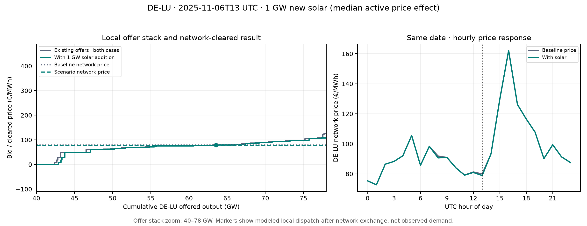

# How an investment changes the offer stack

This is the retained `mixed_curve_fitting` 2025 joint LP compared with its saved **1,000 MW DE-LU solar addition**. The scenario keeps the accepted 799 fitted offer columns, demand, hydro schedule, and network constraints unchanged. It adds one **zero €/MWh** offer column whose hourly availability follows the sealed DE-LU solar availability profile, scaled to a 1,000 MW peak. The figure uses the saved annual witnesses; plotting does not rerun or refit the solver.

The example is **6 November 2025, 13:00 UTC**, chosen as the median absolute DE-LU price change among 780 hours when the added solar had more than 100 MW available and changed price by more than €0.10/MWh. The left panel sorts all *non-emergency* DE-LU offer columns by their bid for this hour and cumulatively sums their available MW. Its 40–78 GW horizontal range is a zoom around clearing; the full bid stack extends beyond that range. Existing offers are the same in both cases. The new solar contributes **532.6 MW** at zero bid, shifting the aggregate stack rightward above zero. Some accepted offers pool renewable technologies, so individual existing steps should not be read as plant-level or technology-pure bids.

| Model result at the example hour | Baseline | With 1 GW solar |
|---|---:|---:|
| DE-LU network-cleared price | €79.95/MWh | €78.85/MWh |
| Existing DE-LU offer dispatch | 63,546.2 MW | 63,013.7 MW |
| New solar dispatch | — | 532.6 MW |
| Total DE-LU offer dispatch | 63,546.2 MW | 63,546.2 MW |

Here, the new solar displaces the same quantity of existing local offer dispatch. The two clearing markers therefore have essentially the same horizontal position. The **price change is an output of the coupled European LP**, with endogenous exchange and network constraints; a local stack alone does not calculate the zonal price. The right panel shows the modeled DE-LU prices on the same UTC date. These are **simulated prices**, not observed ENTSO-E prices. The plotted local dispatch is also not raw observed demand: fixed injections and cross-zone exchange enter the LP balance separately.

This picture explains one scenario response, not the investment's annual value. It uses bids fitted within 2025, a fixed hydro schedule and an unchanged network. The zero-bid solar is a declared screening assumption; its revenue excludes capital and operating costs. Reproduce it with the pinned scientific interpreter using `python tools/plot_compact_scenario_bid_curves.py`. The script verifies the scenario witness hash before plotting.
