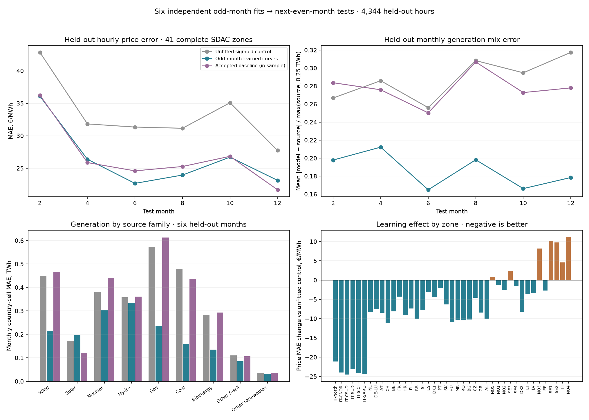
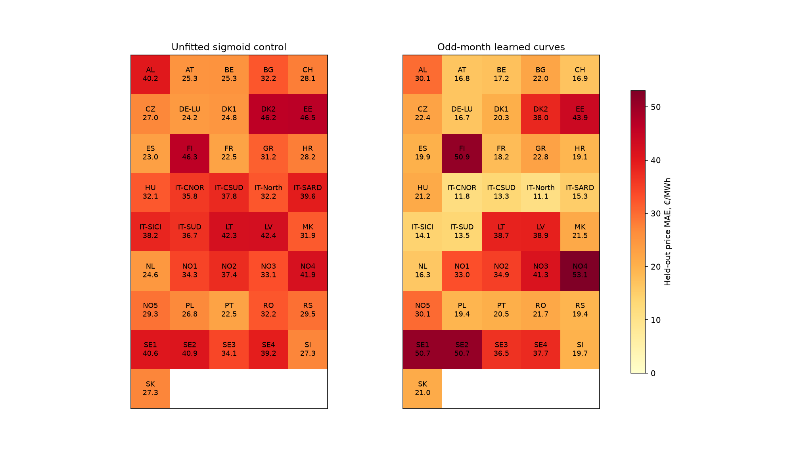
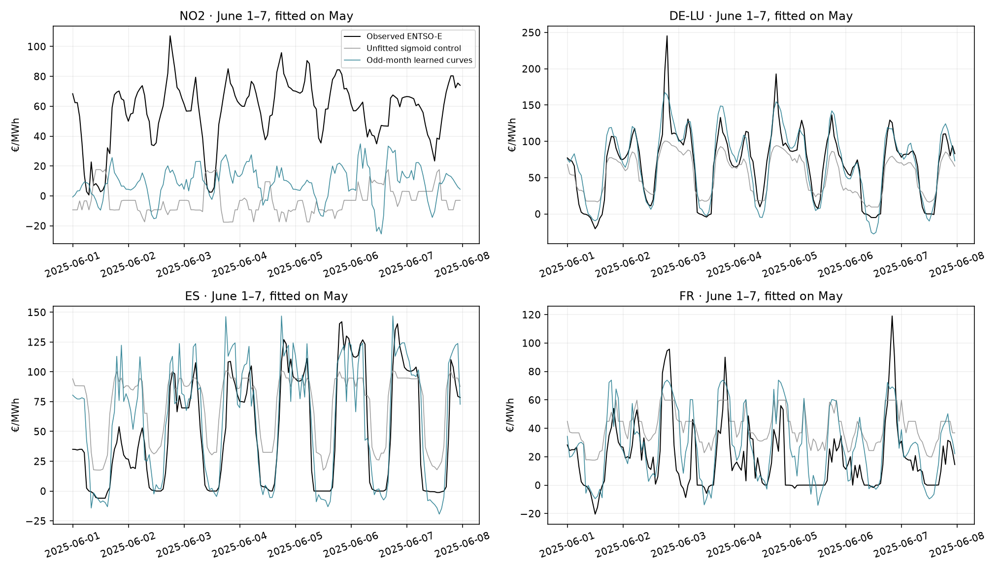

# Learning technology supply curves: six month-ahead tests

**Implemented and evaluated:** fit January→test February, March→April, May→June, July→August, September→October and November→December. Each fit is independent. Results below cover **4,344 held-out hours**, not an out-of-fold 8,760-hour year. The accepted research baseline remains unchanged.

## Model and data

Keep all 48 bidding zones, existing PTDF/GSK/branch and link constraints, fixed hourly demand and fixed reservoir injections. Replace inherited price-fitted bids with source technology operating costs: monthly World Bank TTF/ECB for gas, daily EIA Brent/ECB and existing source-priced oil/CHP treatment, prepared coal/lignite/nuclear/other costs. Keep source capacity and weather availability, IRENA linear commissioning, the verified solar interval correction and generic 0.86/0.90 loss replacement. Remove empirical full-year country solar factors. No capacity is fitted or replaced by observed dispatch.

For each source technology/efficiency group, quantity offered at price p is `A × sigmoid((p − source_cost − calendar_shift) / spread)`. A is source available MW. Midpoint shift uses an intercept and the first two local-time daily sine/cosine harmonics, including DST; spread is positive, between 1 and 100 €/MWh. Effective shift is bounded ±80 €/MWh. Eight equal-volume tranches sample the inverse sigmoid at bin midpoints; all eight sum exactly to available capacity. These are divisible offers and allow negative prices. Finite endpoint truncation is explicit: the logistic tails outside the first/last midpoint are approximated, not infinite market bids.

Parameters are shared **by country and Ember resource family**, because most generation observations are national, not bidding-zone-level. Original source technology/efficiency costs, hourly capacity and zonal network prices still differ. Wind combines on/offshore parameter adjustments; coal combines coal/lignite; oil and waste retain distinct source anchors under Other fossil. This first experiment does not identify independent parameters for every technology in every bidding zone.

Each odd month gets its own fit. Daily patterns repeat through that fit and the next test month; there is no separately fitted curve for each hour and no annually learned seasonal coefficient. The six pairs expose seasonal change explicitly. The model does not interpolate between fits using test observations. Flexible storage is not added: the separately tested storage candidate is unadopted and its full-year-fitted forecast would contaminate this experiment. Fixed reservoir output remains a conditional input.

## Fitting and isolation

First fit midpoint/spread from the odd month’s observed price–generation relationship. Use original ENTSO-E A75 hourly generation only when every technology constituent of the national family is available; use original Ember national monthly totals separately. Missing observations remain unknown. For inverse initialization only, zones without observed SDAC prices use the unfitted model’s own training-month prices, not invented observations. Monthly totals are never expanded into hourly targets.

Then propose up to three network-aware update rounds, with two fixed strengths (0.5 and 1). Each candidate is actually cleared for every training hour. Select the lowest training objective: `0.5 × price_MAE/50 + 0.5 × generation_normalized_MAE + parameter_ridge`. Price MAE equally weights 41 complete SDAC zones; generation averages available country/fuel monthly cells, normalized by max(source,0.25 TWh). The initializer is an inverse least-squares proposal, not proof of the best cleared-price fit. Network updates are bounded heuristic directions and exact objective comparisons, not a global optimisation guarantee.

Freeze the selected parameters and their target/source hashes before clearing or scoring the even month. Independently replay the initializer and network-update direction after replacing every other month’s price/generation target with extreme values: parameters/directions must remain identical. No even-month price or generation value selects a proposal, update strength or hyperparameter. The 41 complete price zones are a fixed source-coverage benchmark cohort. Repeated runs must use a fresh design if test outcomes motivate changes.

## Held-out results

| Model | Price MAE €/MWh | Monthly generation MAE TWh | Normalized generation MAE | Mix-share MAE percentage points |
|---|---:|---:|---:|---:|
| Unfitted sigmoid control | 33.196 | 0.3246 | 0.2882 | 4.06 |
| Odd-month learned curves | 26.359 | 0.1929 | 0.1863 | 2.26 |
| Accepted baseline (in-sample) | 26.616 | 0.3259 | 0.2779 | 4.25 |

Price headline: 41 complete SDAC zones, all 4,344 test hours, equally weighted by zone and hour. Monthly generation headline: 33 countries with available Ember cells, 1458 matched country/family/month cells. **Mix-share coverage is narrower: 9 countries / 54 complete country-months / 486 share cells.** Missing countries/families are excluded rather than counted as zero; all 34 modeled national scopes remain in the CSV. Nuclear availability retains the inherited historical proxy, not a newly verified 2025 outage series.

**Adverse outcomes:** 7 of 41 zones worsen against the unfitted control: FI, NO3, NO4, NO5, SE1, SE2, SE3. Solar monthly generation MAE rises from 0.1718 to 0.1968 TWh, despite the overall generation improvement. These results are retained; aggregate gains do not justify automatic adoption.

| Fit→test | Control price MAE | Learned price MAE | Control mix NMAE | Learned mix NMAE |
|---|---:|---:|---:|---:|
| 1→2 | 42.84 | 36.09 | 0.2668 | 0.1979 |
| 3→4 | 31.83 | 26.39 | 0.2860 | 0.2122 |
| 5→6 | 31.34 | 22.68 | 0.2561 | 0.1649 |
| 7→8 | 31.16 | 23.96 | 0.3083 | 0.1982 |
| 9→10 | 35.09 | 26.72 | 0.2948 | 0.1662 |
| 11→12 | 27.74 | 23.14 | 0.3174 | 0.1785 |

25 country/resource inverse initializations hit their declared evaluation limit across the six fits. These are retained bounded proposals, not claimed nonlinear optima; subsequent selection uses actual constrained training clears. Fit support, convergence flags and every learned coefficient are in the parameter CSV.

Generation errors above compare all available Ember family cells, including fixed hydro and source families absent from the modeled fleet. Their error cannot all be removed by fitting bids. Mix-share MAE separately compares each family’s fraction of national generation in percentage points, only for country/months with all nine source families known and positive totals; the fitting objective uses energy errors, not this additional share metric. The hourly-generation CSV separately reports each available country/technology on its matched hourly observations; incomplete series are not annualized. Accepted-baseline generation inside pooled source columns remains an illustrative proportional allocation. The new explicit technology offers represent an assumed allocation of source capacity, not recovered individual operator orders.

## Interpretation and limitations

The fair learning comparison is against the unfitted sigmoid control with identical source availability and network. The accepted baseline is shown on the same test hours for context, but was fitted using the whole year and retains annual solar factors; it is **not a cross-validated competitor**. These six independently trained policies do not form one fitted annual model, and the odd months are training data rather than held-out predictions.

All of 2025 had already been inspected. Current source choices, static network adjustments, fixed hydro schedules, annual capacity endpoints and weather inputs are inherited/hindsight assumptions. Consequently this is **conditional retrospective month-ahead validation**, not an untouched operational forecast test. Source national generation also differs from scheduled day-ahead dispatch; gross/net coverage, self-consumption, storage classification and missing fleets can limit achievable agreement. The fit cannot uniquely recover bidding curves away from the observed clearing points or establish investment counterfactual accuracy. Learned shifts may compensate for missing outages or incorrect renewable yield rather than real bidding behaviour; in particular a positive learned renewable bid is not evidence of that resource’s actual operating cost. The parameter CSV includes fit support/convergence so weakly identified families remain visible.

## Verification and runtime

Independent audit replays **17,520 retained training/test LP hours** (selected and control), their volume sums, source hashes, objective/dual certificates, generation closure and fold isolation. Max physical residual 1.26e-06 MW; duality gap 1.03e-06 EUR. Zero emergency dispatch required. Four focused tests cover monotone quantiles/volume, chronological splits, target poisoning and invalid primal/price rejection.

Preparation took 117.4 s; six-pair execution 1683.2 s; independent audit active time 410.7 s (excluding waiting for completed pairs). Training clearing 1088.2 s; selected plus control even-month clearing 227.4 s. The auditor ran alongside later fits on a two-CPU environment, so these are experiment wall costs, not isolated solver benchmarks or a fresh full-year scenario timing. Each process uses one solver/BLAS thread and a 5 GiB address-space cap.

## Conclusion

The framework can fit curves on an odd month and run the following month without using its targets. In these six tests, learning changes price MAE by **-6.837 €/MWh** and normalized generation error by **-0.1019** relative to the same-input unfitted control. Both aggregate metrics improve in every test month, but 7 Nordic zones and solar generation worsen. This experiment does not promote a model or establish the €10/MWh goal. Any next curve/feature changes require a new declared experiment; these test months have now been used for evaluation.

[Per-fold metrics](sigmoid-month-pairs-2025-folds.csv) · [Per-zone prices](sigmoid-month-pairs-2025-zones.csv) · [Country/fuel/month generation](sigmoid-month-pairs-2025-generation.csv) · [Matched hourly generation metrics](sigmoid-month-pairs-2025-hourly-generation.csv) · [Learned parameters and fitting support](sigmoid-month-pairs-2025-parameters.csv). Full inputs, parameter proposals, history and witnesses stay ignored locally in `data/bidding-zone-network-2025/sigmoid-month-pairs-v1/`.

Related methods: [Mahler et al., parameterised structural supply curves](https://doi.org/10.1016/j.eneco.2022.105811); [Liang & Dvorkin, inverse marginal-offer recovery](https://arxiv.org/abs/2302.05498); [Pinhão et al., curve representation and forecasting](https://doi.org/10.3390/math10122012). Our national-family sigmoid, fitting objective and six-pair protocol are a separate implementation, not a reproduction of those studies.
