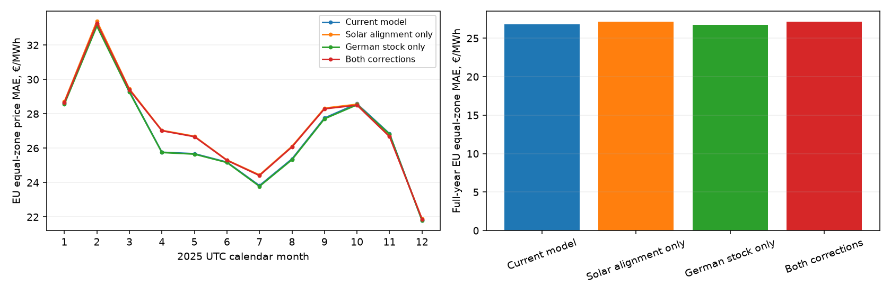
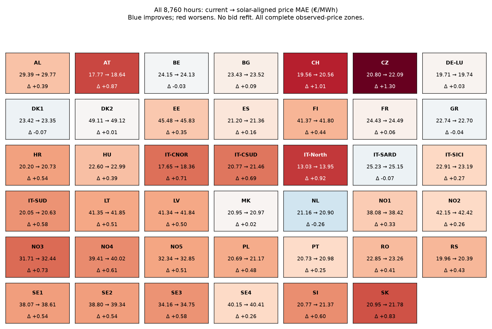
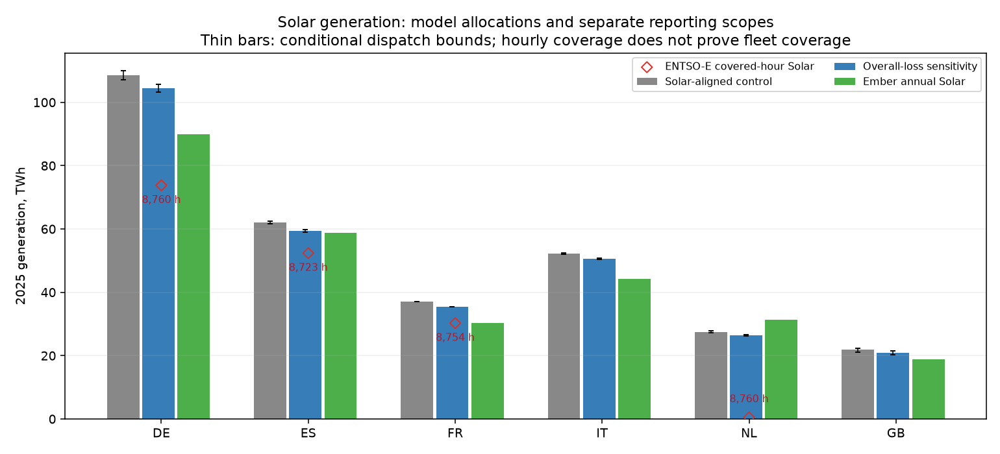
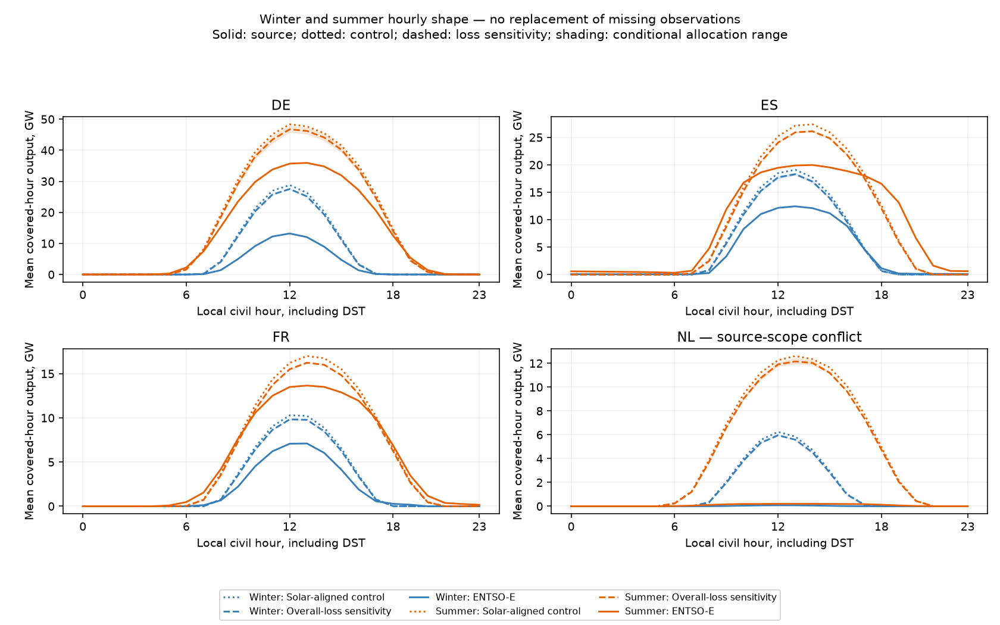
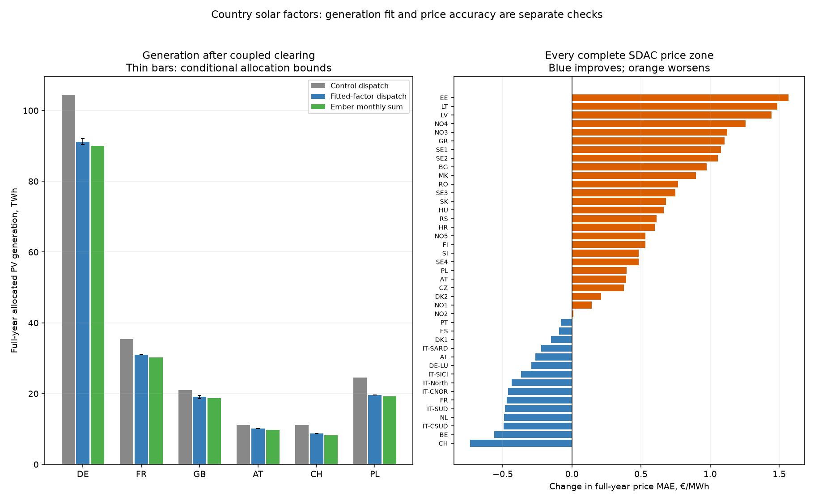

# Full-year 2025 solar-alignment comparison

Verified research comparison, 22 October 2026. Public model and accepted baseline unchanged.

## Result

Solar alignment alone changes full-year **European MAE 27.576 → 27.984 €/MWh** and **EU MAE 26.784 → 27.173 €/MWh**. Of 41 complete price zones, 5 improve and 36 worsen. These are actual 8,760-hour clearing comparisons, not extrapolated January results.

The earlier January improvement came from German thermal-stock reconciliation. Solar timing alone slightly worsened that event-week MAE. The fixed four-case design below separates the two effects across the full year. No bids were refitted or case selected by observed price.

| Case | Europe MAE | EU MAE | Mean Europe r | Emergency MWh | Annual clearing seconds |
|---|---:|---:|---:|---:|---:|
| Current model | 27.576 | 26.784 | 0.617 | 0.000000 | 0.00 |
| Solar alignment only | 27.984 | 27.173 | 0.609 | 0.000000 | 46.90 |
| German stock only | 27.552 | 26.742 | 0.617 | 0.000000 | 59.30 |
| Both corrections | 27.962 | 27.132 | 0.610 | 0.000000 | 75.47 |

MAE is €/MWh. Control reuses the independently audited current oil/CHP25 witness; zero seconds means no repeated solve. Other timings include the clearing driver and witness save, excluding source preparation and independent audit. Cases with any emergency use fail supply-model acceptance even if price errors improve.

## What changes

**All countries:** original ERA5/atlite PV coefficients label the preceding hour. Move the coefficient at t+1 to market interval [t,t+1), for both fixed and tracked solar. Keep destination-hour IRENA 2024→2025 linear commissioning, source-country/plant geography, offer tranches and original arrays. Solar and wind may share a bid group; only its reconstructed solar contribution changes. Wind timing, bids, observed demand, fixed hydro, network/GSK, links, branch ratings and offsets remain unchanged.

**German stock sensitivity only:** use the separately audited SMARD annual net stock factors: hard coal 20.352→15.951 GW, lignite 19.457→15.178 GW, gas 36.896→36.614 GW. These annual totals are not hourly available/offered fleet or proof of outages on a particular date. No other country gets an unverified capacity correction.

**Year endpoint:** the cache ends at 2025-12-31 23:00 UTC, so the shifted last hour requires a 2026-01-01 00:00 UTC coefficient. That coefficient is explicitly model-derived zero, not a retrieved ERA5 observation. Atlite solar elevation across every weather cell and minute of the full 23–24 UTC interval is at most -37.42°; an independent NOAA geometry calculation gives -37.47°. A conservative 2° margin stays below the converter's 1° irradiation cutoff. Zero irradiation produces exactly zero in the retained CSi panel model. This proves the endpoint identity without weather interpolation, circular wrapping or observed-generation substitution. Daylight missing endpoints are rejected.

## Per-zone price errors

[All 48 zones × four cases: annual/monthly MAE, bias, RMSE, correlation, hourly-ramp MAE and top-5%-observed-price MAE](solar-alignment-2025-by-zone.csv). Unknown targets remain missing, not zero errors.

## Country overview

These are equal averages over the listed complete price zones, not demand-weighted national prices. European/EU aggregates weight each unique zone once. DE-LU is shared with Luxembourg and not duplicated; country grouping lists it under DE. Italy and France have incomplete modeled-zone coverage. Shared IE-SEM and other unavailable targets are excluded.

| Country group | Covered/model zones | Current MAE | Solar only | DE stock only | Both |
|---|---:|---:|---:|---:|---:|
| AL | 1/1 | 29.39 | 29.77 | 29.35 | 29.73 |
| AT | 1/1 | 17.77 | 18.64 | 17.65 | 18.53 |
| BE | 1/1 | 24.15 | 24.13 | 23.94 | 23.89 |
| BG | 1/1 | 23.43 | 23.52 | 23.38 | 23.46 |
| CH | 1/1 | 19.56 | 20.56 | 19.33 | 20.37 |
| CZ | 1/1 | 20.80 | 22.09 | 20.65 | 21.95 |
| DE | 1/1 | 19.71 | 19.74 | 19.38 | 19.45 |
| DK | 2/2 | 36.26 | 36.24 | 36.14 | 36.13 |
| EE | 1/1 | 45.48 | 45.83 | 45.52 | 45.85 |
| ES | 1/1 | 21.20 | 21.36 | 21.19 | 21.36 |
| FI | 1/1 | 41.37 | 41.80 | 41.49 | 41.94 |
| FR | 1/2 | 24.43 | 24.49 | 24.36 | 24.42 |
| GR | 1/1 | 22.74 | 22.70 | 22.71 | 22.65 |
| HR | 1/1 | 20.20 | 20.73 | 20.14 | 20.68 |
| HU | 1/1 | 22.60 | 22.99 | 22.50 | 22.89 |
| IT | 6/7 | 19.94 | 20.46 | 19.93 | 20.44 |
| LT | 1/1 | 41.35 | 41.85 | 41.37 | 41.86 |
| LV | 1/1 | 41.34 | 41.84 | 41.36 | 41.85 |
| MK | 1/1 | 20.95 | 20.97 | 20.89 | 20.90 |
| NL | 1/1 | 21.16 | 20.90 | 20.84 | 20.59 |
| NO | 5/5 | 36.74 | 37.23 | 36.88 | 37.38 |
| PL | 1/1 | 20.69 | 21.17 | 20.58 | 21.07 |
| PT | 1/1 | 20.73 | 20.98 | 20.71 | 20.97 |
| RO | 1/1 | 22.85 | 23.26 | 22.80 | 23.20 |
| RS | 1/1 | 19.96 | 20.39 | 19.91 | 20.33 |
| SE | 4/4 | 37.79 | 38.28 | 37.93 | 38.42 |
| SI | 1/1 | 20.77 | 21.37 | 20.71 | 21.31 |
| SK | 1/1 | 20.95 | 21.78 | 20.86 | 21.69 |

Coverage: 48 modeled zones, 41 complete price zones; EU subtotal uses 32 zones grouped under 23 country codes (AT, BE, BG, CZ, DE, DK, EE, ES, FI, FR, GR, HR, HU, IT, LT, LV, NL, PL, PT, RO, SE, SI, SK), with Luxembourg sharing DE-LU. This is the covered EU network, not complete coverage of all 27 member states. No complete targets for: BA, IT-CALA, ME, XK, FR-COR, GB, IE-SEM.

## Verification and interpretation

Independent audit replays **35,040 hourly LP witnesses**, including the reused control: original source profiles, full-year clock/capacity/geographic pooling, native component balances/AC branch limits, offer/link bounds, objectives and full primal/dual optimality. Maximum native residual 4.82e-06 MW; maximum duality gap €1.13e-05. Original feasibility and optimality gates are unchanged. Three boundary tests verify the nighttime identity, reject missing daylight coefficients and check zero-output panel behavior.

All prices are original corrected ENTSO-E main day-ahead hourly targets; published quarter-hour prices are averaged only when all four observations exist. DE-LU/AT use SDAC sequence 1. SMARD provides the German capacity sensitivity, not price targets. Original bids retain non-oil calibration to earlier incorrectly selected targets: this remains an in-sample reconstruction with inherited calibration limitations, not forecast accuracy or recovered auction bids. Timing semantics must follow the source contract even where price MAE worsens. An hourly energy-mix improvement, asset-value validation or annual model promotion cannot be inferred from price error alone.

The solar input issue affects the shared historical network-dispatch pipeline and its downstream witnesses, including the current public country explorer. This study preserves those historical files and evaluates corrected copies. It does not establish an effect on the separate observed-price/flow congestion-rent computation or automatically replace the two-node browser scenario engine.

## Conclusion

The timing correction fixes a shared input contract, but does not by itself improve annual price recovery with the inherited bids. Keep that distinction explicit: prices may have been calibrated around other input errors, while weather magnitude, available/offered fleet and network constraints retain separate uncertainties. This comparison does not identify which uncertainty explains the remaining error. Further source reconciliation and any corrected-input bid recalibration require fresh provenance; do not choose a physically incorrect clock simply because its MAE is lower.

Source/case plan: `config/annual-solar-alignment-2025.json`. Ignored authoritative evidence: `data/bidding-zone-network-2025/annual-solar-alignment-v1/inputs.json`, `summary.json`, `audit.json`, raw annual witnesses and `report-receipt.json`. Source URLs and original hashes remain chained to the January source audit, corrected-price audit and frozen oil/CHP checkpoint. Six historical explorer validation-file hashes are checked against their exact archived bytes at Git commit 5e1fe632861f402029047e3d1ca0c384a2b6212f, because the user later replaced those public exports; no old hash is waived and no obsolete public data is restored. The previous [January investigation](january-scarcity-2025.md) remains separate.

## Solar-fleet magnitude and hourly-shape audit — 22 October 2026

**The modeled solar supply is too high relative to several reported generation series, but source scope is a major confounder.** One documented loss sensitivity reduces Europe price MAE **27.962 → 27.897 €/MWh**. It improves 15 price zones and worsens 26. This small gain does not establish a corrected national fleet, and the public model remains unchanged.

### What is modeled and what changed

Weather is hourly ERA5 on a **0.3° × 0.3° grid**, roughly 21 × 33 km in Germany, with 20,567 retained cells. Atlite converts weather to PV power before PyPSA-Eur aggregates it into 128 regional profiles for each panel technology. Only **123 fixed-panel source generators have positive nameplate**; every tracker generator has zero nameplate, despite the existence of cached tracking profiles. There are 34 source-country fleets, later mapped into 48 market zones. This is historical reanalysis, not an operational forecast.

The fixed-panel model is CSi/Huld, south-facing, 35° tilt, with 0.90 inverter efficiency. Country capacity follows IRENA end-2024 → end-2025 linear commissioning; within-country source capacity/geographical weights are inherited. Regional profile layouts favor eligible productive land rather than establishing the actual location/orientation of the 2025 fleet. A fine weather grid is therefore not proof of fine installed-fleet geography.

Control is the verified solar-aligned plus German-stock source comparison. The new case replaces the existing 0.90 inverter retention with the [PVGIS generic 0.86 overall system retention](https://joint-research-centre.ec.europa.eu/photovoltaic-geographical-information-system-pvgis/getting-started-pvgis/pvgis-user-manual_en): multiply only PV by 0.86/0.90, a 4.44% reduction. Do not multiply a second 14% loss. Existing irradiance/temperature effects stay in Huld. This is a generic sensitivity, not measured national loss or calibration to generation. Bids, wind, demand, fixed hydro, grid/GSK and all other inputs stay fixed.

| Case | Europe price MAE | Emergency MWh | New annual driver seconds |
|---|---:|---:|---:|
| Solar-aligned control | 27.9616 | 0.000000 | 0.00 |
| Overall-loss sensitivity | 27.8967 | 0.000000 | 73.00 |

Forty-one complete SDAC price zones, 48 physical zones; zero seconds means an exact reused witness. These are the same frozen bids, including the inherited earlier-target calibration limitation.

### National energy and reporting boundaries

| Country | Control solar TWh | Loss case TWh | ENTSO-E covered TWh | Hourly coverage | Ember Solar TWh |
|---|---:|---:|---:|---:|---:|
| AL | 1.167 | 1.115 | unavailable | 0/8760 | incomplete |
| AT | 11.674 | 11.172 | 5.665 | 8760/8760 | 9.809 |
| BA | 0.846 | 0.810 | unavailable | 0/8760 | 0.473 |
| BE | 11.370 | 10.866 | 10.200 | 8760/8760 | 10.199 |
| BG | 7.174 | 6.855 | 6.359 | 8760/8760 | 6.359 |
| CH | 11.714 | 11.192 | 5.107 | 8760/8760 | 8.176 |
| CZ | 4.896 | 4.681 | 4.707 | 8759/8760 | 4.708 |
| DE | 108.587 | 104.364 | 73.784 | 8760/8760 | 89.965 |
| DK | 4.620 | 4.499 | 4.473 | 8752/8760 | 4.482 |
| EE | 0.869 | 0.831 | 1.098 | 8760/8760 | 1.099 |
| ES | 62.029 | 59.374 | 52.368 | 8723/8760 | 58.814 |
| FI | 1.242 | 1.188 | 1.303 | 8760/8760 | 0.978 |
| FR | 37.029 | 35.383 | 30.261 | 8754/8760 | 30.273 |
| GB | 21.843 | 20.937 | unavailable | 0/8760 | 18.776 |
| GR | 14.407 | 13.766 | 11.486 | 8758/8760 | 11.485 |
| HR | 1.413 | 1.360 | 0.545 | 8760/8760 | 1.344 |
| HU | 9.507 | 9.085 | 6.812 | 8760/8760 | 10.562 |
| IE | 1.899 | 1.818 | unavailable | 0/8760 | 1.065 |
| IT | 52.273 | 50.581 | unavailable | 0/8760 | 44.315 |
| LT | 2.839 | 2.713 | 1.643 | 8760/8760 | 1.642 |
| LU | 0.734 | 0.705 | unavailable | 0/8760 | 0.429 |
| LV | 0.740 | 0.708 | 0.678 | 8760/8760 | 0.679 |
| ME | 0.037 | 0.035 | unavailable | 0/8760 | 0.078 |
| MK | 1.357 | 1.297 | unavailable | 0/8760 | 1.387 |
| NL | 27.429 | 26.392 | 0.498 | 8760/8760 | 31.420 |
| NO | 0.735 | 0.708 | unavailable | 0/8760 | 0.009 |
| PL | 25.639 | 24.513 | 19.229 | 8760/8760 | 19.228 |
| PT | 9.172 | 8.904 | 6.104 | 8760/8760 | 8.792 |
| RO | 6.674 | 6.377 | 2.718 | 8759/8760 | 5.621 |
| RS | 0.478 | 0.457 | unavailable | 0/8760 | incomplete |
| SE | 5.275 | 5.044 | 2.281 | 8760/8760 | 4.431 |
| SI | 1.773 | 1.711 | 0.783 | 8758/8760 | 1.345 |
| SK | 1.029 | 0.984 | 0.568 | 8759/8760 | 0.569 |
| XK | 0.029 | 0.027 | unavailable | 0/8760 | incomplete |

**Germany:** modeled PV108.587→104.364TWh versus Ember89.965 and ENTSO-E73.784. The [BNetzA 2025 report](https://www.bundesnetzagentur.de/SharedDocs/Pressemitteilungen/EN/2026/20260104_SMARD.html) explicitly excludes household self-consumption from its grid generation figures. [Fraunhofer ISE](https://www.ise.fraunhofer.de/en/press-media/press-releases/2026/german-public-electricity-generation-in-2025-wind-and-solar-power-take-the-lead.html) reports 16.9 TWh self-consumed PV and identifies east/west orientation as a yield factor. This supports a scope/geometry investigation; it does not justify shrinking capacity until the ENTSO-E curve matches. Reconcile demand's grid/gross boundary before splitting self-consumption from market offers, so behind-the-meter energy is not removed twice.

**Netherlands:** the full 8760-hour ENTSO-E source totals only0.498TWh versus Ember31.420. This is a major source-scope conflict; hourly completeness is not national fleet coverage. Reducing modeled output improves its error against the tiny hourly source while moving farther from Ember. Neither metric establishes the correct total. A CBS national-release reconciliation remains open: its webpage was inspectable through web research, but direct frontend/OData retrieval failed, so no CBS dataset or replacement target was ingested.

**Spain:** B16 is Solar rather than an isolated PV measurement. [REE's ENTSO-E comparison definition](https://www.ree.es/en/datos/european-landscape) includes photovoltaic and solar thermal. [REE documents](https://www.sistemaelectrico-ree.es/en/renewable-energies-report/sun/generation/solar-thermal-sun-generation) that stored solar heat extends thermal output to later hours; [its renewable report](https://www.sistemaelectrico-ree.es/en/spanish-electricity-system/generation/renewable-electricity-generation) also distinguishes self-consumption. The retained IRENA2025 parent Solar47206MW exceeds PV44903MW by2303MW (rounded parent-minus-child, not an added measured generator). Our modeled PV does not represent that solar-thermal fleet/storage. Output in the observed Solar series during zero modeled PV cannot automatically be called a PV timing bug. No thermal-storage profile was invented.

Hourly source coverage spans23 countries, with15 complete years. Missing constituent regions/types propagate to missing national observations. Italy, UK and Norway have no complete national hourly comparison here. France lacks 6 hours, Spain 37, Denmark 8. Ember is monthly and national; no hourly Ember profile was manufactured. Its all-Solar and national boundaries need independent reconciliation before treating it as a PV target.

### Hourly and seasonal shape

Curves average identical covered UTC intervals grouped by local civil hour and season, including DST. Shaded ranges are conditional resource-allocation bounds inside identical-price offer pools, not confidence intervals; country bounds need not be jointly attainable. Annual modeled generation uses an availability-proportional illustration within those bounds, not identified plant dispatch.

Germany's hourly correlation changes0.97094→0.97242; daily normalized-shape L1 changes0.08440→0.08399. Spain's shape L1 worsens0.20988→0.21048. This diagnostic normalizes each complete UTC day's model/source energy before summing hourly absolute differences (zero-energy days excluded). Loss scaling primarily changes magnitude; it cannot recover different orientations, tracking, cloud errors, reporting boundaries or solar-thermal night generation. France's unchanged shape/correlation is an explicit example.

[Country energy, dispatch bounds, hourly MAE/correlation, daily-energy and normalized-shape diagnostics](solar-fleet-2025-countries.csv) · [All country/month energy and coverage](solar-fleet-2025-monthly.csv) · [All48 zones: price MAE/bias/correlation and missing targets](solar-fleet-2025-prices.csv). Covered-hour sums are not annual totals where hours are missing. No Europe-wide generation score is presented as comparable across incompatible source scopes.

### Verification and next correction

The independent audit reconstructs original PV coefficients, interval shift, IRENA trajectories, original source-country mapping and all original ENTSO-E B16 observations. It replays **17520 hourly native/KKT certificates**, maximum native residual4.82e-06MW and duality gap1.1e-05EUR, with zero emergency. Generation allocation inequalities and original-source/export rounding are replayed. Three tests guard loss double counting, constituent missingness and mixed-offer bounds. Audit runtime171.3s; new-driver timings exclude preparation/audit.

The next material correction is the **fleet and measurement boundary**, followed by geometry: establish grid feed-in versus total PV and compatible demand; separate PV from solar thermal; reconcile IRENA net capacity with PVGIS DC-STC peak-power normalization; then source country/region-specific tilt, azimuth, tracking and system losses. Do not invent an AC/DC factor or use observed dispatch as available power. Germany's and France's residual surplus remains after the generic loss change, while the Netherlands gives opposing signals by source.

The compact weather cache retains converted per-cell fixed/tracking outputs and deletes original raw meteorology only after verification. It correctly rejects changed orientation/panel requests. New orientation physics therefore requires freshly retrieved radiation/temperature or independently supplied coefficients; it cannot be reconstructed by relabeling existing profiles. Existing fixed and horizontal-tracker conversions can be reused if verified fleet shares/geography become available; no shares were guessed here. The precomputation approach remains fast at clearing time. No weather collection or unseen-year validation was performed in this audit, and no model/site promotion follows from this small in-sample price improvement.

Reproduction: config/solar-fleet-audit-2025.json; tools/solar_fleet_audit_2025.py prepare/run, audit_solar_fleet_2025.py, report_solar_fleet_2025.py using the pinned interpreter and original local source caches. Sealed ignored inputs/components, annual witness, source receipts, audit, quantity arrays and renderer receipt are under data/bidding-zone-network-2025/solar-fleet-audit-v1/. Raw provider data and hourly matrices remain outside Git.

## Country solar-factor regression — 22 October 2026

**Implemented and independently tested:** one zero-intercept factor for each of 21 eligible countries, using monthly generation only. All 8,760 hours clear with zero emergency. European price MAE **27.897 → 28.239 €/MWh**; 15 zones improve and 26 worsen. This candidate is not promoted.

### Method and limits

For each country, form twelve monthly energy values $x_m$ from the preserved, interval-aligned weather/IRENA PV profiles after the generic loss correction. Fit original Ember Solar totals $y_m$ with $\alpha=\sum_m x_m y_m/\sum_m x_m^2$, without an intercept. Apply that same factor to every source PV hour and region in the country before offer pooling. No hourly generation is copied into the inputs, and no price enters the regression.

This fits **pre-clearing available energy**, not an assumed linear response of market dispatch. Rerunning the network determines curtailment and generation afterward. One pass only: no seasonal coefficients, dispatch-feedback refit or price-selected iteration. Nameplate, original profile files, night zeros, geography, IRENA commissioning and all non-PV inputs/bids remain unchanged.

Require twelve finite nonnegative Ember months and compatible IRENA Solar/PV parent endpoints within 2 MW rounding tolerance. The Netherlands is excluded for the documented source conflict. Spain and Italy retain their inputs because the strict parent check detects solar thermal (including Italy's small 5 MW difference). A declared reduction-only guard accepts raw factors from 0.5 to 1; rejected values remain reported and their applied factor stays 1, never clipped. The guard is a research assumption, not a verified physical bound.

All 34 countries and exclusion/raw-coefficient records are in the CSV. Norwegian raw factor is about0.0129 and is rejected, rather than removing98.7% of weather-derived PV to reproduce9GWh. Upward fits and missing/incompatible sources are also retained unchanged. Country-specific gross/grid-feed-in, demand, AC/DC and geographical scope remain limitations: this empirical factor can absorb measurement, losses, curtailment or fleet-model errors. It does not identify physical efficiency or market-eligible capacity.

### Generation after clearing

Across the 21 fitted countries, equal-country mean monthly generation MAE against the fitting source changes **0.1683 → 0.0880 TWh/month**; 19 countries improve on that metric. These are post-clearing allocated generation comparisons, not just the regression's algebraic weather fit. They are in-sample and do not establish unseen-year accuracy or uniquely recovered unit dispatch.

| Country | Factor | Control TWh | After clearing TWh | Ember TWh |
|---|---:|---:|---:|---:|
| DE | 0.8637 | 104.364 | 91.194 | 89.965 |
| FR | 0.8761 | 35.383 | 30.998 | 30.273 |
| GB | 0.9076 | 20.937 | 19.097 | 18.776 |
| AT | 0.9001 | 11.172 | 10.077 | 9.809 |
| CH | 0.7752 | 11.192 | 8.676 | 8.176 |
| PL | 0.8006 | 24.513 | 19.645 | 19.228 |

Conditional generation-allocation bounds remain explicit. Correcting input PV in one country can change curtailment and generation in other countries whose factor is unchanged. A national energy match also cannot correct an incorrect within-day shape through a single scalar.

### Price result and verification

Generation calibration does not guarantee better prices. Germany and France improve, but the all-zone score worsens; every covered zone is shown in the figure/CSV. Existing bids were calibrated against earlier inputs/auction targets, and source-boundary/network uncertainties remain. This experiment does not identify which of those causes the price trade-off. Price results remain a retrospective cross-target check: all2025 was already inspected, so this is not independent forecasting validation.

Independent audit reads the original Ember provider CSV, checks IRENA scope, solves the regression with a separate least-squares implementation, reconstructs the PV-only delta and replays **17,520 hourly native/KKT certificates**. Maximum native residual **8.14e-06 MW**, duality gap **0.000104 EUR**; zero emergency in both years. New annual driver **86.7s**, independent audit **110.8s**, excluding source preparation. Three tests cover scalar recovery/no intercept, missing data and rejected-factor behavior.

[All country factors, eligibility, raw slopes and post-clearing scores](solar-country-fit-2025.csv) · [Monthly target/control/cleared quantities and bounds](solar-country-fit-2025-monthly.csv) · [All48 price zones, including missing targets](solar-country-fit-2025-prices.csv).

Design: config/solar-country-fit-2025.json. New producer/auditor/renderer are named solar_country_fit_2025; exact local sources, delta, witnesses, source-fit/audit summaries and renderer receipt remain in ignored data/bidding-zone-network-2025/solar-country-fit-v1/. The source-loss control is reused byte-for-byte. Public and accepted baselines remain unchanged; automatic reviews stay disabled.
