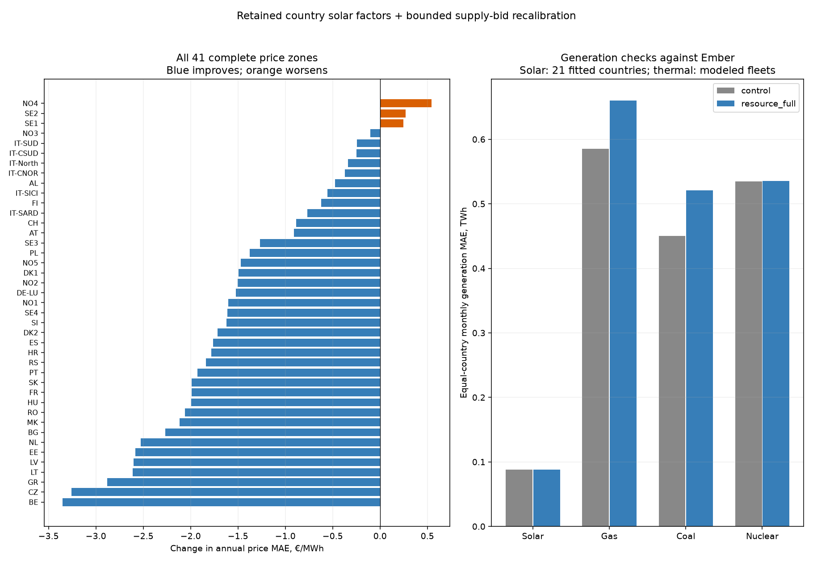

# Supply bids after the country solar correction

**Result:** the lowest-price-error trial `resource_full` changes full-year European price MAE **28.239 → 26.795 €/MWh (5.11% lower)** with the retained solar factors. 38 zones improve and 3 worsen. But thermal generation error increases **17.41%**, failing the predeclared 5% guard. **No new bid trial qualifies; retain the solar-corrected control.** All four 8,760-hour cases pass independent source/bid/native/KKT replay with zero emergency. Website/explorer unchanged.

## What changes

Start from the user-retained solar-country-fit-v1/country_factors: 21 source-country PV factors, the corrected weather interval, generic loss retention and German stock reconciliation. Keep their exclusions and original source files intact. The old non-oil bid calibration used earlier auction targets; this experiment fits a fresh bounded **increment** against corrected ENTSO-E main day-ahead (SDAC) hourly prices.

The existing gas, coal/lignite and nuclear offers retain their daily fuel, efficiency, carbon, variable-cost and inherited bid components. Add one smooth effective correction per zone/resource. Calendar features are annual sine/cosine, local-hour first/second harmonics, seasonal × daily interactions and a centered local weekend indicator (16 coefficients; DST respected). No residual-demand predictor, observed hourly generation, hourly price lookup in dispatch or post-clearing price correction is used.

Fit ridge regression (168 I) to observed-minus-anchor price errors, clipped to ±100 €/MWh. The common calendar rule uses all available target hours; the resource rule uses only hours with positive local interior dispatch, more than 0.001 MW from either bound, and offer cost within 1e-5 €/MWh of the local anchor price. Require 168 observations; unsupported fits remain zero. Bound incremental offers to ±30 €/MWh gas/coal and ±7.5 nuclear; the half case uses half these corrections. Floor final thermal bids at zero and apply the same correction to every tranche, preserving their ordering. These are research bounds, not measured markups.

Oil/CHP, renewable bids, emergency bids, fixed hydro schedules, physical MW, solar factors, demand, network/GSK/PTDF and link limits are unchanged. Hydro remains precomputed; this does not introduce reservoir optimization or a new chronological storage model. Clearing reruns every hour of 2025 under the constrained market model.

## Fixed experiment and all results

One reused control and exactly three new annual trials, all from one unchanged-anchor proposal: half/full common calendar and full resource-specific correction. No successive residual fitting or search expansion. Select the lowest all-year equal-zone MAE among independently verified zero-emergency cases whose solar monthly MAE and thermal monthly normalized generation error are each at most 105% of control. That 5% is an experimental selection guard, not a relaxed product acceptance gate.

| Case | Price MAE €/MWh | Daily-demeaned MAE | Solar monthly MAE TWh | Thermal normalized error | Eligible |
|---|---:|---:|---:|---:|---|
| control | 28.239 | 19.876 | 0.08799 | 0.3145 | yes |
| calendar_half | 27.349 | 19.188 | 0.08820 | 0.3382 | no |
| calendar_full | 26.932 | 18.947 | 0.08828 | 0.3608 | no |
| resource_full | 26.795 | 18.752 | 0.08834 | 0.3692 | no |

Thermal guard: mean absolute monthly Gas/Coal/Nuclear generation error divided by max(source TWh,0.25), over known original Ember targets for modeled resource-country pairs. Each selected thermal offer has a single verified source country, so these national resource totals need no proportional inter-country allocation. Coal includes lignite. Missing targets are unknown. This guard excludes countries without the corresponding modeled fleet; it is not a complete national-mix validation. Oil is not compared to Ember Other fossil, which also contains other fuels.

Solar uses proportional generation allocation within equal-price pools, with conditional lower/upper bounds retained in the local audit. Its monthly score covers the 21 fitted countries and is distinct from pre-clearing yield fit. The factors and source profiles stay fixed even when market curtailment changes. The generation CSV shows every modeled thermal country/resource and the 21 solar countries, with source coverage and all trial totals.

## Lowest-price-error trial: detail (not adopted)

| Zone | Anchor MAE | Trial MAE | Anchor correlation | Trial correlation |
|---|---:|---:|---:|---:|
| DE-LU | 18.872 | 17.349 | 0.835 | 0.849 |
| FR | 23.679 | 21.689 | 0.800 | 0.823 |
| ES | 21.370 | 19.605 | 0.820 | 0.853 |
| NO1 | 38.745 | 37.142 | 0.184 | 0.208 |
| NO2 | 42.544 | 41.042 | 0.120 | 0.143 |
| NO3 | 34.201 | 34.098 | 0.216 | 0.242 |
| NO4 | 41.989 | 42.532 | 0.089 | 0.111 |
| NO5 | 33.767 | 32.295 | 0.260 | 0.287 |
| SE1 | 40.319 | 40.568 | 0.112 | 0.139 |
| SE4 | 41.139 | 39.525 | 0.259 | 0.300 |

Equal-zone mean correlation **0.609 → 0.633**; daily-demeaned MAE **19.876 → 18.752 €/MWh**; hourly-ramp MAE **12.898 → 12.802 €/MWh**.

Scarcity remains unresolved: pooled MAE over observed prices above 300 €/MWh in the 41 complete zones is **239.53 → 234.83 €/MWh** (a conditional pooled score, not the equal-zone annual metric). At 20 January 16:00 UTC, Germany clears **162.40 → 161.34 €/MWh**, versus **583.40** observed.

This is an all-8,760-hour solve, scored equally over 41 complete ENTSO-E zones out of 48 modeled zones. Unavailable observations remain missing, with coverage in the CSV. Fitting, trial selection and final scoring all use already-inspected 2025; these are **in-sample reconstruction results**, not cross-validation, unseen-year forecasting accuracy, recovered actual bids or verified investment benefits. Effective corrections can absorb source and grid errors. Smooth calendar corrections cannot by themselves explain exceptional scarcity spikes or establish plant eligibility/startup constraints.

## Verification and conclusion

Independent audit verifies the sealed source/proposal hashes, re-solves each ridge fit through augmented least squares, reconstructs resource-only costs, and replays all **35,040** hourly primal/native/KKT certificates. Maximum native residual **8.14e-06 MW**, maximum duality gap **0.000104 EUR**. No emergency in any case; original feasibility/optimality gates remain unchanged. New clearing times: calendar_half 56.3s, calendar_full 63.4s, resource_full 51.8s. Independent audit 62.0s. Three focused tests cover unsupported/missing fits, clipping/ridge and unchanged nonthermal/tranche behavior.

The declared selection retains `control`. The `resource_full` price improvement demonstrates sensitivity to supply bids, but its generation trade-off prevents adoption; the two common-calendar trials also fail the thermal guard. Solar monthly MAE changes only 0.08799 → 0.08834 TWh, so the principal rejection is thermal mix. A useful next experiment would constrain bid fitting jointly by country/resource generation instead of fitting prices first and checking mix afterward. That needs a new declared design, not relaxed guards or an expanded version of this completed search. Public report/explorer/browser solver remain unchanged and recurring reviews stay disabled.

[All 48 zones and all trial price/shape scores](solar-anchor-bids-2025-prices.csv) · [Country/resource generation, all trial totals and monthly errors](solar-anchor-bids-2025-generation.csv).

Reproduce: pinned scientific Python with PYTHONPATH=tools and BLAS/OMP threads1; run solar_anchor_bids_2025.py prepare then run (fresh directory only), audit_solar_anchor_bids_2025.py, report_solar_anchor_bids_2025.py. Design is config/solar-anchor-bids-2025.json. Full hashes, coefficients, source memberships, witnesses, all monthly allocation bounds and certificates are retained in ignored data/bidding-zone-network-2025/solar-anchor-bids-v1/. No hourly matrices or raw-provider data are added to Git.
