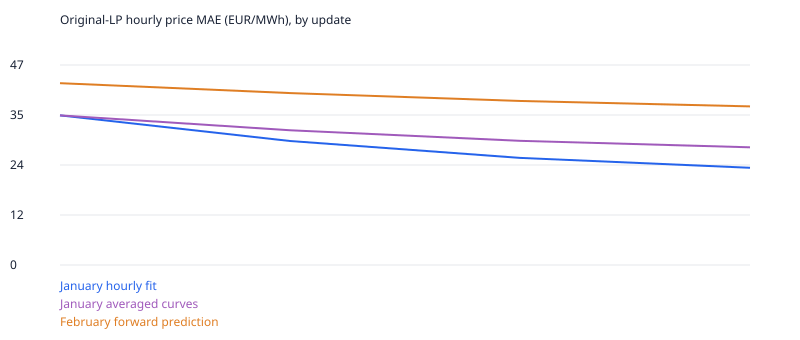

# Faster hourly spline fitting: January→February 2025

The custom gradient-trained supply curves remain unchanged. A condensed linear
algebra backend accelerates smooth dispatch, with residual-checked
fallback to the original sparse solver. On six matched January/February pilot
hours, cold clearing took 3.816 s originally and 1.638 s condensed
(2.33×). Matched warm solves improve by 2.37×. Adjoint computation is slightly
slower in this microbenchmark; no backward-pass acceleration is claimed. These
are solver microbenchmarks, not whole-year times.

The full pipeline fits all 744 January hours and predicts all 672 February hours.
It tests three gradient updates, not annual convergence. Selected update
**3** minimizes February LP price MAE among these proposals. Stop reason:
`three_update_test_budget_not_convergence`. This bounded selection is not an untouched test.

| Update | January fit MAE | January averaged MAE | February MAE | February mix MAE TWh | Iteration seconds |
|---|---:|---:|---:|---:|---:|
| 0 | 35.266 | 35.266 | 42.860 | 0.3504 | 55.5 |
| 1 | 29.227 | 31.761 | 40.525 | 0.3412 | 221.5 |
| 2 | 25.248 | 29.271 | 38.662 | 0.3387 | 202.4 |
| 3 | 22.916 | 27.740 | 37.389 | 0.3348 | 211.9 |

Iteration 0 revalidates the identical, saved neutral January KKT states; its
dispatch time is **cache replay**, not fresh clearing. Later updates change
hourly bids and require fresh warm-started solves. Times above include smooth
dispatch/replay, full-month backward gradients and three original-LP evaluations
(January hourly, January averaged, February averaged); they exclude input loading,
process startup, some checkpoint writes and the independent audit. Phase timings
are in the iteration CSV. Short ordering/QP diagnostics overlapped updates1/2
on the two-core host, so these unpaired whole-month times are diagnostic, not
a controlled before/after speed ratio. No 30–60 second annual fitting claim follows.

## What is fitted

Every hour/technology/zone has six unconstrained parameters. The midpoint shift
is 80·tanh(raw/4) EUR/MWh; five positive increments are0.001+20·softplus(raw).
These define monotone cubic supply curves at 0/20/40/60/80/100% of available MW.
Adam updates the raw parameters using gradients through constrained clearing,
jointly against hourly ENTSO-E prices and actual monthly Ember generation. This
is not ordinary spline regression against observed bid points. Shape derivatives
use complex-step evaluation of the cubic formulas; the clearing gradient is an
implicit KKT adjoint, not finite differences of repeated dispatch solves.

The midpoint/shape functions are differentiable within their smooth branches;
PCHIP slope switches and dispatch active-set changes still require gradient
checks. The small technical regularizers and smooth-training versus20-tranche
LP-scoring distinction remain explicit. Six European backend comparisons and
three directional finite-difference checks preserve the original tolerances.

For February, average January's economic functions by zone/technology/local hour
of week, without February price or generation targets. February's own demand,
MW, fuel anchors, constraints and fixed hydro remain exogenous perfect inputs.
The physical feasible set, zero wind/solar/run-of-river bids and monthly loss are
unchanged. This compares optimization engines, not a different economic model.

## Verification and limits

Independent SciPy PCHIP reconstruction and original LP certificates replay
4,320 saved initial/selected/last witness hours. Gates remain
1e-4 MW feasibility,0.05 EUR objective/complementarity and1e-5 EUR/MWh free
reduced cost; no artificial emergency dispatch is accepted. Sources and cache
ancestry are hash-sealed in local `spline-performance-jan-feb-v1`.

The earlier published 29.55 s annual figure measured a **forward LP clearing loop**
for the earlier fixed-bid model, excluding input preparation/audit. It was not
gradient fitting. This experiment additionally optimizes hourly curve coefficients,
backpropagates coupled monthly generation errors, and evaluates three LP passes.
It also uses a different offer discretization. Compare like-for-like workloads.

This is conditional historical model-selection validation, with observed future
demand/weather/fuel/fixed hydro supplied. Monthly generation is national/family
data, not hourly zonal ground truth. Equal-price renewable allocations can be
nonunique. The annual study is intentionally paused for these tests; the accepted
baseline and public explorer remain unchanged.

[Iteration/timing data](assets/spline-performance-jan-feb-iterations.csv) ·
[February zone errors](assets/spline-performance-feb-zones.csv) ·
[Monthly generation](assets/spline-performance-jan-feb-generation.csv)

## Faster LP inference without changing economic bids

A separate exact projection combines the 20 identical zero-price tranches for
 each renewable curve into a single offer. This cuts LP columns from **6,653 to
3,784**, collapsing 151 renewable curves. Expanded results are certified against
 the original20-tranche constraints and costs; no available MW is removed.

| Complete month | Original LP, seconds | Compact LP, seconds | Speedup |
|---|---:|---:|---:|
| January,744 hours |10.49|7.10|1.48×|
| February,672 hours |8.83|5.81|1.52×|

These timings include model preparation, clearing and certificates; one-off
imports were warmed before both passes. The February compact clearing loop alone
 took 5.25 s. This is inference after curves have been fitted, not gradient training.
No annual runtime is inferred from these two months.

All 41 scored-zone prices agree within 1.19e-8 EUR/MWh in January and 7.43e-10 in
February. Original-equation certificates pass for all 1,416 compact witness hours.
The January price dual in **FR-COR**, outside the 41 complete scored zones, can
 differ by 98.01 EUR/MWh despite the same optimal cost. Both solutions pass the original cost/duality gates; this exposes a
degenerate or numerically weakly identified price, rather than a changed
physical feasible set. It still
needs a declared pricing convention before compact inference replaces the
existing engine everywhere.

Identical-cost renewable generation allocations also change: individual curve
outputs differ by up to 9.80 GW in January and 2.17 GW in February. Monthly mix MAE
 changes only 0.336571→0.336676 TWh and 0.334806→0.334873 TWh respectively. Keep
these adverse differences visible; an equivalent optimum does not establish
unique country/technology dispatch. Original20-tranche results remain the
reference for the fitting comparison above.

Alternative factor orderings were not consistently faster. A native HiGHS QP
initializer failed on two of three tested hours; its successful case needed
additional nonlinear polishing and had no total speed advantage. Neither is
adopted. Local `ordering-pilot.json`, `qp-initializer-pilot.json`,
`compact-lp-benchmark.json` and `compact-dual-sensitivity.json` retain the evidence.

## Conclusion

The complete January-fit/February-transfer pipeline works: after three updates,
forward price MAE improves **12.8%**, and February monthly generation MAE improves
**4.4%**. These compare with the same-input neutral control, not the accepted
baseline. The raw hourly fits improve more than the averaged transferable curves;
the table makes that distinction explicit.

The current gradient-compatible parameterisation is already cheap to update.
Repeated constrained solves dominate fitting. Condensation improves the inner
solver, and duplicate-offer projection improves inference, but the measured
updated fitting iterations still take **3.4–3.7 minutes**, not seconds. The
annual study remains intentionally paused after these bounded tests. Further
training-backend acceleration and an explicit degenerate-price/allocation
convention are the next actions; the accepted model and public site stay intact.
