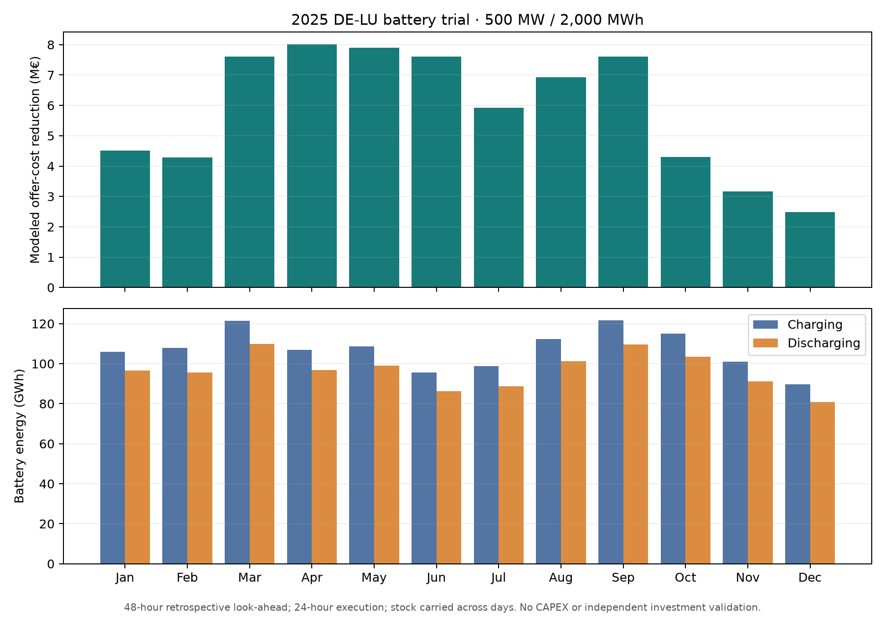

# Full-year chronological battery trial on the European network LP

## Result

A declared **500 MW / 2,000 MWh DE-LU battery** was added to the retained
`mixed_curve_fitting` European LP for every hour of 2025. Each daily decision
optimised a 48-hour window, executed only its first 24 hours, then carried the
**actual cleared stock** to the next day. Charging and discharging entered the
DE-LU nodal balance; the unchanged PTDF, island and link constraints cleared
jointly. Charging and discharging efficiencies were each 95% (90.25%
round-trip). The trial started and ended at 1,000 MWh. A 0.01 €/MWh throughput
cost discouraged gratuitous cycling.

| Full-year, paired-model measure | Result |
| --- | ---: |
| Executed chronological hours | 8,760 / 8,760 |
| Emergency dispatch | 0 MWh |
| Maximum hourly network/stock primal residual | 3.47×10⁻⁸ MW or MWh |
| Maximum annual stock replay error | 1.32×10⁻¹¹ MWh (daily replay); 2.32×10⁻¹⁰ MWh (whole-year replay) |
| Battery charging / discharging | 1.285 / 1.159 TWh |
| Modeled annual offer-cost reduction | **70.34 M€** |
| Modeled battery energy-market revenue | **69.45 M€** |
| Mean absolute change in all zonal model prices | 0.219 €/MWh |
| Total coupled-LP solve time / end-to-end run | 911 / 915 seconds |

These numbers come from the **executed** daily intervals; overlapping
look-ahead plans are discarded and never counted twice. All 365 daily
checkpoints passed independent readback of source chronology, objective,
original offer bounds, zonal balance including battery power, link bounds,
PTDF/island limits, no-emergency dispatch and MWh stock. Checkpoint hashes,
source/model hashes, annual metrics and monthly values are recorded in the
[compact receipt](data/compact-storage-annual-2025.json). Large daily hourly
arrays remain ignored under
`data/bidding-zone-network-2025/compact-storage-annual-v1/`.
No hour has simultaneous charging and discharging. Whole-year charge/discharge
ratio is 0.9025, matching the declared round-trip efficiency for a cyclic year.

## Interpretation and limits

The battery's benefit varies by month: the modeled system saving peaks at
**8.01 M€ in April** and is **2.48 M€ in December**. The figure shows the
monthly pattern without turning the short-window November illustration into
an annual estimate. The annual simulated energy revenue is distinct from the
system offer-cost reduction; neither includes CAPEX, fixed operating cost,
degradation, connection, balancing or financing cost. This is **not** a
€5 billion investment allocation or a validated return.

The 48-hour look-ahead uses future *model* bids, demand and weather with perfect
retrospective knowledge, and targets 1,000 MWh at each look-ahead boundary.
That target is a heuristic policy, not an observed operator strategy or a
single annual optimum. Hydro remains on the retained fixed schedule and cannot
respond to the battery. Bids were fitted to 2025 observed outcomes, so this is
an in-sample sensitivity, not independent market validation. The unchanged
baseline remains the original hourly LP; zero-battery 24-hour coupled solves
reproduced its objective and zonal prices to numerical precision in the
bounded formulation checks.

**Runtime is now the main blocker for budget search.** At roughly 15 minutes
per full-year battery case, hundreds of direct portfolio evaluations would be
expensive. Before storage enters the general investment runner, test a faster
but physically equivalent daily formulation or a defensible two-stage screen,
then verify the same annual stock, network and price outputs. Compare alternative
look-ahead and terminal policies, assess battery MW/MWh costs and buildability,
and run joint battery-plus-renewable/link portfolios. Do not add the 70.34 M€
to single-asset renewable results as though interactions were absent.
