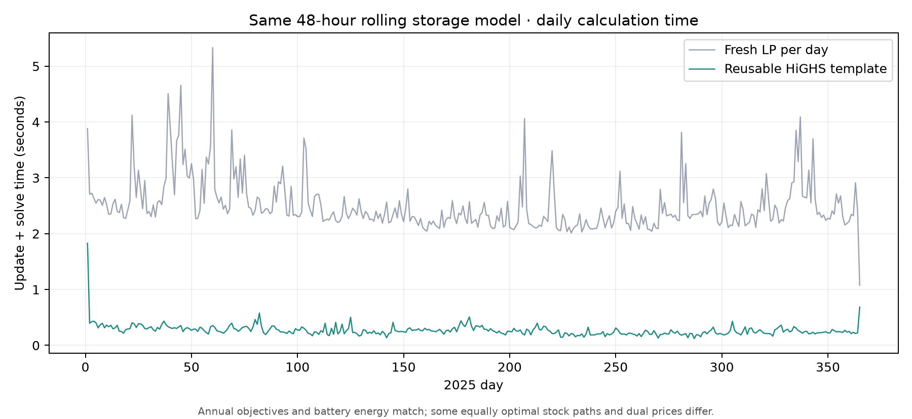

# Reusable 48-hour storage LP: annual speed and parity audit

## What changed

The original rolling 2025 DE-LU battery trial built a new 48-hour sparse LP
and started HiGHS afresh for each day. The new
`baselines/compact/storage_reuse.py` builds the same hourly network,
charging/discharging and stock matrix **once**. For each subsequent day it
updates offer costs, availability, demand, link and PTDF bounds, and starting
MWh stock in the existing HiGHS model. The solver retains its previous basis.
The final 24-hour window uses a separate reusable template. The original
annual witness and its source-hashed checkpoints were not modified.

The comparison uses the **same 500 MW / 2,000 MWh DE-LU battery**, 95% charge
and discharge efficiency, 48-hour retrospective model-input look-ahead,
24-hour execution, 1,000 MWh starting/ending stock, fixed hydro and original
2025 physical network. Its [compact audit receipt](data/compact-storage-reuse-2025.json)
links both full-year summaries, hashes all 365 daily checkpoints for each run,
and retains source/model hashes. The sampled 15-window cold-versus-reuse
[benchmark](data/compact-storage-reuse-benchmark-2025.json) independently
compares complete LP objectives and primal gates.

## Full-year result

| Measure | Fresh LP each day | Reusable HiGHS template |
| --- | ---: | ---: |
| 2025 executed hours | 8,760 | 8,760 |
| Update + solve time | 910.7 s | **97.9 s** (8.0 s update, 89.9 s solve) |
| End-to-end wall time | 915.2 s | **105.8 s** |
| Modeled annual offer-cost reduction | 70.340672 M€ | **70.340672 M€** |
| Battery charge / discharge | 1.284576 / 1.159330 TWh | Same to <0.00001 MWh |
| Emergency dispatch | 0 MWh | 0 MWh |
| Year-end stock | 1,000 MWh | 1,000 MWh |
| Maximum primal residual | 3.47×10⁻⁸ | 6.63×10⁻⁸ MW or MWh |

**Speedup: 9.30×** for update plus solve and **8.65×** end to end. The annual
objective difference is about **€0.000005**. The largest numerical correction
when carrying a stock a tiny amount outside [0, 2,000] MWh is
**1.78×10⁻¹¹ MWh**, far below the unchanged 10⁻⁴ primal gate; its total over
the year is 4.21×10⁻¹¹ MWh. Both runs have no simultaneous charge/discharge.

## Non-unique hourly outcomes

Equal LP objectives do not make all primal vectors or dual prices unique. In
the two annual runs, **four days** have different end-of-day battery stock
(maximum **375 MWh**), although annual energy and terminal stock coincide.
Across all 8,760 × 48 zonal price cells, **551 differ by more than €0.01/MWh**;
**344** are in FR-COR, the isolated-zone price direction already known to be
weakly identified. In DE-LU, **8 hours** differ by more than €0.01/MWh and the
largest gap is **€5.00/MWh**. Simulated battery energy-market revenue is
**€2,748 higher** with reusable HiGHS (69.4528 versus 69.4500 M€).
These are solver-selection differences among equally optimal or near-degenerate
solutions, not evidence that one run better predicts observed prices. The
15-window benchmark has objective gaps below €0.000003 with unchanged primal
feasibility, while some within-window stock paths and dual prices differ.

The reusable path is therefore suitable as a **fast candidate for modeled
system offer-cost screening**, with explicit uncertainty around hourly price
and investor-revenue outputs. It is not yet a drop-in replacement for a
reported hour-by-hour price trace or storage-income estimate. Before a
€5 billion joint budget search, test price/stock tie-breaking or report
sensitivity bands, extend the formulation to multiple batteries and
battery-plus-renewable/link portfolios, and check scenario response under
alternative look-ahead and terminal policies. The underlying 2025 fitted bids,
fixed hydro and perfect retrospective model-input look-ahead retain the same
investment-validity limitations as the original 915-second trial.
