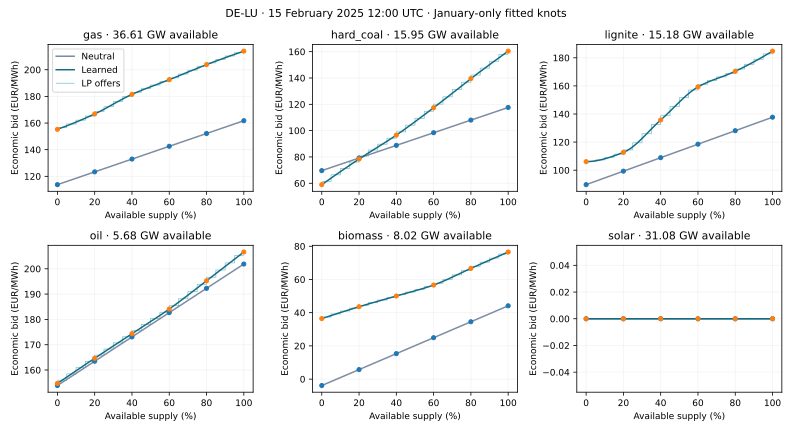
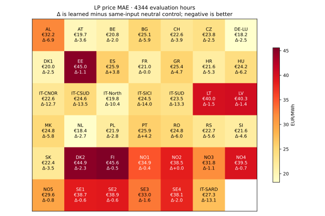
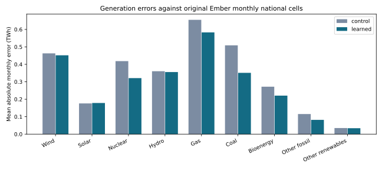

# Six supply-level spline knots in the original LP model

2026-10-23 17:36 CEST. **Complete and independently audited.** Research candidate; accepted model and public explorer unchanged.

## Summary

The model fits marginal prices at **0%,20%,40%,60%,80% and100%** of available technology output in each bidding zone. It then clears those bids in the original linear-programming model. Over **4344 even-month hours/41 complete price zones**, fitted LP price MAE is **€28.385/MWh**, versus **€32.299/MWh** for the same-input unfitted control. Monthly generation MAE is **0.2982 TWh**, versus **0.3417 TWh**; normalized errors are **0.2289** and **0.2978**. Generation coverage: 1458 known Ember cells/33 countries.

These are actual LP cleared-price and generated-energy scores, not spline regression error or sampled training loss. The comparison evaluates fitting under one common pooling/control design; it does not isolate the benefit of six-node splines over the old sigmoid family. Six even months are not an8760-hour out-of-fold year, and2025 has been inspected before.

## Model: what changes and what stays

There are **326 technology/bidding-zone curves**. Five positive price increments set the six nodes, and monotone cubic Hermite interpolation (PCHIP) connects them. Unequal increments permit several changes in curvature, while keeping higher cumulative output no cheaper than lower output. Five additional local-clock coefficients move the midpoint through the day. Hourly availability scales the horizontal axis, and hourly source costs anchor the vertical axis. Parameters are shared within a month, not independently fitted for every hour.

The earlier I-spline also allowed curvature. Six explicit interpolation nodes make the requested supply levels direct parameters; this change alone does not establish greater expressiveness or accuracy. Zone-specific parameter sharing also differs from the earlier national sharing.

Wind, solar and run-of-river keep zero economic bids. Reservoir hydro keeps its original fixed hourly injections; this experiment adds no storage fleet or water rescheduling. The original fixed demand, branch constraints, GSK/ratings, link bounds and all physical MW are retained. Only technology columns with identical network coefficients are pooled; pooling error is 2.3e-10 MW.

Pooling produces a genuine technology-zone supply curve. Its source-cost anchor is the hourly availability-weighted mean of its original source groups. This replaces their separate cost anchors and is a substantive modelling assumption. National generation from a mixed-country curve is attributed in original available-capacity proportions. This is an illustrative allocation, not independently identified plant/country dispatch. Both fitted and neutral controls use the same pooling and allocation, so their difference does not reward a change in bookkeeping.

## Fitting and original-LP inference

Each odd month initializes from only its own earlier saved smooth-spline fit, resampled at the six nodes. Eight additional Adam updates use implicit gradients of constrained **smooth** clearing on a fixed16-hour sample. The joint loss includes prices, sample-expanded monthly generation and a small ridge; normalized generation errors divide by max(observed,0.25 TWh), not an unqualified percentage error. The minimum training-loss proposal freezes before the following even month's observations are scored. This is a bounded exploratory fit, not a converged full-month optimization. More parameters with only16 sampled hours can remain underidentified.

The monotone cubic curve is continuously differentiable in supply volume. Local gradients in its node parameters use the explicit cubic formulas; PCHIP's endpoint-slope clipping is only piecewise differentiable in parameters. Local gradient tests cover the evaluated cases, not every clipping/active-constraint transition.

The original HiGHS **LP** represents each smooth bid with20 divisible equal-volume tranches. Each tranche price is the exact average of the economic spline over its volume interval. Total offered MW equals available MW; the economic LP has no quadratic tie-break. The smooth training solver's small curvature regularizer is not included in LP bids. Gradient descent therefore trains a smooth surrogate; the reported scores measure its actual transfer to LP clearing. Hard LP prices/allocations are not globally differentiable, and discrete offer transitions can change them.

Across all96 selected training hours, smooth-to-LP price differences average €0.324/MWh and reach €20.08/MWh. All six selected training losses replay; poisoning all other months' observation targets leaves the loss and derivatives identical. These checks do not establish annual approximation convergence.

Dots mark the six actual nodal prices; available GW is shown separately. [Nodal data](supply-knots-lp-2025-curves.csv). More knots allow curvature but do not require visually wiggly curves: technologies that are always out of merit or fully dispatched may leave parts of the bid curve weakly identified. The figure uses February physical inputs with January-only fitted parameters; no February prices construct these offers.

## LP price and generation results

Price units are EUR/MWh; generation units are mean absolute monthly TWh per known national/resource cell.

| Test month | Neutral price MAE | Fitted price MAE | Neutral generation MAE | Fitted generation MAE |
|---|---:|---:|---:|---:|
| 02 | 42.86 | 39.46 | 0.3504 | 0.3206 |
| 04 | 30.38 | 26.77 | 0.3294 | 0.2821 |
| 06 | 29.69 | 26.61 | 0.3176 | 0.3030 |
| 08 | 30.02 | 25.42 | 0.2950 | 0.2641 |
| 10 | 34.34 | 29.53 | 0.3550 | 0.3080 |
| 12 | 27.39 | 23.48 | 0.4028 | 0.3115 |

38/41 complete price zones improve against the neutral control. Zones without an improvement: ES, PT, NO2. [All48 zones, observed-hour coverage, MAE, bias and correlation](supply-knots-lp-2025-zones.csv). The accepted full-year-fitted model scores €26.616/MWh on these hours, as **in-sample context**, not a held-out competitor.

Headline price MAE weights every covered zone/hour equally; it is not demand-weighted. The seven zones without complete annual observed-price coverage remain in the network and are reported separately with their actual coverage.

[Errors by observed-price band, including negative prices and price spikes](supply-knots-lp-2025-price-bands.csv) retain the price-variance cases that an overall MAE can hide.

Price-spike recovery remains poor: the 29 zone-hours above €500/MWh have fitted MAE €562.09/MWh, versus €592.29/MWh neutral. Overall improvement does not establish adequate capture of extreme variability. Solar monthly generation MAE also worsens slightly against neutral; the resource plot retains that adverse result.

The earlier odd/even-month sigmoid candidate scores €26.359/MWh and 0.1929 TWh monthly generation MAE on these same test months. That is another retrospective held-out result, but it used full odd-month fitting, shared national parameters, separate source-cost groups and different renewable bids. The new study changes all these assumptions together; it is not a controlled curve-family superiority test.

[All observed/model monthly generation cells](supply-knots-lp-2025-generation.csv), [resource summary](supply-knots-lp-2025-families.csv), [fold scores](supply-knots-lp-2025-folds.csv). Missing observations remain unknown. Generation-share MAE, restricted to complete nine-family country/months, is 3.04 percentage points fitted versus 4.49 neutral; this narrower score does not cover all national scopes.

**Generation allocation is not always unique.** Zero-priced wind, solar and run-of-river offers with identical physical columns can exchange curtailed output without changing cost, zonal supply, prices or network feasibility. The headline generation errors describe the saved LP allocation. An equally optimal allocation that curtails these zero-bid resources proportionally to availability gives monthly generation MAE **0.2983 TWh fitted/0.3416 TWh neutral**. This is a sensitivity check, not a selected improvement or a change to saved dispatch. [Per-fold ambiguity and allocation differences](supply-knots-lp-2025-allocation-sensitivity.csv). Source-column interchangeability, unchanged zonal totals and capacity bounds are explicitly verified.

## Sources and verification

The sealed [source experiment](sigmoid-month-pairs-2025.md) supplies original hourly ENTSO-E SDAC prices/demand, original Ember monthly national generation, capacities/availability and source costs. No new external data or annual target-fitted PV/bid coefficients are introduced. Fixed reservoir, historical grid and perfect-input assumptions remain conditional retrospective limitations. Generation and day-ahead auction data describe different source/market scopes; IRENA capacity is not hourly generated energy.

Five focused tests pass, including nodal interpolation against SciPy, monotonicity/integrated costs, joint clearing gradients, exact zero-renewable LP bids and mixed-country generation-loss derivatives. A European knot-shape adjoint check differs from finite differences by 3.38e-05. All72 January pilot LP hours pass original feasibility/economic gates.20vs40 tranches differ by a mean €0.356/MWh in that pilot; annual discretization convergence is not established.

Independent auditing reconstructs economic costs with SciPy PCHIP, rather than the producer's interpolation implementation, then replays saved primal/dual LP certificates, quantities, source allocations, source observations, fold boundaries and scores. Audit status: **all8688_LP_witness_hours_independent_scipy_costs_and_metrics_passed**. Original gates remain1e-4 MW physical residual and€0.05 objective/complementarity error, with zero artificial emergency dispatch.

The report also independently reconstructs national technology allocation using sparse source-membership/attribution matrices, rather than the producer's allocation loop: 8688 witness hours checked, maximum discrepancy 0 MW.

Measured active job wall time, including the checkpointed first phase and two-worker continuation: **2315.6s**. The continuation's parallel fitting phase took **845.8s**. Summed LP compilation/clearing/certificate time for both cases: **646.3s**. Fitting, independent audits and transfer checks overlapped; these timings are not additive. These cover the listed month pairs, not measured annual runtime. Source loading/reporting and any pre-existing warm-initializer fit should not be mistaken for fresh inference time. Full hourly witnesses stay ignored locally; only compact reports, figures and score CSVs enter Git.

## Conclusion

The requested six-node curves work as ordinary LP offers. Fitting improves price and generation errors against the matching neutral control in every test month. However, the **€28.385/MWh** price MAE remains above the earlier sigmoid fit's **€26.359/MWh** on these months; this experiment supplies no basis for replacing that stronger fit. It changes pooling, parameter sharing, renewable bids and training budget together, so the outcome does not show that spline interpolation itself is inferior. A larger declared training budget, a controlled curve-family comparison and full-period discretization checks are the next tests; no baseline promotion follows from this prototype.

Reproduce: `run_supply_knots_lp_2025.py`, `audit_supply_knots_lp_2025.py`, then `report_supply_knots_lp_2025.py` with the pinned scientific Python and `PYTHONPATH=tools OPENBLAS_NUM_THREADS=1 OMP_NUM_THREADS=1`. Inspect live jobs first; resumes require unchanged sealed dependencies.
