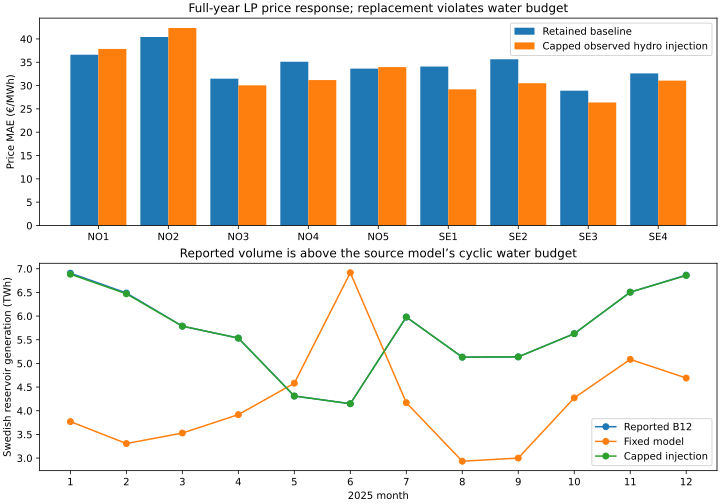

# Swedish reported reservoir generation as a clearing sensitivity

**Status:** retrospective price sensitivity; **not a water-feasible hydro schedule, accepted baseline, or scenario model**. Frozen `mixed_curve_fitting` bids, original 799-offer hourly physical LP, source demand, original renewable availability and network limits were retained. No bid was refitted. The target is the retained ENTSO-E B12 (hydro water reservoir) national hourly generation series; this is observed generation, not independently available water.

## Test and its physical limit

The retained source PyPSA network has five Swedish hydro storage units with **12.304 GW** combined turbine capacity and cyclic inventory. Reported national B12 output peaks at **13.116 GW**, above that capacity in **163 hours**. For a bounded numerical price test, I clipped only those hours to 12.304 GW; this removes **0.050 TWh** from the 68.423 TWh report. I replaced the retained fixed national 50.175 TWh schedule with the 68.374 TWh capped series. Each hourly national change was distributed across the five existing units by nameplate power and through their retained physical-bus shares. The change was applied to both zonal net demand and the exact PTDF branch-flow offset; all other inputs stayed frozen.

This schedule **cannot satisfy the retained Swedish water model**. Its annual inflow is 56.039 TWh of stored energy and discharge efficiency is 0.9, permitting at most **50.435 TWh** with unchanged cyclic inventory, even without spill. The capped target exceeds this upper bound by **17.939 TWh**. The current fixed output of 50.175 TWh is close to that limit. Thus the injected water is an implicit, unverified additional resource. The national B12 category may also differ in plant coverage from the five aggregate model units; this source mapping has not been reconciled. The injected hourly distribution is a power-share proxy, not a verified unit schedule, and no Swedish unit stock trajectory is reconstructed.

## LP price response

The modified physical LP was optimal for **all 8,760 hours**, with **zero emergency supply** and maximum checked primal residual **2.68×10⁻⁷ MW**. This confirms clearing feasibility given the extra exogenous injections; it does **not** make the extra hydro energy water-feasible.

| Zone | Retained price MAE €/MWh | Capped injection MAE €/MWh | Retained bias €/MWh | Injection bias €/MWh |
| --- | ---: | ---: | ---: | ---: |
| NO1 | 36.61 | 37.86 | -19.75 | -24.75 |
| NO2 | 40.42 | 42.35 | -24.51 | -29.45 |
| NO3 | 31.48 | 30.05 | +15.49 | +13.46 |
| NO4 | 35.11 | 31.18 | +30.22 | +26.42 |
| NO5 | 33.63 | 33.96 | -11.23 | -15.50 |
| SE1 | 34.08 | 29.20 | +25.04 | +18.75 |
| SE2 | 35.63 | 30.51 | +26.89 | +20.14 |
| SE3 | 28.91 | 26.37 | -0.60 | -5.98 |
| SE4 | 32.61 | 31.06 | -14.20 | -19.21 |

The equal-zone European hourly price MAE goes from **25.051 to 24.796 €/MWh** in this infeasible sensitivity. Swedish mean model prices fall by about **5–7 €/MWh**. When the substituted hydro is greater than the fixed schedule, the Swedish zonal price falls in roughly **74–79%** of such hours; transmission and changes in the marginal unit prevent a guaranteed fall at every hour.

The north–south problem persists: modelled annual **NO4 minus NO2** changes from **−1.96 to −0.82 €/MWh**, against **−56.69 observed**. Modelled **SE2 minus SE4** changes from **−2.81 to −4.55 €/MWh**, against **−43.90 observed**. Adding a country total improves some Swedish price levels but does not recover the missing spatial separation. It also worsens NO1 and NO2. Because B12 is inserted by construction, a Swedish hydro-generation error score would be circular; non-hydro generation and exchanges have not been independently audited for this sensitivity.

## Conclusion and next source check

The proposed residual-demand shift has the expected broad price effect, but the full observed volume cannot be supplied by the retained cyclic hydro fleet and inflow. Before changing the model, reconcile the five-unit PyPSA fleet and inflow against ENTSO-E B12 plant/reporting scope, Swedish installed turbine capacity, observed reservoir stocks and inflow or hydrology, and other hydro categories (run-of-river and pumped storage). A water-feasible, geographically allocated schedule should then be recleared and checked against prices, source-covered generation, observed commercial exchanges and north–south spreads. Do not promote this price-conditioned historical injection as a feasible investment-response model.

## Reproduction

Run `data/pypsa-eur/upstream/.pixi/envs/default/bin/python -m baselines.compact.swedish_hydro_injection` from the repository root, then `python -m tools.plot_swedish_hydro_injection_2025`. The ignored `data/bidding-zone-network-2025/swedish-hydro-injection-v1/` contains the full-hour price witness and source-hashed summary. The command rejects an existing witness, preventing accidental duplicate runs. The tracked SVG contains no large input arrays. The active research baseline pointer and public app are unchanged.
